# Abe Garage backend API design and tasks

This package defines the backend implementation work for your four-person garage team. It contains 44 REST endpoint contracts and 6 shared infrastructure tasks, following the attached forum task archive’s structure: API documentation,implementation instructions,logic/Git workflow,PR checklist and Mermaid diagram. It is a design package; it does not implement or deploy the backend.

## Read in this order

1. [Task classification and owners](TASK-CLASSIFICATION.md)
2. [Shared conventions and response format](CONVENTIONS.md)
3. [Database additions supporting the contracts](DATABASE-CHANGES.md)
4. [Requirements coverage and deliberate changes](REQUIREMENTS-MAP.md)
5. Open the task file for your assigned endpoint from the index below.

## API index

| Method | Endpoint                               | Access                                                         | Owner | Task                                                                                     |
| ------ | -------------------------------------- | -------------------------------------------------------------- | ----- | ---------------------------------------------------------------------------------------- |
| POST   | `/api/auth/login`                      | Public                                                         | M1    | [BE-004 Staff login](auth/be-004-login.md)                                               |
| POST   | `/api/auth/forgot-password`            | Public                                                         | M1    | [BE-005 Request password reset](auth/be-005-forgot-password.md)                          |
| POST   | `/api/auth/reset-password`             | Public                                                         | M1    | [BE-006 Reset forgotten password](auth/be-006-reset-password.md)                         |
| PATCH  | `/api/auth/password`                   | Any active staff                                               | M1    | [BE-007 Change own password](auth/be-007-change-password.md)                             |
| GET    | `/api/profile`                         | Any active staff                                               | M1    | [BE-008 Get own staff profile](auth/be-008-get-profile.md)                               |
| POST   | `/api/employees`                       | Admin                                                          | M1    | [BE-009 Create employee](employees/be-009-create-employee.md)                            |
| GET    | `/api/employees`                       | Admin; Manager limited to active technicians                   | M1    | [BE-010 List and search employees](employees/be-010-list-employees.md)                   |
| GET    | `/api/employees/:employee_id`          | Admin                                                          | M1    | [BE-011 View employee](employees/be-011-get-employee.md)                                 |
| PATCH  | `/api/employees/:employee_id`          | Admin                                                          | M1    | [BE-012 Edit or deactivate employee](employees/be-012-update-employee.md)                |
| GET    | `/api/roles`                           | Admin                                                          | M1    | [BE-013 List fixed staff roles](settings/be-013-list-roles.md)                           |
| GET    | `/api/settings`                        | Admin                                                          | M1    | [BE-014 Read garage settings](settings/be-014-get-settings.md)                           |
| PATCH  | `/api/settings`                        | Admin                                                          | M1    | [BE-015 Update garage settings](settings/be-015-update-settings.md)                      |
| POST   | `/api/customers`                       | Manager or Admin                                               | M2    | [BE-016 Register customer](customers/be-016-create-customer.md)                          |
| GET    | `/api/customers`                       | Any active staff                                               | M2    | [BE-017 List and search customers](customers/be-017-list-customers.md)                   |
| GET    | `/api/customers/:customer_id`          | Any active staff                                               | M2    | [BE-018 View customer profile and financial summary](customers/be-018-get-customer.md)   |
| PATCH  | `/api/customers/:customer_id`          | Manager or Admin                                               | M2    | [BE-019 Edit or deactivate customer](customers/be-019-update-customer.md)                |
| POST   | `/api/vehicles`                        | Manager or Admin                                               | M2    | [BE-020 Add vehicle to customer](vehicles/be-020-create-vehicle.md)                      |
| GET    | `/api/customers/:customer_id/vehicles` | Any active staff                                               | M2    | [BE-021 List a customer’s vehicles](vehicles/be-021-list-customer-vehicles.md)           |
| GET    | `/api/vehicles/:vehicle_id`            | Any active staff                                               | M2    | [BE-022 View vehicle](vehicles/be-022-get-vehicle.md)                                    |
| PATCH  | `/api/vehicles/:vehicle_id`            | Manager or Admin                                               | M2    | [BE-023 Edit vehicle details](vehicles/be-023-update-vehicle.md)                         |
| GET    | `/api/vehicles/:vehicle_id/orders`     | Any active staff                                               | M2    | [BE-024 View vehicle service history](vehicles/be-024-vehicle-history.md)                |
| POST   | `/api/services`                        | Admin                                                          | M2    | [BE-025 Create repair service](services/be-025-create-service.md)                        |
| GET    | `/api/services`                        | Any active staff                                               | M2    | [BE-026 List staff service catalogue](services/be-026-list-services.md)                  |
| PATCH  | `/api/services/:service_id`            | Admin                                                          | M2    | [BE-027 Edit or deactivate service](services/be-027-update-service.md)                   |
| GET    | `/api/public/services`                 | Public                                                         | M2    | [BE-028 Read public services and prices](services/be-028-public-services.md)             |
| POST   | `/api/orders`                          | Manager or Admin                                               | M3    | [BE-029 Create repair order and estimate](orders/be-029-create-order.md)                 |
| GET    | `/api/orders`                          | Any active staff                                               | M3    | [BE-030 List and filter orders](orders/be-030-list-orders.md)                            |
| GET    | `/api/orders/:order_id`                | Any active staff                                               | M3    | [BE-031 View repair order detail](orders/be-031-get-order.md)                            |
| PATCH  | `/api/orders/:order_id`                | Manager or Admin                                               | M3    | [BE-032 Edit estimate or order notes](orders/be-032-update-order.md)                     |
| PATCH  | `/api/orders/:order_id/approval`       | Manager or Admin                                               | M3    | [BE-033 Record estimate approval or decline](orders/be-033-record-approval.md)           |
| POST   | `/api/orders/:order_id/lines`          | Manager or Admin                                               | M3    | [BE-034 Add extra work and request reapproval](orders/be-034-add-extra-job.md)           |
| PATCH  | `/api/order-lines/:line_id/technician` | Manager or Admin                                               | M2    | [BE-035 Assign technician to job line](technician-jobs/be-035-assign-technician.md)      |
| GET    | `/api/my-jobs`                         | Technician only                                                | M2    | [BE-036 List my technician jobs](technician-jobs/be-036-my-jobs.md)                      |
| PATCH  | `/api/order-lines/:line_id/status`     | Assigned Technician; Manager or Admin                          | M2    | [BE-037 Start or finish technician job](technician-jobs/be-037-update-job-status.md)     |
| PATCH  | `/api/order-lines/:line_id/note`       | Assigned Technician; Manager or Admin                          | M2    | [BE-038 Add or edit technician work note](technician-jobs/be-038-job-note.md)            |
| GET    | `/api/orders/:order_id/estimate`       | Manager or Admin                                               | M3    | [BE-039 Read printable estimate data](orders/be-039-get-estimate.md)                     |
| POST   | `/api/orders/:order_id/invoice`        | Manager or Admin                                               | M4    | [BE-040 Issue immutable invoice](billing/be-040-issue-invoice.md)                        |
| GET    | `/api/orders/:order_id/invoice`        | Manager or Admin                                               | M4    | [BE-041 Read issued invoice](billing/be-041-get-invoice.md)                              |
| PATCH  | `/api/orders/:order_id/payment`        | Manager or Admin                                               | M4    | [BE-042 Record cash payment](billing/be-042-record-cash-payment.md)                      |
| GET    | `/api/public/orders/:order_hash`       | Public with valid unguessable order hash                       | M4    | [BE-044 Read private-link customer order status](tracking/be-044-public-order-status.md) |
| POST   | `/api/orders/:order_id/resend-email`   | Manager or Admin                                               | M4    | [BE-045 Resend order tracking email](tracking/be-045-resend-status-email.md)             |
| GET    | `/api/dashboard`                       | Manager or Admin                                               | M4    | [BE-046 Read operational dashboard](dashboard/be-046-get-dashboard.md)                   |
| POST   | `/api/install`                         | Deployment operator with setup secret; unavailable after setup | M1    | [BE-047 Initialize and lock installation](setup/be-047-install.md)                       |
| GET    | `/api/health`                          | Public                                                         | M1    | [BE-048 Check API readiness](setup/be-048-health.md)                                     |

## Supporting files

- [Contract fixtures](contracts.json):all endpoint request/query/success response examples and ownership,for building mocks without waiting for teammates. Placeholders are not working credentials.
- foundation/:6 non-endpoint implementation and verification tasks.
- Every endpoint file has request body (or None),success JSON,permissions,error cases,business rules,dependencies,paths,Git instructions,acceptance checks and logic diagram.

## Sources

- User-provided garage requirements DOCX and UI ER diagram control project scope. Later conversation decisions override original examples: no v1,no /me,no Google,centralized errors,password reset,JWT token-version revocation.
- C:/Users/Yeabsira/Downloads/ai-powered-forum-project-main/tasks/backend.zip supplies the task-document format only. Its public forum registration/AI features are not garage requirements.
- C:/Users/Yeabsira/Downloads/EvangadiForum.zip supplies the reference controller/service/error flow; reusable reset JWT behavior was replaced by single-use hashed tokens.
- Technical references are linked in CONVENTIONS.md.

[Required fields,optional inputs and response variants](VALIDATION.md) complete the endpoint examples.

---

<!-- Source: CONVENTIONS.md -->

# Shared backend API conventions

This contract applies to every endpoint and task. Node.js/Express and MySQL form one modular backend. API base is /api with no version segment. No public registration, Google sign-in, /me, online payment, appointment booking or inventory endpoints.

## Requests and responses

- snake_case JSON names; plural resource URLs; Content-Type:application/json. GET requests have no body. PATCH is partial update, never an unrestricted database merge.
- Successful envelope: {status:"success",message,data}. Error envelope: {status:"error",message,data:null}; validation uses data.errors keyed by field. HTTP statuses remain authoritative.
- Missing required data/invalid type/empty PATCH/unknown body or query field →400. Duplicate unique data or invalid state →409; missing resource →404. Wrong method on unknown API route →404 through shared not-found handler.
- Public tracking malformed/unknown hash intentionally returns404; reset invalid/used/expired token intentionally returns400. Never leak underlying token existence.
- IDs are positive safe JSON integers; SQL BIGINT must remain within Number.MAX_SAFE_INTEGER or be serialized consistently as strings after an explicit contract change. FK types must exactly match referenced PK types.
- Database booleans serialize to JSON true/false. Money and labor_hours serialize as decimal strings with two places. Keep MySQL DECIMAL strings; never parseFloat for arithmetic.
- Time values are ISO8601 UTC with Z; store UTC DATETIME. Configure DB/session timezone UTC. Null timestamps remain null. Local day/week/month boundaries use GARAGE_TIMEZONE=Africa/Addis_Ababa.
- Illustrative launch currency is ETB; team must confirm before release. Use one CURRENCY_CODE env value consistently; no FX or multicurrency. Currency is snapshotted with orders/invoices.
- Names: nonempty 1–100 chars; email max254 normalized lowercase; phone max32 normalized with one shared policy while preserving string format; notes max2000; plate max32 uppercase; other vehicle strings max100; year1886..current year+1. Validate strict numbers, not coercible mixtures.
- Password policy: at least8 characters and at most72 UTF-8 bytes for bcrypt; never trim passwords. Existing passwords can be checked on login without reapplying new-password rules.
- Positive page defaults1; limit defaults10, max100. Invalid/zero/negative/noninteger values →400, no silent clamping. total_pages=ceil(total/limit),0 if no results. Empty/beyond-last page →200 empty array.
- search is trimmed text max100. Query active/paid/unpaid_only accept only strings true or false, not truthiness. status1..5, role_id1..3, line_status0..2; customer_id/vehicle_id positive integers. Unspecified filters mean all allowed records.
- Examples show optional filters, not mandatory combinations. No unlisted client-controlled sort fields. Stable sort defined per endpoint.

## Authentication and errors

- Bearer access JWT; lifetime default3600 seconds; payload employee_id,token_version,token_use=access,iat,exp plus issuer/audience. Verify signature/algorithm/expiry/issuer/audience, then read employee and current role/active/token_version from DB.
- Missing,invalid,expired,version-mismatched JWT →401. Deleted/unavailable employee →401. Inactive employee →403. Current role disallowed →403. JWT claims or frontend cache never grant authority alone.
- Deactivation/reactivation/role changes increment token_version. Password reset/change increment it. Email changes invalidate outstanding reset links; current role always comes from DB. Logout only clears frontend token/profile; it does not revoke a still-valid JWT.
- Central AppError(message,statusCode,details) and typed subclasses. Controllers catch and next(error); shared async wrapper is permitted. Error middleware (err,req,res,next) comes after all routes and not-found handler.
- Map validation400,auth401,forbidden403,missing404,duplicate/state409,rate limit429,unexpected500,external mail outage503. Unknown errors return generic message, with sanitized server-side logs and no SQL/stack/secret to client.
- Malformed JSON and body-size limit errors use same envelope (400/413). Include Retry-After on429. Parameterized SQL for every untrusted value; dynamic columns/sort/clauses from static allowlists only.
- Bound JSON bodies to256KB by default. Configure allowed frontend origin,HTTPS,request IDs and login/reset/public lookup/resend rate limits. Redact Authorization,passwords,reset tokens and public tracking hashes from logs.

## Money and order lifecycle

- Service/order-line prices are before VAT. Compute in integer minor units or tested decimal utility: subtotal=sum(lines); VAT=round half up(subtotal*vat_rate/100) once; total=subtotal+VAT. Do not round VAT per line.
- At creation snapshot VAT rate,currency and line name/description/labor_hours/price. Subsequent catalogue/settings updates never change those values. Helpers are shared across orders,estimates,invoices and dashboard.
- Status1 Awaiting approval;2 Approved;3 In progress;4 Completed;5 Declined. Paid is a separate boolean.
- Initial1→2 or5 via recorded approval;2→3 on first start;3→4 when all jobs done. Job0→1→2 only. No job progress without approved scope. Approval actor/time/method and every significant mutation go in history.
- Extra work Should feature: statuses1/2/3 may add an unstarted line; approved scope goes back to1 and all progress pauses until new approval. Preserve old progress/history and derive2/3/4 after reapproval. Declining with performed work is deliberately unsupported409; never wipe performed work.
- Every mutation affecting order/lines/invoice/payment locks the parent order first on one connection. This serializes status,totals,approval,assignments and invoice issuance. Lock lines only after parent. Missing line checks must be revalidated after locking.
- All multi-row writes use begin/commit/rollback with connection release in finally. External email runs after commit and cannot undo successful creation/completion.
- One active Technician per line. Manager/Admin may assign/progress work, but candidate assigned employee must have Technician role.
- No DELETE endpoints for employee/customer/vehicle/service/order records. Customer/staff/service use active flag; vehicle ownership transfer and order cancellation beyond initial decline are out of scope. Unapproved,unstarted estimate-line replacement may remove child lines only with history.

## Printing, website and external side effects

- Estimates and invoices return JSON; frontend uses A4 print CSS/browser Save as PDF. GET does not issue an invoice; POST issues it once. No PDF binary generation service.
- Public Home/About/Contact are frontend content; service list and tracking are the backend APIs they need. Contact form delivery is not required; no invented contact-submission endpoint.
- Email sent means SMTP accepted the message, not guaranteed inbox delivery. Automatic send failures write history and keep order success; explicit resend may return503. No exactly-once SMTP guarantee; production crash retries may require a future durable outbox.
- Automatic creation and completion hooks belong to shared notifications service, not frontend calls or internal HTTP calls. Use an injected fake mail adapter while integration is incomplete.

## Verified technical references

- Express error handling: https://expressjs.com/en/4x/guide/error-handling/
- OWASP password reset: https://cheatsheetseries.owasp.org/cheatsheets/Forgot_Password_Cheat_Sheet.html

The attachment supplies the task-document structure, not additional garage requirements. Agreed garage requirements and subsequent conversation decisions control behavior.

See [request field rules and response variants](VALIDATION.md) for required/optional/null fields,role projections and alternate success states. Order history may include details JSON for safe audit metadata.

---

<!-- Source: VALIDATION.md -->

# Request field and response variants

All request examples are concrete examples,not JSON Schema. This table defines presence rules. Unknown fields are rejected. A required field cannot be null; omitted optional fields use the stated default. PATCH accepts only listed mutable fields,at least one. IDs are positive integers and decimal strings accept exactly the precision/range in CONVENTIONS.

| Endpoint/task                                         | Required input                                             | Optional input/default                                                                                  |
| ----------------------------------------------------- | ---------------------------------------------------------- | ------------------------------------------------------------------------------------------------------- |
| BE-004 login                                          | email,password                                             | None                                                                                                    |
| BE-005 forgot password                                | email                                                      | None                                                                                                    |
| BE-006 reset password                                 | token,new_password                                         | None                                                                                                    |
| BE-007 change password                                | current_password,new_password                              | None                                                                                                    |
| BE-009 employee create                                | first_name,last_name,email,phone,password,role_id          | active=true                                                                                             |
| BE-012 employee patch                                 | At least one permitted field                               | first_name,last_name,email,phone,role_id,active;omission preserves current value                        |
| BE-015 settings patch                                 | At least one permitted field                               | name,address,phone,email,vat_rate                                                                       |
| BE-016 customer create                                | first_name,last_name,email,phone                           | active=true                                                                                             |
| BE-019 customer patch                                 | At least one permitted field                               | first_name,last_name,email,phone,active                                                                 |
| BE-020 vehicle create                                 | customer_id,year,make,model,type,mileage,plate,color       | vin=null                                                                                                |
| BE-023 vehicle patch                                  | At least one permitted field                               | year,make,model,type,mileage,plate,vin,color;vin may be null                                            |
| BE-025 service create                                 | name,description,price,labor_hours                         | active=true                                                                                             |
| BE-027 service patch                                  | At least one permitted field                               | name,description,price,labor_hours,active                                                               |
| BE-029 order create                                   | customer_id,vehicle_id,lines (1..100),estimated_ready_date | notes_for_customer=null,internal_notes=null;line_price optional per line if custom pricing implemented  |
| BE-032 order patch                                    | At least one permitted field                               | lines,estimated_ready_date,notes_for_customer,internal_notes;notes may be null;state restrictions apply |
| BE-033 approval                                       | decision,approval_method                                   | decision approved or declined;method phone or in_person                                                 |
| BE-034 extra job                                      | service_id                                                 | line_price=current service price                                                                        |
| BE-035 assign                                         | technician_id                                              | None;unassign unsupported                                                                               |
| BE-037 job progress                                   | line_status                                                | Only1(start) or2(done);0 is not a new transition target                                                 |
| BE-038 work note                                      | technician_note                                            | null clears note;otherwise max2000 chars                                                                |
| BE-042 payment                                        | paid=true                                                  | No client amount,date,collector or method                                                               |
| BE-040 invoice issue / BE-045 resend / BE-047 install | No JSON body                                               | Reject unexpected input;install seed from env                                                           |
| Every GET                                             | No JSON body                                               | Only endpoint-documented query parameters                                                               |

## Role projections and state variants

- GET employees Admin fields:employee_id,first_name,last_name,email,phone,role_id,role_name,active,created_at. Manager fields:employee_id,first_name,last_name,role_name. Same employees/pagination wrapper.
- GET order Technician projection:remove customer.email,customer.phone,internal_notes,order_hash,tracking_url;retain permitted order/vehicle/job/history data. Manager/Admin receive full example. Public tracking uses a completely separate allowlist.
- Approval decline response has same keys as approval but status5,status_name Declined,approved_by=null,approved_at=null. approval_method retains recorded channel; actor/time/decision recorded in history.details. Reapproval can derive status3/4.
- Repeating invoice issuance returns200 rather than201 with identical issued document. Repeating paid=true returns200 with original payment metadata. Job-status replay returns current parent status and original line timestamps,not a fabricated new start/completion.
- Resend failure example:HTTP503,{status:error,message:Email could not be sent,data:{order_id:24,email_status:failed}}. Strings shown here without quotes for readability;actual HTTP bodies are valid JSON. Automatic send failures never replace order201/completion200.
- Empty list response uses resource array=[],pagination:{page:1,limit:10,total:0,total_pages:0};past-end pages retain actual total/total_pages.
- Every error uses the shared envelope; validation error keys match offending fields such as employee_id,lines,token or email. The email error block in task documents illustrates shared structure,not a mandatory field for every route.

## HTTP status distinctions

400 malformed fields;401 authentication failure/revocation;403 denied role/inactive caller;404 missing record;409 existing conflicting record or invalid business state;429 rate limit;500 internal failure;503 controlled unavailable dependency. Public reset/tracking exceptions follow their task contract.

## Integration ownership

Member3 provides shared helpers calculateOrderTotals(lockedOrder,lines),deriveOrderStatus(lines),assertOrderMutationAllowed(order,operation),and appendOrderHistory(connection,event). Member2 uses them for technician mutations. Member4 uses totals/snapshots without rewriting calculation rules. Function names are proposed interfaces to agree on Day1;use explicit connection argument for transaction-aware calls.

---

<!-- Source: DATABASE-CHANGES.md -->

# Database additions supporting API contracts

This is a proposed design update, not an executed migration. The supplied ER diagram shows logical fields without exact SQL types. Member1 must match FK types/signedness to actual DDL. Ten domain tables remain; migration metadata is operational.

## Already agreed authentication additions

- employees.token_version INT UNSIGNED NOT NULL DEFAULT0.
- password_reset_tokens:reset_id BIGINT UNSIGNED PK AUTO_INCREMENT;employee_id matching employees PK FK;token_hash CHAR(64) UNIQUE NOT NULL;expires_at DATETIME NOT NULL;used_at DATETIME NULL;created_at DATETIME NOT NULL. SHA-256 digest only.
- Index reset(employee_id,used_at,expires_at). UTC values and InnoDB.

## Additional fields needed to meet old-order and invoice requirements

| Table       | Proposed fields                        | Purpose                                                              |
| ----------- | -------------------------------------- | -------------------------------------------------------------------- |
| orders      | currency CHAR(3) NOT NULL              | Snapshot single configured currency                                  |
| orders      | invoice_number VARCHAR(32) NULL UNIQUE | Stable issued invoice identifier                                     |
| orders      | invoice_issued_at DATETIME NULL        | Persist issue time; GET never creates it                             |
| orders      | invoice_snapshot JSON NULL             | Freeze garage/customer/vehicle/line details and totals at issue time |
| order_lines | service_name VARCHAR(150) NOT NULL     | Keep historic job name after catalogue edit                          |
| order_lines | service_description TEXT NOT NULL      | Preserve historic description                                        |
| order_lines | labor_hours DECIMAL(8,2) NOT NULL      | Preserve agreed labor estimate                                       |

orders.vat_rate is already in supplied diagram; retain it as snapshot. Do not read current settings when calculating old estimates. paid/paid_at/paid_received_by stay on orders outside invoice_snapshot so payment can update without modifying invoice content.

In issued invoice JSON, store issued_at,invoice_number,garage identity,customer contact fields,vehicle fields,line descriptions/prices,subtotal,vat_rate,vat_amount,total,currency. Exclude paid metadata from frozen JSON or consistently overlay live metadata when reading; choose one canonical serializer. Internal notes and tracking hashes never enter snapshot.

No invoice table is needed for this one-invoice-per-order scope. Corrections,credit notes,partial payments and invoice reissue are outside scope. Order.customer_id and vehicle_id are immutable once created; moving ownership requires a future design.

## Clarifications

- roles1:N employees (not employees1:N roles).
- orders.created_by,approved_by,paid_received_by and order_lines.technician_id reference employees; optional references are nullable. order_history.employee_id nullable for system actions.
- service prices/line prices/totals use DECIMAL(12,2); VAT rate DECIMAL(5,2); record application range/overflow checks. No FLOAT for money.
- Required unique constraints from diagram remain; no hard-delete API for master records.
- For any proposed migration on an existing populated database, add nullable columns,backfill from known historical values and validate before making NOT NULL. Cannot reconstruct historic descriptions retrospectively with certainty.

## Structured order audit details

Add order_history.details JSON NULL alongside action. Keep action as a fixed event key;details stores safe before/after values,approval decision/method and line references. Prior approvals must remain understandable after reapproval clears current order approval fields. Do not place secrets or full raw tokens in details. Return safe details on staff order history responses;public tracking excludes history entirely.

---

<!-- Source: TASK-CLASSIFICATION.md -->

# Backend task classification

One backend; module ownership separates work. API count does not equal effort. Member3 has the most complex business rules; Member2 takes technician job endpoints,Member4 owns mail and integration tests,Member1 supplies foundation early. This distribution reduces blocking but is not a claim of exactly equal workload.

| Member | Ownership                                                                            | Coordination                                                 |
| ------ | ------------------------------------------------------------------------------------ | ------------------------------------------------------------ |
| 1      | Foundation,auth,employees,roles,settings,installation,health,deployment              | Schema and shared middleware owner                           |
| 2      | Customers,vehicles,service catalogue,technician assignment/jobs/progress             | Use Member3’s shared order status/locking/money contract     |
| 3      | Order creation,detail,filters,estimate edits,approval,extra work,estimate data       | Own order-domain business rules; support Member2 integration |
| 4      | Notification adapter,invoice,payment,public tracking,dashboard,acceptance collection | Offer fake mail and fixture orders immediately               |

## Complete task board

| Task                                                                                                                        | Owner | Priority                                    | Endpoint or scope                            | Dependencies                           |
| --------------------------------------------------------------------------------------------------------------------------- | ----- | ------------------------------------------- | -------------------------------------------- | -------------------------------------- |
| [BE-001 Project structure and local runtime](foundation/be-001-project-foundation.md)                                       | M1    | Must                                        | Shared infrastructure                        | —                                      |
| [BE-002 Database migrations and deterministic seed data](foundation/be-002-database-and-seeds.md)                           | M1    | Must                                        | Shared infrastructure                        | BE-001                                 |
| [BE-003 Shared authentication, authorization, validation and error middleware](foundation/be-003-auth-validation-errors.md) | M1    | Must                                        | Shared infrastructure                        | BE-001, BE-002                         |
| [BE-004 Staff login](auth/be-004-login.md)                                                                                  | M1    | Must                                        | `POST /api/auth/login`                       | BE-001, BE-002, BE-003                 |
| [BE-005 Request password reset](auth/be-005-forgot-password.md)                                                             | M1    | Must (agreed addition)                      | `POST /api/auth/forgot-password`             | BE-003, BE-043                         |
| [BE-006 Reset forgotten password](auth/be-006-reset-password.md)                                                            | M1    | Must (agreed addition)                      | `POST /api/auth/reset-password`              | BE-005                                 |
| [BE-007 Change own password](auth/be-007-change-password.md)                                                                | M1    | Should                                      | `PATCH /api/auth/password`                   | BE-003, BE-004                         |
| [BE-008 Get own staff profile](auth/be-008-get-profile.md)                                                                  | M1    | Must (agreed addition)                      | `GET /api/profile`                           | BE-003                                 |
| [BE-009 Create employee](employees/be-009-create-employee.md)                                                               | M1    | Must                                        | `POST /api/employees`                        | BE-003                                 |
| [BE-010 List and search employees](employees/be-010-list-employees.md)                                                      | M1    | Must                                        | `GET /api/employees`                         | BE-003                                 |
| [BE-011 View employee](employees/be-011-get-employee.md)                                                                    | M1    | Must                                        | `GET /api/employees/:employee_id`            | BE-003                                 |
| [BE-012 Edit or deactivate employee](employees/be-012-update-employee.md)                                                   | M1    | Must                                        | `PATCH /api/employees/:employee_id`          | BE-009                                 |
| [BE-013 List fixed staff roles](settings/be-013-list-roles.md)                                                              | M1    | Must (supporting endpoint)                  | `GET /api/roles`                             | BE-003                                 |
| [BE-014 Read garage settings](settings/be-014-get-settings.md)                                                              | M1    | Must (supporting endpoint)                  | `GET /api/settings`                          | BE-003                                 |
| [BE-015 Update garage settings](settings/be-015-update-settings.md)                                                         | M1    | Must (supporting endpoint)                  | `PATCH /api/settings`                        | BE-014                                 |
| [BE-016 Register customer](customers/be-016-create-customer.md)                                                             | M2    | Must                                        | `POST /api/customers`                        | BE-003                                 |
| [BE-017 List and search customers](customers/be-017-list-customers.md)                                                      | M2    | Must                                        | `GET /api/customers`                         | BE-003                                 |
| [BE-018 View customer profile and financial summary](customers/be-018-get-customer.md)                                      | M2    | Must                                        | `GET /api/customers/:customer_id`            | BE-016, BE-003                         |
| [BE-019 Edit or deactivate customer](customers/be-019-update-customer.md)                                                   | M2    | Must                                        | `PATCH /api/customers/:customer_id`          | BE-016                                 |
| [BE-020 Add vehicle to customer](vehicles/be-020-create-vehicle.md)                                                         | M2    | Must                                        | `POST /api/vehicles`                         | BE-016                                 |
| [BE-021 List a customer’s vehicles](vehicles/be-021-list-customer-vehicles.md)                                              | M2    | Must                                        | `GET /api/customers/:customer_id/vehicles`   | BE-020                                 |
| [BE-022 View vehicle](vehicles/be-022-get-vehicle.md)                                                                       | M2    | Must                                        | `GET /api/vehicles/:vehicle_id`              | BE-020                                 |
| [BE-023 Edit vehicle details](vehicles/be-023-update-vehicle.md)                                                            | M2    | Must                                        | `PATCH /api/vehicles/:vehicle_id`            | BE-020                                 |
| [BE-024 View vehicle service history](vehicles/be-024-vehicle-history.md)                                                   | M2    | Should                                      | `GET /api/vehicles/:vehicle_id/orders`       | BE-022                                 |
| [BE-025 Create repair service](services/be-025-create-service.md)                                                           | M2    | Must                                        | `POST /api/services`                         | BE-003                                 |
| [BE-026 List staff service catalogue](services/be-026-list-services.md)                                                     | M2    | Must                                        | `GET /api/services`                          | BE-003                                 |
| [BE-027 Edit or deactivate service](services/be-027-update-service.md)                                                      | M2    | Must                                        | `PATCH /api/services/:service_id`            | BE-025                                 |
| [BE-028 Read public services and prices](services/be-028-public-services.md)                                                | M2    | Should (scope overlap resolved for release) | `GET /api/public/services`                   | BE-025                                 |
| [BE-029 Create repair order and estimate](orders/be-029-create-order.md)                                                    | M3    | Must                                        | `POST /api/orders`                           | BE-003, BE-016, BE-020, BE-025, BE-043 |
| [BE-030 List and filter orders](orders/be-030-list-orders.md)                                                               | M3    | Must                                        | `GET /api/orders`                            | BE-003                                 |
| [BE-031 View repair order detail](orders/be-031-get-order.md)                                                               | M3    | Must                                        | `GET /api/orders/:order_id`                  | BE-003                                 |
| [BE-032 Edit estimate or order notes](orders/be-032-update-order.md)                                                        | M3    | Must; custom prices Should                  | `PATCH /api/orders/:order_id`                | BE-029                                 |
| [BE-033 Record estimate approval or decline](orders/be-033-record-approval.md)                                              | M3    | Must                                        | `PATCH /api/orders/:order_id/approval`       | BE-029                                 |
| [BE-034 Add extra work and request reapproval](orders/be-034-add-extra-job.md)                                              | M3    | Should                                      | `POST /api/orders/:order_id/lines`           | BE-032, BE-033                         |
| [BE-035 Assign technician to job line](technician-jobs/be-035-assign-technician.md)                                         | M2    | Must                                        | `PATCH /api/order-lines/:line_id/technician` | BE-003, BE-029                         |
| [BE-036 List my technician jobs](technician-jobs/be-036-my-jobs.md)                                                         | M2    | Must                                        | `GET /api/my-jobs`                           | BE-035                                 |
| [BE-037 Start or finish technician job](technician-jobs/be-037-update-job-status.md)                                        | M2    | Must                                        | `PATCH /api/order-lines/:line_id/status`     | BE-035, BE-033, BE-043                 |
| [BE-038 Add or edit technician work note](technician-jobs/be-038-job-note.md)                                               | M2    | Should                                      | `PATCH /api/order-lines/:line_id/note`       | BE-035                                 |
| [BE-039 Read printable estimate data](orders/be-039-get-estimate.md)                                                        | M3    | Must                                        | `GET /api/orders/:order_id/estimate`         | BE-031                                 |
| [BE-040 Issue immutable invoice](billing/be-040-issue-invoice.md)                                                           | M4    | Must (supporting endpoint)                  | `POST /api/orders/:order_id/invoice`         | BE-037, BE-039                         |
| [BE-041 Read issued invoice](billing/be-041-get-invoice.md)                                                                 | M4    | Must                                        | `GET /api/orders/:order_id/invoice`          | BE-040                                 |
| [BE-042 Record cash payment](billing/be-042-record-cash-payment.md)                                                         | M4    | Must                                        | `PATCH /api/orders/:order_id/payment`        | BE-040                                 |
| [BE-043 Shared email adapter and automatic order notifications](foundation/be-043-notification-adapter.md)                  | M4    | Must                                        | Shared infrastructure                        | BE-001, BE-002                         |
| [BE-044 Read private-link customer order status](tracking/be-044-public-order-status.md)                                    | M4    | Must                                        | `GET /api/public/orders/:order_hash`         | BE-003                                 |
| [BE-045 Resend order tracking email](tracking/be-045-resend-status-email.md)                                                | M4    | Should                                      | `POST /api/orders/:order_id/resend-email`    | BE-043, BE-029                         |
| [BE-046 Read operational dashboard](dashboard/be-046-get-dashboard.md)                                                      | M4    | Must; money totals Should                   | `GET /api/dashboard`                         | BE-003, BE-042                         |
| [BE-047 Initialize and lock installation](setup/be-047-install.md)                                                          | M1    | Must; repeat safety Should                  | `POST /api/install`                          | BE-001, BE-002                         |
| [BE-048 Check API readiness](setup/be-048-health.md)                                                                        | M1    | Must (operational)                          | `GET /api/health`                            | BE-001                                 |
| [BE-049 Shared backend integration and acceptance tests](foundation/be-049-backend-acceptance-tests.md)                     | M4    | Must                                        | Shared infrastructure                        | BE-003                                 |
| [BE-050 Backend deployment and handover](foundation/be-050-backend-deployment.md)                                           | M1    | Must                                        | Shared infrastructure                        | BE-047, BE-048, BE-049                 |

## Start without waiting

1. All four review CONVENTIONS and fixture contracts first. Member1 starts BE-001/002/003; others implement service units against fake auth context and repositories,not insecure production bypasses.
2. Member2 builds customer/vehicle/catalogue functions with local seed data. Member3 builds order-domain logic using fixture customer/vehicle/service records. Member4 builds mail adapter and invoices/tracking against fixture orders.
3. Member2 uses the shared order mutation helper for job updates; do not independently rewrite status rules. Agree function signatures before merging.
4. Dependencies in the board indicate required behavior for integration; a GET order read can be developed before create-order completes using seeded records. Avoid internal HTTP calls between modules.
5. Deliver small PRs,merge daily; blocked work goes to another ready card. Every endpoint owner supplies Postman/tests; Member4 coordinates rather than writes everyone’s tests.

## Suggested delivery gates

- Day1:shared contracts,foundation,seed data and mock adapters.
- Days2–3:login and master records,order creation basic.
- Days4–7:approval,job lifecycle,billing,tracking/email integration.
- Days8–9:all Must contracts implemented; scope freeze.
- Days10–12:cross-role,concurrency,privacy,performance and hosted tests.
- Days13–14:release verification,fixes and handover buffer.

Should features may be dropped only explicitly and consistently across API/screens. Password reset is a Must addition requested in conversation. Public live prices are treated as a release Should feature with an explicit scope check because they appear in scope but carry Should IDs in requirements.

---

<!-- Source: REQUIREMENTS-MAP.md -->

# Backend requirements coverage

| Requirement area        | Tasks                                             | Notes                                                                |
| ----------------------- | ------------------------------------------------- | -------------------------------------------------------------------- |
| FR-INS                  | BE-002,BE-047                                     | POST installer; locked/idempotent underlying setup                   |
| FR-AUTH                 | BE-003 through008                                 | Logout is frontend; no /me or Google                                 |
| FR-EMP                  | BE-009 through013                                 | Admin management; Manager technician lookup                          |
| FR-CUS                  | BE-016 through019,BE-030                          | Profile summary plus paginated order history                         |
| FR-VEH                  | BE-020 through024                                 | Read/update/owned vehicles/history                                   |
| FR-SRV                  | BE-025 through028                                 | Catalogue and public list                                            |
| FR-ORD                  | BE-029 through032,BE-034                          | Four UI steps culminate in one atomic create                         |
| FR-EST                  | BE-033,BE-034,BE-039                              | Recorded approval,decline,extra-work reapproval,print data           |
| FR-TEC                  | BE-035 through038                                 | Assignment,own jobs,progress,notes                                   |
| FR-INV                  | BE-040 through042,BE-030                          | Invoice issue/read,payment,unpaid filters                            |
| FR-TRK                  | BE-029,BE-037,BE-043 through045                   | Hash,tracking,automatic emails,resend                                |
| FR-WEB                  | BE-028,BE-044                                     | Public pages/404/code box are frontend; no unused backend pages APIs |
| FR-DSH                  | BE-003,BE-046                                     | Menus are frontend,server roles and counters backend                 |
| NFR-01 through09        | BE-001/002/003,CONVENTIONS,BE-049                 | Security,transactions,serialization,1000-row performance             |
| NFR-10 through12        | Frontend phase; BE-039/041 data supports printing | Field error shapes defined backend                                   |
| NFR-13 through15        | BE-049 and all task PR checklists                 | Shared Postman,every endpoint tested,module layer convention         |
| Password-reset addition | BE-005/006/007,DATABASE-CHANGES                   | Single-use15min tokens,token_version revocation                      |

## Intentional differences from source examples

- /api without v1; plural resources; PATCH partial updates; Authorization:Bearer instead of x-access-token.
- Central {status,message,data} response; reference task archive’s {success,user,token} examples are not copied as garage conventions.
- /api/profile instead of /me; login response contains access_token and employee.
- POST /api/install changes state; HTTP installer locks after setup. Idempotent internal migrations resolve the document’s competing repeat-success/locked-public-route requirements.
- Invoice POST separates issuance from safe GET read. Extra invoice/snapshot columns explicitly proposed,not silently assumed.
- Member2 owns technician endpoints to rebalance Member3 workload. No microservices or separate deployments.
- Reapproval decline with already performed work is409 rather than closing performed work; expanded cancellation/credit handling deferred.
- Monetary example230.00 +15% uses ETB as a proposed single launch currency,not a currency conversion from source’s dollar example. Team confirms currency before launch.

---

<!-- Source: foundation/be-001-project-foundation.md -->

# Task BE-001: Project structure and local runtime

**Owner**: Member 1 · **Priority**: Must

**Dependencies**: None

## 1. API Documentation

Shared infrastructure task; no independent business endpoint or response body. Endpoint behavior is specified in linked task files and [CONVENTIONS.md](CONVENTIONS.md).

## 2. Instructions

1. Create backend/package.json with dev,start,test scripts; use one supported Node runtime across team and commit lockfile. Use ES modules consistently.
2. Folders: backend/src/app.js; server.js; api/<module>/{routes,controller,service,validations}; middleware;utils/errors;shared; backend/db/{migrations,seeds};tests.
3. Create .env.example containing PORT,NODE_ENV,DB_HOST,DB_PORT,DB_USER,DB_PASSWORD,DB_NAME,JWT_SECRET,JWT_ISSUER,JWT_AUDIENCE,JWT_EXPIRES_IN_SECONDS,FRONTEND_URL,CORS_ORIGIN,SMTP_HOST,SMTP_PORT,SMTP_SECURE,SMTP_USER,SMTP_PASSWORD,MAIL_FROM,GARAGE_TIMEZONE,CURRENCY_CODE,INSTALL_ENABLED,INSTALL_SECRET and initial garage/admin seed settings. Ignore real .env and all credentials.
4. Configure mysql2 promise pool and UTC; provide withTransaction helper using one connection and finally release. Enable JSON body limit256KB and explicit CORS allowlist.
5. Add minimal fixtures and injectable repositories/mail adapter so other members can work independently on Day1. Everyone runs separate local DB; shared staging DB has no real customer data.
6. Backend routes are module routers; Member1 coordinates route mounting, not every implementation PR. Freeze contracts first, then small daily merges.

## 3. Logic & Git Instructions

Branch: `codex/be-001-project-foundation`; start from updated dev, commit with [BE-001], open PR into dev for teammate review.

### PR checklist

- [ ] Every instruction has implementation or verification evidence.
- [ ] Local README and env examples are updated where required.
- [ ] No secrets or generated database dumps committed.
- [ ] Agreed contracts remain unchanged or affected owners reviewed the change.

## 4. Logic Diagram

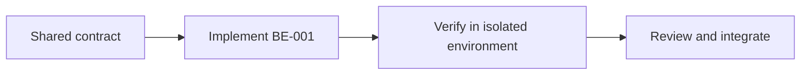

---

<!-- Source: foundation/be-002-database-and-seeds.md -->

# Task BE-002: Database migrations and deterministic seed data

**Owner**: Member 1 · **Priority**: Must

**Dependencies**: BE-001

## 1. API Documentation

Shared infrastructure task; no independent business endpoint or response body. Endpoint behavior is specified in linked task files and [CONVENTIONS.md](CONVENTIONS.md).

## 2. Instructions

1. Create ten business tables from ER diagram:roles,employees,customers,vehicles,services,orders,order_lines,order_history,garage_settings,password_reset_tokens. Apply the explicit additions in DATABASE-CHANGES.md.
2. Use InnoDB,utf8mb4,matching FK signedness and DECIMAL money. Unique employee/customer emails,customer phone,vehicle plate,service name,order hash,reset hash and invoice number. Preserve referenced records with RESTRICT rather than cascade delete.
3. Add indexes on orders(status,created_at),orders(paid,status),orders(customer_id,created_at),orders(vehicle_id,created_at),orders(paid_at),order_lines(order_id),order_lines(technician_id,line_status),order_history(order_id,created_at),password_reset_tokens(employee_id,used_at,expires_at). Measure before adding more.
4. Seed fixed roles1 Technician,2 Manager,3 Admin; one singleton settings row and environment-defined initial Admin. Development fixtures include each role,active/inactive staff,customer and vehicles,service prices50.00/180.00,orders in all5 states,paid/unpaid and history.
5. Track applied migrations in an operational schema_migrations ledger (not a new domain resource). Use consistent schema owner review; developers contribute migrations rather than editing production tables manually.
6. Keep a test seed script for1000 orders. Migrations/seed rerun without duplicates. MySQL DDL implicit commits require staged installation; rollback assertions apply to DML transactions, not whole CREATE TABLE batches.
7. Verify vehicle.customer_id matches order.customer_id in order service under lock. Consider composite FK if supported by final DDL; never rely solely on frontend checks.

## 3. Logic & Git Instructions

Branch: `codex/be-002-database-and-seeds`; start from updated dev, commit with [BE-002], open PR into dev for teammate review.

### PR checklist

- [ ] Every instruction has implementation or verification evidence.
- [ ] Local README and env examples are updated where required.
- [ ] No secrets or generated database dumps committed.
- [ ] Agreed contracts remain unchanged or affected owners reviewed the change.

## 4. Logic Diagram

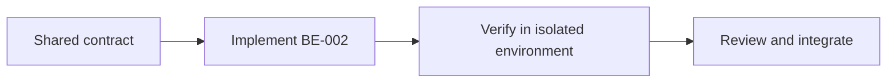

---

<!-- Source: foundation/be-003-auth-validation-errors.md -->

# Task BE-003: Shared authentication, authorization, validation and error middleware

**Owner**: Member 1 · **Priority**: Must

**Dependencies**: BE-001, BE-002

## 1. API Documentation

Shared infrastructure task; no independent business endpoint or response body. Endpoint behavior is specified in linked task files and [CONVENTIONS.md](CONVENTIONS.md).

## 2. Instructions

1. Implement AppError and typed BadRequest,Unauthorized,Forbidden,NotFound,Conflict,RateLimit,ServiceUnavailable errors. Carry safe field details separately from internal diagnostics.
2. Use express-validator or equivalent consistently; validation handler produces400 with data.errors. Reject unknown fields,empty PATCH and malformed JSON. Use centralized positive-ID,query-boolean,pagination and money validation helpers.
3. Authenticate Bearer JWT and verify algorithm,issuer,audience,token_use,signature and expiry. Read current employee/role/active/token_version from MySQL; middleware cannot trust stored frontend profile or stale JWT role.
4. Use hasRole(...roles) authorization plus resource-level assignment checks inside services under locks. Authentication401 precedes authorization403; do not expose missing resource existence to unauthorized roles.
5. Implement JSON not-found handler then error middleware (err,req,res,next). Express4 async callbacks must catch/next(error) or use shared async wrapper. If headers already sent delegate next(error).
6. Translate SQL duplicate to409 without exposing raw DB error. Generic500 for unknown failures; log sanitized request ID,stack internally. Never pass SQL syntax or err.message indiscriminately to users.
7. Shared output serialization converts decimals to fixed strings,dates UTC and flags booleans. Public DTOs use explicit allowlists. SQL values parameterized; dynamic structural pieces from constants only.
8. Implement rate limits/login/reset/public lookup/resend and Retry-After on429. Audit every mutation in order_history using fixed action keys and actor/time; allow null actor for automated delivery events.

## 3. Logic & Git Instructions

Branch: `codex/be-003-auth-validation-errors`; start from updated dev, commit with [BE-003], open PR into dev for teammate review.

### PR checklist

- [ ] Every instruction has implementation or verification evidence.
- [ ] Local README and env examples are updated where required.
- [ ] No secrets or generated database dumps committed.
- [ ] Agreed contracts remain unchanged or affected owners reviewed the change.

## 4. Logic Diagram


---

<!-- Source: auth/be-004-login.md -->

# Task BE-004: Staff login

**Endpoint**: `POST /api/auth/login`

**Owner**: Member 1 · **Priority**: Must · **Requirement**: FR-AUTH-01/02/03

**Dependencies**: BE-001, BE-002, BE-003. Dependencies describe contracts and integration order; use fixtures to begin development before the corresponding endpoint is complete.

## 1. API Documentation

- **Method**: `POST`
- **URL**: `/api/auth/login`
- **Access**: Public
- **Authentication**: `None`
- **Content-Type**: `application/json`

### Request body

```json
{
  "email": "manager@abegarage.com",
  "password": "StrongPassword123!"
}
```

### Success response (200)

```json
{
  "status": "success",
  "message": "Staff login successful",
  "data": {
    "access_token": "<application-jwt>",
    "token_type": "Bearer",
    "expires_in": 3600,
    "employee": {
      "employee_id": 2,
      "first_name": "Abebe",
      "last_name": "Kebede",
      "email": "abebe@abegarage.com",
      "phone": "0911234567",
      "role_id": 2,
      "role_name": "Manager",
      "active": true,
      "created_at": "2026-10-25T12:00:00Z"
    }
  }
}
```

Examples use representative fixture records. Responses may have more/fewer array elements; fields and types are contractual. Nullable fields remain present as null. Where a task documents a restricted role projection, that projection replaces the general example for that role.

### Errors

- 400 Invalid input (unless this task specifies a different public-token rule)
- 401 Invalid email or password
- 403 Account disabled
- 429 Too many attempts
- 500 Unexpected server error

Shared error format (field errors apply to validation failures):

```json
{
  "status": "error",
  "message": "Validation failed",
  "data": {
    "errors": {
      "email": "Enter a valid email address"
    }
  }
}
```

Non-validation errors use `data: null`, except explicitly documented safe metadata. See [shared conventions](CONVENTIONS.md).

## 2. Instructions

1. Define route and middleware in `backend/src/api/auth/routes/auth.route.js`.
2. Add `loginValidation` in `backend/src/api/auth/validations/auth.validation.js`.
3. Implement `loginController` in `backend/src/api/auth/controller/auth.controller.js`. Extract allowlisted inputs and verified actor context only.
4. Implement `loginService` in `backend/src/api/auth/service/auth.service.js`. Keep business rules and SQL out of controllers.
5. Share transactions, money/status helpers and notification adapter as described in foundation tasks; do not duplicate other modules’ logic.
6. On errors call `next(error)` from controller catches or use the shared async wrapper. Do not send competing error formats.

## 3. Logic & Git Instructions

### Logic steps

1. Validate email and password; trim/lowercase email. Do not trim or silently modify passwords.
2. Look up employee; compare bcrypt hash. Unknown email and wrong password both yield 401 with Invalid email or password. Use a dummy bcrypt comparison for unknown accounts to reduce timing differences.
3. After credentials match, reject inactive employee with 403 Account disabled.
4. Issue access JWT containing employee_id, token_version, token_use=access, iat and exp; use JWT_EXPIRES_IN_SECONDS (default 3600). Middleware allowlists signing algorithm and verifies issuer/audience.
5. Return safe employee fields and access_token. Rate-limit attempts by IP and normalized account identifier; never log credentials or tokens.

### Git workflow

```bash
git checkout dev
git pull --ff-only origin dev
git checkout -b codex/be-004-login
# Implement and run task-specific checks
git add <changed-files>
git commit -m "[BE-004] Staff login"
git push -u origin codex/be-004-login
```

Open a PR into dev with requirement IDs, examples and test evidence. One teammate reviews. Coordinate shared route registration through Member 1; module files belong to their listed owner.

### PR checklist and acceptance criteria

- [ ] Successful request returns 200 and exactly the documented safe response shape.
- [ ] Works without staff login; applies documented rate limits and public-field restrictions.
- [ ] Verify 401 Invalid email or password.
- [ ] Verify 403 Account disabled.
- [ ] Verify 429 Too many attempts.
- [ ] Invalid/unknown input fields are rejected; no unexpected database changes occur on failure.
- [ ] Transaction/concurrency behavior and repeated-request behavior match the logic below.
- [ ] All errors go through centralized error middleware; no sensitive fields or stack traces escape.

## 4. Logic Diagram


---

<!-- Source: auth/be-005-forgot-password.md -->

# Task BE-005: Request password reset

**Endpoint**: `POST /api/auth/forgot-password`

**Owner**: Member 1 · **Priority**: Must (agreed addition) · **Requirement**: AUTH extension

**Dependencies**: BE-003, BE-043. Dependencies describe contracts and integration order; use fixtures to begin development before the corresponding endpoint is complete.

## 1. API Documentation

- **Method**: `POST`
- **URL**: `/api/auth/forgot-password`
- **Access**: Public
- **Authentication**: `None`
- **Content-Type**: `application/json`

### Request body

```json
{
  "email": "abebe@abegarage.com"
}
```

### Success response (200)

```json
{
  "status": "success",
  "message": "If an eligible account exists, a password reset link will be sent.",
  "data": null
}
```

Examples use representative fixture records. Responses may have more/fewer array elements; fields and types are contractual. Nullable fields remain present as null. Where a task documents a restricted role projection, that projection replaces the general example for that role.

### Errors

- 400 Invalid input (unless this task specifies a different public-token rule)
- 400 Invalid email format
- 429 Too many attempts
- 500 Unexpected server error

Shared error format (field errors apply to validation failures):

```json
{
  "status": "error",
  "message": "Validation failed",
  "data": {
    "errors": {
      "email": "Enter a valid email address"
    }
  }
}
```

Non-validation errors use `data: null`, except explicitly documented safe metadata. See [shared conventions](CONVENTIONS.md).

## 2. Instructions

1. Define route and middleware in `backend/src/api/auth/routes/auth.route.js`.
2. Add `forgotPasswordValidation` in `backend/src/api/auth/validations/auth.validation.js`.
3. Implement `forgotPasswordController` in `backend/src/api/auth/controller/auth.controller.js`. Extract allowlisted inputs and verified actor context only.
4. Implement `forgotPasswordService` in `backend/src/api/auth/service/auth.service.js`. Keep business rules and SQL out of controllers.
5. Share transactions, money/status helpers and notification adapter as described in foundation tasks; do not duplicate other modules’ logic.
6. On errors call `next(error)` from controller catches or use the shared async wrapper. Do not send competing error formats.

## 3. Logic & Git Instructions

### Logic steps

1. Validate and normalize email. Always return the exact same 200 message for eligible, missing and inactive accounts: If an eligible account exists, a password reset link will be sent.
2. For active staff generate crypto.randomBytes(32).toString("hex"); store only its SHA-256 hex digest with a 15-minute UTC expiry.
3. Serialize issuance per employee in a transaction: invalidate outstanding tokens, insert new token. Send only after commit through the shared mail adapter. Build the link from configured FRONTEND_URL, never the request Host header.
4. Send /reset-password?token=<raw-token> by email, never in this API response. Handle delivery failure internally with sanitized logs and a retryable user action; preserve the generic response. Do not store raw tokens in logs.
5. Rate-limit by account and IP; align response timing for account eligibility outcomes. Do not alter the employee password or token_version at this stage.

### Git workflow

```bash
git checkout dev
git pull --ff-only origin dev
git checkout -b codex/be-005-forgot-password
# Implement and run task-specific checks
git add <changed-files>
git commit -m "[BE-005] Request password reset"
git push -u origin codex/be-005-forgot-password
```

Open a PR into dev with requirement IDs, examples and test evidence. One teammate reviews. Coordinate shared route registration through Member 1; module files belong to their listed owner.

### PR checklist and acceptance criteria

- [ ] Successful request returns 200 and exactly the documented safe response shape.
- [ ] Works without staff login; applies documented rate limits and public-field restrictions.
- [ ] Verify 400 Invalid email format.
- [ ] Verify 429 Too many attempts.
- [ ] Invalid/unknown input fields are rejected; no unexpected database changes occur on failure.
- [ ] Transaction/concurrency behavior and repeated-request behavior match the logic below.
- [ ] All errors go through centralized error middleware; no sensitive fields or stack traces escape.

## 4. Logic Diagram

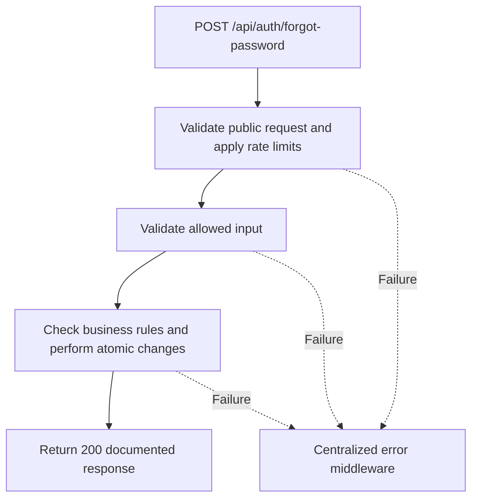

---

<!-- Source: auth/be-006-reset-password.md -->

# Task BE-006: Reset forgotten password

**Endpoint**: `POST /api/auth/reset-password`

**Owner**: Member 1 · **Priority**: Must (agreed addition) · **Requirement**: AUTH extension

**Dependencies**: BE-005. Dependencies describe contracts and integration order; use fixtures to begin development before the corresponding endpoint is complete.

## 1. API Documentation

- **Method**: `POST`
- **URL**: `/api/auth/reset-password`
- **Access**: Public
- **Authentication**: `None`
- **Content-Type**: `application/json`

### Request body

```json
{
  "token": "<64-character-hex-reset-token>",
  "new_password": "NewStrongPassword123!"
}
```

### Success response (200)

```json
{
  "status": "success",
  "message": "Password reset successfully. Please log in.",
  "data": null
}
```

Examples use representative fixture records. Responses may have more/fewer array elements; fields and types are contractual. Nullable fields remain present as null. Where a task documents a restricted role projection, that projection replaces the general example for that role.

### Errors

- 400 Invalid input (unless this task specifies a different public-token rule)
- 400 Invalid or expired reset link
- 429 Too many attempts
- 500 Unexpected server error

Shared error format (field errors apply to validation failures):

```json
{
  "status": "error",
  "message": "Validation failed",
  "data": {
    "errors": {
      "email": "Enter a valid email address"
    }
  }
}
```

Non-validation errors use `data: null`, except explicitly documented safe metadata. See [shared conventions](CONVENTIONS.md).

## 2. Instructions

1. Define route and middleware in `backend/src/api/auth/routes/auth.route.js`.
2. Add `resetPasswordValidation` in `backend/src/api/auth/validations/auth.validation.js`.
3. Implement `resetPasswordController` in `backend/src/api/auth/controller/auth.controller.js`. Extract allowlisted inputs and verified actor context only.
4. Implement `resetPasswordService` in `backend/src/api/auth/service/auth.service.js`. Keep business rules and SQL out of controllers.
5. Share transactions, money/status helpers and notification adapter as described in foundation tasks; do not duplicate other modules’ logic.
6. On errors call `next(error)` from controller catches or use the shared async wrapper. Do not send competing error formats.

## 3. Logic & Git Instructions

### Logic steps

1. Validate token format and password (8 to 72 UTF-8 bytes for bcrypt). Hash the supplied token with SHA-256.
2. Use one pooled connection and transaction. Resolve candidate token, lock its employee row first, then lock token row; recheck all eligibility after locking. Use the same lock order as issuance and password change.
3. Missing, used, expired tokens and inactive employees all return 400 Invalid or expired reset link. The token is not an access JWT and cannot authenticate staff APIs.
4. Update password_hash using bcrypt; increment token_version; mark every outstanding reset token for the employee used; commit atomically.
5. Do not log the user in automatically. Frontend returns to login. Rate-limit reset attempts.

### Git workflow

```bash
git checkout dev
git pull --ff-only origin dev
git checkout -b codex/be-006-reset-password
# Implement and run task-specific checks
git add <changed-files>
git commit -m "[BE-006] Reset forgotten password"
git push -u origin codex/be-006-reset-password
```

Open a PR into dev with requirement IDs, examples and test evidence. One teammate reviews. Coordinate shared route registration through Member 1; module files belong to their listed owner.

### PR checklist and acceptance criteria

- [ ] Successful request returns 200 and exactly the documented safe response shape.
- [ ] Works without staff login; applies documented rate limits and public-field restrictions.
- [ ] Verify 400 Invalid or expired reset link.
- [ ] Verify 429 Too many attempts.
- [ ] Invalid/unknown input fields are rejected; no unexpected database changes occur on failure.
- [ ] Transaction/concurrency behavior and repeated-request behavior match the logic below.
- [ ] All errors go through centralized error middleware; no sensitive fields or stack traces escape.

## 4. Logic Diagram


---

<!-- Source: auth/be-007-change-password.md -->

# Task BE-007: Change own password

**Endpoint**: `PATCH /api/auth/password`

**Owner**: Member 1 · **Priority**: Should · **Requirement**: FR-AUTH-07

**Dependencies**: BE-003, BE-004. Dependencies describe contracts and integration order; use fixtures to begin development before the corresponding endpoint is complete.

## 1. API Documentation

- **Method**: `PATCH`
- **URL**: `/api/auth/password`
- **Access**: Any active staff
- **Authentication**: `Authorization: Bearer <access_token>`
- **Content-Type**: `application/json`

### Request body

```json
{
  "current_password": "StrongPassword123!",
  "new_password": "AnotherStrongPassword123!"
}
```

### Success response (200)

```json
{
  "status": "success",
  "message": "Password changed successfully. Please log in again.",
  "data": null
}
```

Examples use representative fixture records. Responses may have more/fewer array elements; fields and types are contractual. Nullable fields remain present as null. Where a task documents a restricted role projection, that projection replaces the general example for that role.

### Errors

- 400 Invalid input (unless this task specifies a different public-token rule)
- 401 Missing, invalid, expired or revoked access token
- 403 Inactive account or insufficient role
- 400 Current password is incorrect
- 500 Unexpected server error

Shared error format (field errors apply to validation failures):

```json
{
  "status": "error",
  "message": "Validation failed",
  "data": {
    "errors": {
      "email": "Enter a valid email address"
    }
  }
}
```

Non-validation errors use `data: null`, except explicitly documented safe metadata. See [shared conventions](CONVENTIONS.md).

## 2. Instructions

1. Define route and middleware in `backend/src/api/auth/routes/auth.route.js`.
2. Add `changePasswordValidation` in `backend/src/api/auth/validations/auth.validation.js`.
3. Implement `changePasswordController` in `backend/src/api/auth/controller/auth.controller.js`. Extract allowlisted inputs and verified actor context only.
4. Implement `changePasswordService` in `backend/src/api/auth/service/auth.service.js`. Keep business rules and SQL out of controllers.
5. Share transactions, money/status helpers and notification adapter as described in foundation tasks; do not duplicate other modules’ logic.
6. On errors call `next(error)` from controller catches or use the shared async wrapper. Do not send competing error formats.

## 3. Logic & Git Instructions

### Logic steps

1. Take employee_id only from verified authentication context, not from request body. Validate both password fields.
2. Verify current password; mismatch returns 400 Current password is incorrect.
3. Within one transaction lock employee, recheck current password and active flag, update bcrypt hash, increment token_version, invalidate outstanding reset tokens.
4. Return 200 Password changed successfully. Please log in again. The current JWT and every other access JWT are invalid on their next request; clear local session after success.

### Git workflow

```bash
git checkout dev
git pull --ff-only origin dev
git checkout -b codex/be-007-change-password
# Implement and run task-specific checks
git add <changed-files>
git commit -m "[BE-007] Change own password"
git push -u origin codex/be-007-change-password
```

Open a PR into dev with requirement IDs, examples and test evidence. One teammate reviews. Coordinate shared route registration through Member 1; module files belong to their listed owner.

### PR checklist and acceptance criteria

- [ ] Successful request returns 200 and exactly the documented safe response shape.
- [ ] Missing/expired/revoked token returns401; inactive account and unauthorized role return403.
- [ ] Verify 400 Current password is incorrect.
- [ ] Invalid/unknown input fields are rejected; no unexpected database changes occur on failure.
- [ ] Transaction/concurrency behavior and repeated-request behavior match the logic below.
- [ ] All errors go through centralized error middleware; no sensitive fields or stack traces escape.

## 4. Logic Diagram

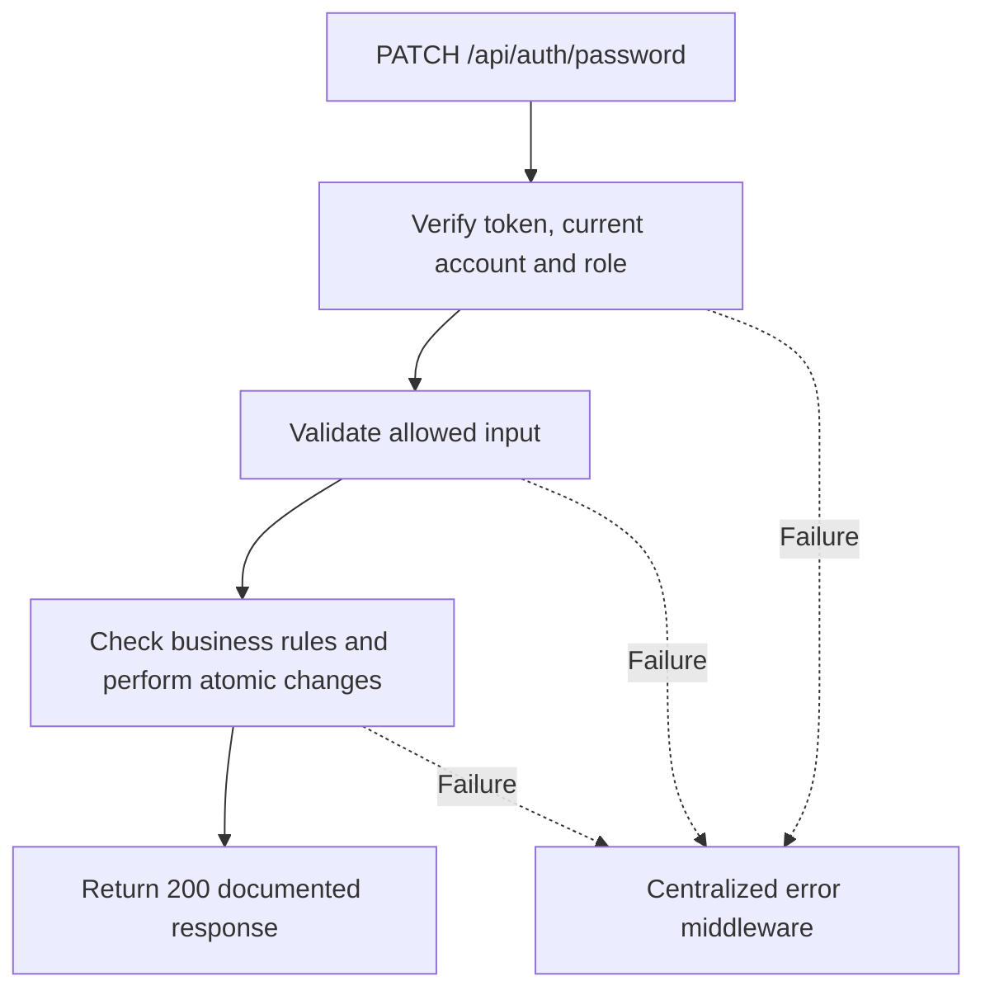

---

<!-- Source: auth/be-008-get-profile.md -->

# Task BE-008: Get own staff profile

**Endpoint**: `GET /api/profile`

**Owner**: Member 1 · **Priority**: Must (agreed addition) · **Requirement**: FR-AUTH-05 / profile

**Dependencies**: BE-003. Dependencies describe contracts and integration order; use fixtures to begin development before the corresponding endpoint is complete.

## 1. API Documentation

- **Method**: `GET`
- **URL**: `/api/profile`
- **Access**: Any active staff
- **Authentication**: `Authorization: Bearer <access_token>`
- **Content-Type**: `application/json`

### Request body

None. Do not send a JSON body.

### Success response (200)

```json
{
  "status": "success",
  "message": "Get own staff profile successful",
  "data": {
    "employee_id": 5,
    "first_name": "Abebe",
    "last_name": "Kebede",
    "email": "abebe@abegarage.com",
    "phone": "0911234567",
    "role_id": 1,
    "role_name": "Technician",
    "active": true,
    "created_at": "2026-10-25T12:00:00Z"
  }
}
```

Examples use representative fixture records. Responses may have more/fewer array elements; fields and types are contractual. Nullable fields remain present as null. Where a task documents a restricted role projection, that projection replaces the general example for that role.

### Errors

- 400 Invalid input (unless this task specifies a different public-token rule)
- 401 Missing, invalid, expired or revoked access token
- 403 Inactive account or insufficient role
- 500 Unexpected server error

Shared error format (field errors apply to validation failures):

```json
{
  "status": "error",
  "message": "Validation failed",
  "data": {
    "errors": {
      "email": "Enter a valid email address"
    }
  }
}
```

Non-validation errors use `data: null`, except explicitly documented safe metadata. See [shared conventions](CONVENTIONS.md).

## 2. Instructions

1. Define route and middleware in `backend/src/api/auth/routes/auth.route.js`.
2. Add `getProfileValidation` in `backend/src/api/auth/validations/auth.validation.js`.
3. Implement `getProfileController` in `backend/src/api/auth/controller/auth.controller.js`. Extract allowlisted inputs and verified actor context only.
4. Implement `getProfileService` in `backend/src/api/auth/service/auth.service.js`. Keep business rules and SQL out of controllers.
5. Share transactions, money/status helpers and notification adapter as described in foundation tasks; do not duplicate other modules’ logic.
6. On errors call `next(error)` from controller catches or use the shared async wrapper. Do not send competing error formats.

## 3. Logic & Git Instructions

### Logic steps

1. Get employee_id from verified token; select current database details joined to roles.
2. Return only explicit safe fields. Never expose password_hash or token_version. The frontend may restore cached profile then refresh using this endpoint; cached data grants no authorization.
3. No /me endpoint, public registration or Google sign-in is provided. Logout clears frontend token/profile; expiry, password changes and deactivation enforce server-side restrictions.

### Git workflow

```bash
git checkout dev
git pull --ff-only origin dev
git checkout -b codex/be-008-get-profile
# Implement and run task-specific checks
git add <changed-files>
git commit -m "[BE-008] Get own staff profile"
git push -u origin codex/be-008-get-profile
```

Open a PR into dev with requirement IDs, examples and test evidence. One teammate reviews. Coordinate shared route registration through Member 1; module files belong to their listed owner.

### PR checklist and acceptance criteria

- [ ] Successful request returns 200 and exactly the documented safe response shape.
- [ ] Missing/expired/revoked token returns401; inactive account and unauthorized role return403.
- [ ] Invalid/unknown input fields are rejected; no unexpected database changes occur on failure.
- [ ] GET has no data-changing side effects; list pagination/counts stay consistent.
- [ ] All errors go through centralized error middleware; no sensitive fields or stack traces escape.

## 4. Logic Diagram

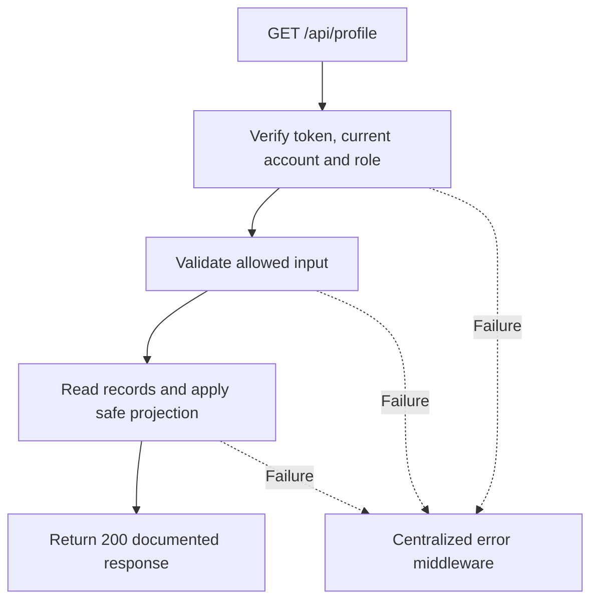

---

<!-- Source: employees/be-009-create-employee.md -->

# Task BE-009: Create employee

**Endpoint**: `POST /api/employees`

**Owner**: Member 1 · **Priority**: Must · **Requirement**: FR-EMP-01/02

**Dependencies**: BE-003. Dependencies describe contracts and integration order; use fixtures to begin development before the corresponding endpoint is complete.

## 1. API Documentation

- **Method**: `POST`
- **URL**: `/api/employees`
- **Access**: Admin
- **Authentication**: `Authorization: Bearer <access_token>`
- **Content-Type**: `application/json`

### Request body

```json
{
  "first_name": "Abebe",
  "last_name": "Kebede",
  "email": "abebe@abegarage.com",
  "phone": "0911234567",
  "password": "StrongPassword123!",
  "role_id": 1,
  "active": true
}
```

### Success response (201)

```json
{
  "status": "success",
  "message": "Create employee successful",
  "data": {
    "employee_id": 5,
    "first_name": "Abebe",
    "last_name": "Kebede",
    "email": "abebe@abegarage.com",
    "phone": "0911234567",
    "role_id": 1,
    "role_name": "Technician",
    "active": true,
    "created_at": "2026-10-25T12:00:00Z"
  }
}
```

Examples use representative fixture records. Responses may have more/fewer array elements; fields and types are contractual. Nullable fields remain present as null. Where a task documents a restricted role projection, that projection replaces the general example for that role.

### Errors

- 400 Invalid input (unless this task specifies a different public-token rule)
- 401 Missing, invalid, expired or revoked access token
- 403 Inactive account or insufficient role
- 409 Email already used
- 500 Unexpected server error

Shared error format (field errors apply to validation failures):

```json
{
  "status": "error",
  "message": "Validation failed",
  "data": {
    "errors": {
      "email": "Enter a valid email address"
    }
  }
}
```

Non-validation errors use `data: null`, except explicitly documented safe metadata. See [shared conventions](CONVENTIONS.md).

## 2. Instructions

1. Define route and middleware in `backend/src/api/employees/routes/employee.route.js`.
2. Add `createEmployeeValidation` in `backend/src/api/employees/validations/employee.validation.js`.
3. Implement `createEmployeeController` in `backend/src/api/employees/controller/employee.controller.js`. Extract allowlisted inputs and verified actor context only.
4. Implement `createEmployeeService` in `backend/src/api/employees/service/employee.service.js`. Keep business rules and SQL out of controllers.
5. Share transactions, money/status helpers and notification adapter as described in foundation tasks; do not duplicate other modules’ logic.
6. On errors call `next(error)` from controller catches or use the shared async wrapper. Do not send competing error formats.

## 3. Logic & Git Instructions

### Logic steps

1. Validate nonempty names (1–100 characters), normalized unique email, phone string, password policy, role_id in 1/2/3, and boolean active (default true).
2. Hash password; insert employee with token_version=0. Database UNIQUE(email) is the final concurrency safeguard; map duplicate to 409.
3. Return safe created employee; never accept employee_id, token_version, password_hash or created_at from client.

### Git workflow

```bash
git checkout dev
git pull --ff-only origin dev
git checkout -b codex/be-009-create-employee
# Implement and run task-specific checks
git add <changed-files>
git commit -m "[BE-009] Create employee"
git push -u origin codex/be-009-create-employee
```

Open a PR into dev with requirement IDs, examples and test evidence. One teammate reviews. Coordinate shared route registration through Member 1; module files belong to their listed owner.

### PR checklist and acceptance criteria

- [ ] Successful request returns 201 and exactly the documented safe response shape.
- [ ] Missing/expired/revoked token returns401; inactive account and unauthorized role return403.
- [ ] Verify 409 Email already used.
- [ ] Invalid/unknown input fields are rejected; no unexpected database changes occur on failure.
- [ ] Transaction/concurrency behavior and repeated-request behavior match the logic below.
- [ ] All errors go through centralized error middleware; no sensitive fields or stack traces escape.

## 4. Logic Diagram


---

<!-- Source: employees/be-010-list-employees.md -->

# Task BE-010: List and search employees

**Endpoint**: `GET /api/employees`

**Owner**: Member 1 · **Priority**: Must · **Requirement**: FR-EMP-03 / FR-TEC-01

**Dependencies**: BE-003. Dependencies describe contracts and integration order; use fixtures to begin development before the corresponding endpoint is complete.

## 1. API Documentation

- **Method**: `GET`
- **URL**: `/api/employees`
- **Access**: Admin; Manager limited to active technicians
- **Authentication**: `Authorization: Bearer <access_token>`
- **Content-Type**: `application/json`

### Request body

None. Do not send a JSON body.

### Query parameters example

```json
{
  "search": "abebe",
  "role_id": 1,
  "active": true,
  "page": 1,
  "limit": 10
}
```

See [shared conventions](CONVENTIONS.md) for types, limits and defaults. All filters are optional. Endpoint-specific behavior is described below.

### Success response (200)

```json
{
  "status": "success",
  "message": "List and search employees successful",
  "data": {
    "employees": [
      {
        "employee_id": 5,
        "first_name": "Abebe",
        "last_name": "Kebede",
        "email": "abebe@abegarage.com",
        "phone": "0911234567",
        "role_id": 1,
        "role_name": "Technician",
        "active": true,
        "created_at": "2026-10-25T12:00:00Z"
      }
    ],
    "pagination": {
      "page": 1,
      "limit": 10,
      "total": 1,
      "total_pages": 1
    }
  }
}
```

Examples use representative fixture records. Responses may have more/fewer array elements; fields and types are contractual. Nullable fields remain present as null. Where a task documents a restricted role projection, that projection replaces the general example for that role.

### Errors

- 400 Invalid input (unless this task specifies a different public-token rule)
- 401 Missing, invalid, expired or revoked access token
- 403 Inactive account or insufficient role
- 403 Managers may only list active technicians
- 500 Unexpected server error

Shared error format (field errors apply to validation failures):

```json
{
  "status": "error",
  "message": "Validation failed",
  "data": {
    "errors": {
      "email": "Enter a valid email address"
    }
  }
}
```

Non-validation errors use `data: null`, except explicitly documented safe metadata. See [shared conventions](CONVENTIONS.md).

## 2. Instructions

1. Define route and middleware in `backend/src/api/employees/routes/employee.route.js`.
2. Add `listEmployeesValidation` in `backend/src/api/employees/validations/employee.validation.js`.
3. Implement `listEmployeesController` in `backend/src/api/employees/controller/employee.controller.js`. Extract allowlisted inputs and verified actor context only.
4. Implement `listEmployeesService` in `backend/src/api/employees/service/employee.service.js`. Keep business rules and SQL out of controllers.
5. Share transactions, money/status helpers and notification adapter as described in foundation tasks; do not duplicate other modules’ logic.
6. On errors call `next(error)` from controller catches or use the shared async wrapper. Do not send competing error formats.

## 3. Logic & Git Instructions

### Logic steps

1. Validate search, role_id, active, page and limit. Admin may filter any role or active state.
2. For Manager force role_id=1 and active=true. An explicit conflicting filter returns 403. Manager projection is employee_id, first_name, last_name, role_name only; Admin projection matches example.
3. Search first_name, last_name and email; bind search values. Use stable created_at DESC, employee_id DESC ordering, limit/offset and separate count with identical filters.
4. No matches return employees=[] and total=0/total_pages=0. A page beyond the last returns [] with actual total. Never expose hashes or token versions.

### Git workflow

```bash
git checkout dev
git pull --ff-only origin dev
git checkout -b codex/be-010-list-employees
# Implement and run task-specific checks
git add <changed-files>
git commit -m "[BE-010] List and search employees"
git push -u origin codex/be-010-list-employees
```

Open a PR into dev with requirement IDs, examples and test evidence. One teammate reviews. Coordinate shared route registration through Member 1; module files belong to their listed owner.

### PR checklist and acceptance criteria

- [ ] Successful request returns 200 and exactly the documented safe response shape.
- [ ] Missing/expired/revoked token returns401; inactive account and unauthorized role return403.
- [ ] Verify 403 Managers may only list active technicians.
- [ ] Invalid/unknown input fields are rejected; no unexpected database changes occur on failure.
- [ ] GET has no data-changing side effects; list pagination/counts stay consistent.
- [ ] All errors go through centralized error middleware; no sensitive fields or stack traces escape.

## 4. Logic Diagram

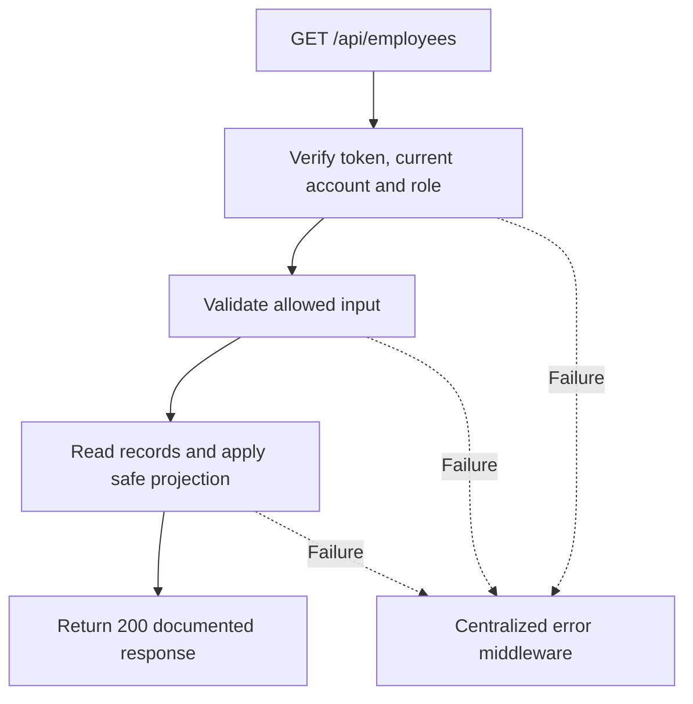

---

<!-- Source: employees/be-011-get-employee.md -->

# Task BE-011: View employee

**Endpoint**: `GET /api/employees/:employee_id`

**Owner**: Member 1 · **Priority**: Must · **Requirement**: FR-EMP-04

**Dependencies**: BE-003. Dependencies describe contracts and integration order; use fixtures to begin development before the corresponding endpoint is complete.

## 1. API Documentation

- **Method**: `GET`
- **URL**: `/api/employees/:employee_id`
- **Access**: Admin
- **Authentication**: `Authorization: Bearer <access_token>`
- **Content-Type**: `application/json`
- **Path parameters**: `employee_id` (positive integer)

### Request body

None. Do not send a JSON body.

### Success response (200)

```json
{
  "status": "success",
  "message": "View employee successful",
  "data": {
    "employee_id": 5,
    "first_name": "Abebe",
    "last_name": "Kebede",
    "email": "abebe@abegarage.com",
    "phone": "0911234567",
    "role_id": 1,
    "role_name": "Technician",
    "active": true,
    "created_at": "2026-10-25T12:00:00Z"
  }
}
```

Examples use representative fixture records. Responses may have more/fewer array elements; fields and types are contractual. Nullable fields remain present as null. Where a task documents a restricted role projection, that projection replaces the general example for that role.

### Errors

- 400 Invalid input (unless this task specifies a different public-token rule)
- 401 Missing, invalid, expired or revoked access token
- 403 Inactive account or insufficient role
- 404 Employee not found
- 500 Unexpected server error

Shared error format (field errors apply to validation failures):

```json
{
  "status": "error",
  "message": "Validation failed",
  "data": {
    "errors": {
      "email": "Enter a valid email address"
    }
  }
}
```

Non-validation errors use `data: null`, except explicitly documented safe metadata. See [shared conventions](CONVENTIONS.md).

## 2. Instructions

1. Define route and middleware in `backend/src/api/employees/routes/employee.route.js`.
2. Add `getEmployeeValidation` in `backend/src/api/employees/validations/employee.validation.js`.
3. Implement `getEmployeeController` in `backend/src/api/employees/controller/employee.controller.js`. Extract allowlisted inputs and verified actor context only.
4. Implement `getEmployeeService` in `backend/src/api/employees/service/employee.service.js`. Keep business rules and SQL out of controllers.
5. Share transactions, money/status helpers and notification adapter as described in foundation tasks; do not duplicate other modules’ logic.
6. On errors call `next(error)` from controller catches or use the shared async wrapper. Do not send competing error formats.

## 3. Logic & Git Instructions

### Logic steps

1. Validate positive employee_id; fetch employee joined to role, including inactive records.
2. Return 404 if absent; select safe detail fields explicitly.

### Git workflow

```bash
git checkout dev
git pull --ff-only origin dev
git checkout -b codex/be-011-get-employee
# Implement and run task-specific checks
git add <changed-files>
git commit -m "[BE-011] View employee"
git push -u origin codex/be-011-get-employee
```

Open a PR into dev with requirement IDs, examples and test evidence. One teammate reviews. Coordinate shared route registration through Member 1; module files belong to their listed owner.

### PR checklist and acceptance criteria

- [ ] Successful request returns 200 and exactly the documented safe response shape.
- [ ] Missing/expired/revoked token returns401; inactive account and unauthorized role return403.
- [ ] Verify 404 Employee not found.
- [ ] Invalid/unknown input fields are rejected; no unexpected database changes occur on failure.
- [ ] GET has no data-changing side effects; list pagination/counts stay consistent.
- [ ] All errors go through centralized error middleware; no sensitive fields or stack traces escape.

## 4. Logic Diagram

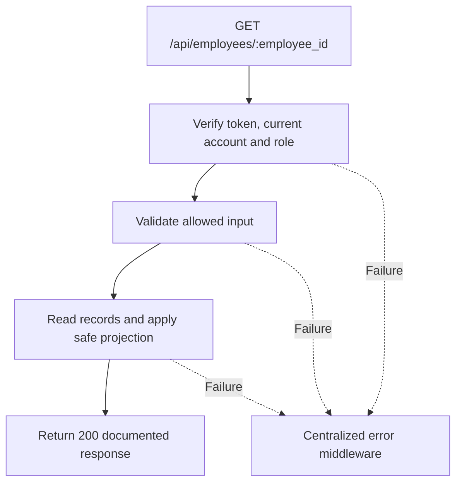

---

<!-- Source: employees/be-012-update-employee.md -->

# Task BE-012: Edit or deactivate employee

**Endpoint**: `PATCH /api/employees/:employee_id`

**Owner**: Member 1 · **Priority**: Must · **Requirement**: FR-EMP-04/05

**Dependencies**: BE-009. Dependencies describe contracts and integration order; use fixtures to begin development before the corresponding endpoint is complete.

## 1. API Documentation

- **Method**: `PATCH`
- **URL**: `/api/employees/:employee_id`
- **Access**: Admin
- **Authentication**: `Authorization: Bearer <access_token>`
- **Content-Type**: `application/json`
- **Path parameters**: `employee_id` (positive integer)

### Request body

```json
{
  "phone": "0911000000",
  "role_id": 2,
  "active": true
}
```

### Success response (200)

```json
{
  "status": "success",
  "message": "Edit or deactivate employee successful",
  "data": {
    "employee_id": 5,
    "first_name": "Abebe",
    "last_name": "Kebede",
    "email": "abebe@abegarage.com",
    "phone": "0911000000",
    "role_id": 2,
    "role_name": "Manager",
    "active": true,
    "created_at": "2026-10-25T12:00:00Z"
  }
}
```

Examples use representative fixture records. Responses may have more/fewer array elements; fields and types are contractual. Nullable fields remain present as null. Where a task documents a restricted role projection, that projection replaces the general example for that role.

### Errors

- 400 Invalid input (unless this task specifies a different public-token rule)
- 401 Missing, invalid, expired or revoked access token
- 403 Inactive account or insufficient role
- 404 Employee not found
- 409 Email already used
- 409 At least one active Admin is required
- 500 Unexpected server error

Shared error format (field errors apply to validation failures):

```json
{
  "status": "error",
  "message": "Validation failed",
  "data": {
    "errors": {
      "email": "Enter a valid email address"
    }
  }
}
```

Non-validation errors use `data: null`, except explicitly documented safe metadata. See [shared conventions](CONVENTIONS.md).

## 2. Instructions

1. Define route and middleware in `backend/src/api/employees/routes/employee.route.js`.
2. Add `updateEmployeeValidation` in `backend/src/api/employees/validations/employee.validation.js`.
3. Implement `updateEmployeeController` in `backend/src/api/employees/controller/employee.controller.js`. Extract allowlisted inputs and verified actor context only.
4. Implement `updateEmployeeService` in `backend/src/api/employees/service/employee.service.js`. Keep business rules and SQL out of controllers.
5. Share transactions, money/status helpers and notification adapter as described in foundation tasks; do not duplicate other modules’ logic.
6. On errors call `next(error)` from controller catches or use the shared async wrapper. Do not send competing error formats.

## 3. Logic & Git Instructions

### Logic steps

1. Allow first_name,last_name,email,phone,role_id,active only. Require at least one field; reject unknown fields and direct password changes.
2. Lock all Admin-role employee rows in a consistent order before target updates so concurrent demotions/deactivations cannot remove the last active Admin. Reject loss of the last active Admin with 409.
3. Enforce unique normalized email. A role change or any active-flag change increments token_version; email change invalidates outstanding reset tokens. Staff must log in again after role/active changes.
4. Do not delete employees. Existing job/order foreign keys remain. Deactivated employees disappear from assignment candidates. Existing assignments remain visible; Manager reassigns unfinished work.
5. Update transactionally and return safe employee. Do not accept a second password through this endpoint.

### Git workflow

```bash
git checkout dev
git pull --ff-only origin dev
git checkout -b codex/be-012-update-employee
# Implement and run task-specific checks
git add <changed-files>
git commit -m "[BE-012] Edit or deactivate employee"
git push -u origin codex/be-012-update-employee
```

Open a PR into dev with requirement IDs, examples and test evidence. One teammate reviews. Coordinate shared route registration through Member 1; module files belong to their listed owner.

### PR checklist and acceptance criteria

- [ ] Successful request returns 200 and exactly the documented safe response shape.
- [ ] Missing/expired/revoked token returns401; inactive account and unauthorized role return403.
- [ ] Verify 404 Employee not found.
- [ ] Verify 409 Email already used.
- [ ] Verify 409 At least one active Admin is required.
- [ ] Invalid/unknown input fields are rejected; no unexpected database changes occur on failure.
- [ ] Transaction/concurrency behavior and repeated-request behavior match the logic below.
- [ ] All errors go through centralized error middleware; no sensitive fields or stack traces escape.

## 4. Logic Diagram

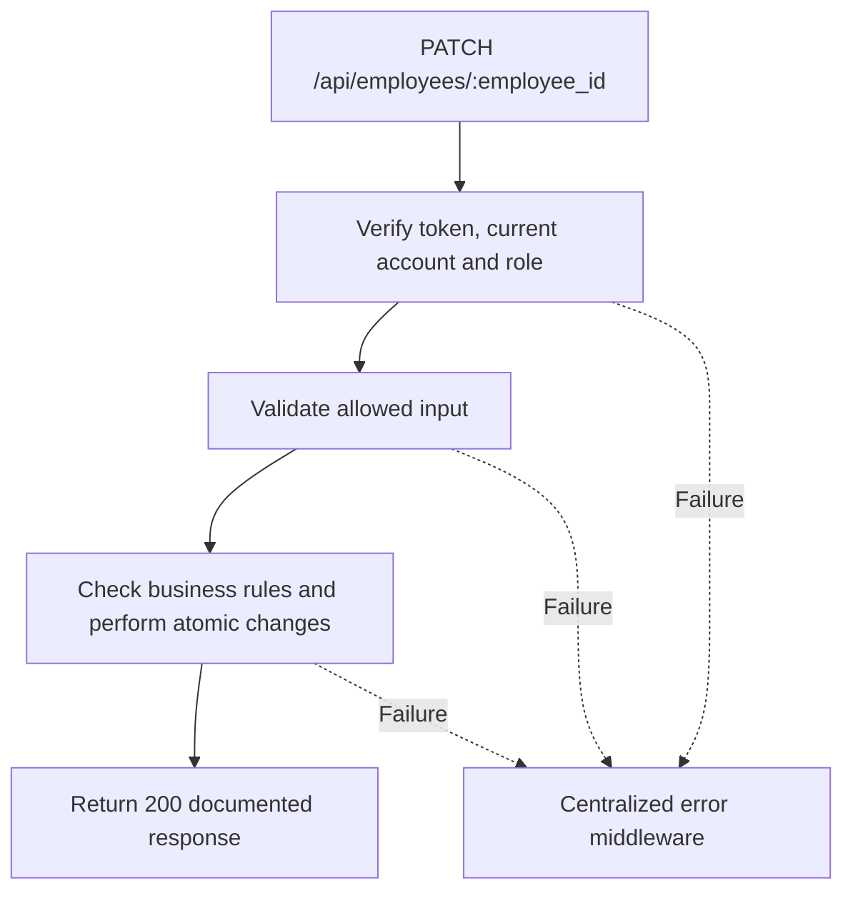

---

<!-- Source: settings/be-013-list-roles.md -->

# Task BE-013: List fixed staff roles

**Endpoint**: `GET /api/roles`

**Owner**: Member 1 · **Priority**: Must (supporting endpoint) · **Requirement**: FR-EMP-01

**Dependencies**: BE-003. Dependencies describe contracts and integration order; use fixtures to begin development before the corresponding endpoint is complete.

## 1. API Documentation

- **Method**: `GET`
- **URL**: `/api/roles`
- **Access**: Admin
- **Authentication**: `Authorization: Bearer <access_token>`
- **Content-Type**: `application/json`

### Request body

None. Do not send a JSON body.

### Success response (200)

```json
{
  "status": "success",
  "message": "List fixed staff roles successful",
  "data": {
    "roles": [
      {
        "role_id": 1,
        "role_name": "Technician"
      },
      {
        "role_id": 2,
        "role_name": "Manager"
      },
      {
        "role_id": 3,
        "role_name": "Admin"
      }
    ]
  }
}
```

Examples use representative fixture records. Responses may have more/fewer array elements; fields and types are contractual. Nullable fields remain present as null. Where a task documents a restricted role projection, that projection replaces the general example for that role.

### Errors

- 400 Invalid input (unless this task specifies a different public-token rule)
- 401 Missing, invalid, expired or revoked access token
- 403 Inactive account or insufficient role
- 500 Unexpected server error

Shared error format (field errors apply to validation failures):

```json
{
  "status": "error",
  "message": "Validation failed",
  "data": {
    "errors": {
      "email": "Enter a valid email address"
    }
  }
}
```

Non-validation errors use `data: null`, except explicitly documented safe metadata. See [shared conventions](CONVENTIONS.md).

## 2. Instructions

1. Define route and middleware in `backend/src/api/settings/routes/settings.route.js`.
2. Add `listRolesValidation` in `backend/src/api/settings/validations/settings.validation.js`.
3. Implement `listRolesController` in `backend/src/api/settings/controller/settings.controller.js`. Extract allowlisted inputs and verified actor context only.
4. Implement `listRolesService` in `backend/src/api/settings/service/settings.service.js`. Keep business rules and SQL out of controllers.
5. Share transactions, money/status helpers and notification adapter as described in foundation tasks; do not duplicate other modules’ logic.
6. On errors call `next(error)` from controller catches or use the shared async wrapper. Do not send competing error formats.

## 3. Logic & Git Instructions

### Logic steps

1. Read the seeded roles in role_id order. Roles are fixed reference data; do not implement create/edit/delete role APIs.

### Git workflow

```bash
git checkout dev
git pull --ff-only origin dev
git checkout -b codex/be-013-list-roles
# Implement and run task-specific checks
git add <changed-files>
git commit -m "[BE-013] List fixed staff roles"
git push -u origin codex/be-013-list-roles
```

Open a PR into dev with requirement IDs, examples and test evidence. One teammate reviews. Coordinate shared route registration through Member 1; module files belong to their listed owner.

### PR checklist and acceptance criteria

- [ ] Successful request returns 200 and exactly the documented safe response shape.
- [ ] Missing/expired/revoked token returns401; inactive account and unauthorized role return403.
- [ ] Invalid/unknown input fields are rejected; no unexpected database changes occur on failure.
- [ ] GET has no data-changing side effects; list pagination/counts stay consistent.
- [ ] All errors go through centralized error middleware; no sensitive fields or stack traces escape.

## 4. Logic Diagram

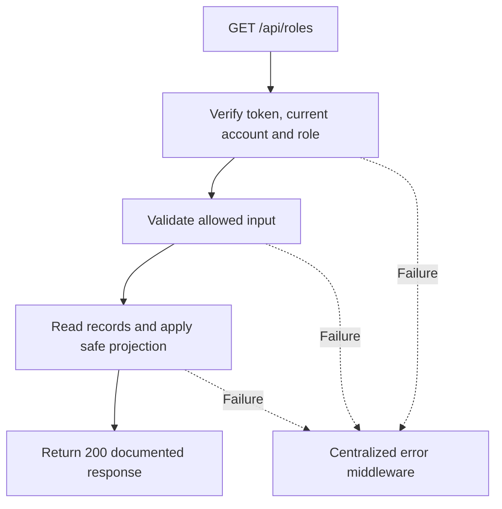

---

<!-- Source: settings/be-014-get-settings.md -->

# Task BE-014: Read garage settings

**Endpoint**: `GET /api/settings`

**Owner**: Member 1 · **Priority**: Must (supporting endpoint) · **Requirement**: Settings / FR-INV-01

**Dependencies**: BE-003. Dependencies describe contracts and integration order; use fixtures to begin development before the corresponding endpoint is complete.

## 1. API Documentation

- **Method**: `GET`
- **URL**: `/api/settings`
- **Access**: Admin
- **Authentication**: `Authorization: Bearer <access_token>`
- **Content-Type**: `application/json`

### Request body

None. Do not send a JSON body.

### Success response (200)

```json
{
  "status": "success",
  "message": "Read garage settings successful",
  "data": {
    "settings_id": 1,
    "name": "Abe Garage",
    "address": "Addis Ababa",
    "phone": "0111234567",
    "email": "contact@abegarage.com",
    "vat_rate": "15.00"
  }
}
```

Examples use representative fixture records. Responses may have more/fewer array elements; fields and types are contractual. Nullable fields remain present as null. Where a task documents a restricted role projection, that projection replaces the general example for that role.

### Errors

- 400 Invalid input (unless this task specifies a different public-token rule)
- 401 Missing, invalid, expired or revoked access token
- 403 Inactive account or insufficient role
- 503 System not initialized
- 500 Unexpected server error

Shared error format (field errors apply to validation failures):

```json
{
  "status": "error",
  "message": "Validation failed",
  "data": {
    "errors": {
      "email": "Enter a valid email address"
    }
  }
}
```

Non-validation errors use `data: null`, except explicitly documented safe metadata. See [shared conventions](CONVENTIONS.md).

## 2. Instructions

1. Define route and middleware in `backend/src/api/settings/routes/settings.route.js`.
2. Add `getSettingsValidation` in `backend/src/api/settings/validations/settings.validation.js`.
3. Implement `getSettingsController` in `backend/src/api/settings/controller/settings.controller.js`. Extract allowlisted inputs and verified actor context only.
4. Implement `getSettingsService` in `backend/src/api/settings/service/settings.service.js`. Keep business rules and SQL out of controllers.
5. Share transactions, money/status helpers and notification adapter as described in foundation tasks; do not duplicate other modules’ logic.
6. On errors call `next(error)` from controller catches or use the shared async wrapper. Do not send competing error formats.

## 3. Logic & Git Instructions

### Logic steps

1. Read singleton settings_id=1. Return 503 if installation has not completed. Do not expose SMTP credentials or environment secrets.

### Git workflow

```bash
git checkout dev
git pull --ff-only origin dev
git checkout -b codex/be-014-get-settings
# Implement and run task-specific checks
git add <changed-files>
git commit -m "[BE-014] Read garage settings"
git push -u origin codex/be-014-get-settings
```

Open a PR into dev with requirement IDs, examples and test evidence. One teammate reviews. Coordinate shared route registration through Member 1; module files belong to their listed owner.

### PR checklist and acceptance criteria

- [ ] Successful request returns 200 and exactly the documented safe response shape.
- [ ] Missing/expired/revoked token returns401; inactive account and unauthorized role return403.
- [ ] Verify 503 System not initialized.
- [ ] Invalid/unknown input fields are rejected; no unexpected database changes occur on failure.
- [ ] GET has no data-changing side effects; list pagination/counts stay consistent.
- [ ] All errors go through centralized error middleware; no sensitive fields or stack traces escape.

## 4. Logic Diagram

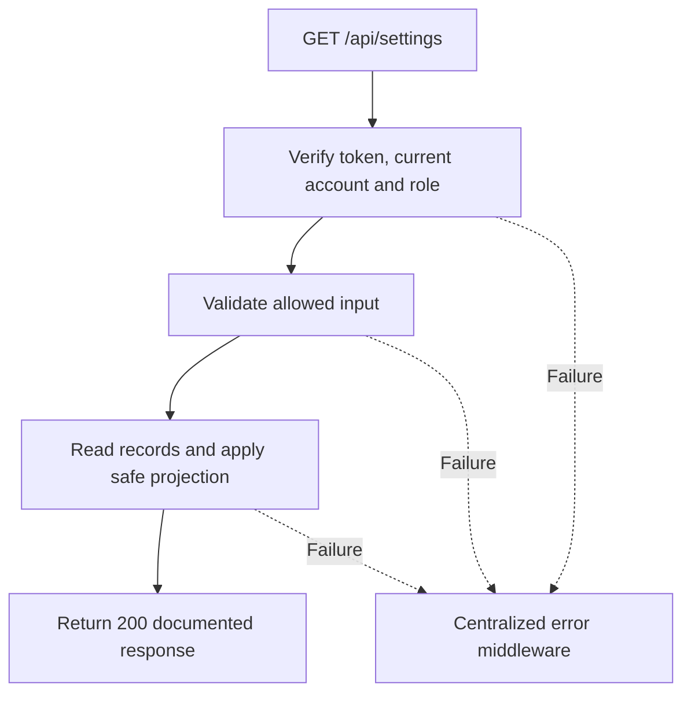

---

<!-- Source: settings/be-015-update-settings.md -->

# Task BE-015: Update garage settings

**Endpoint**: `PATCH /api/settings`

**Owner**: Member 1 · **Priority**: Must (supporting endpoint) · **Requirement**: Settings / FR-INV-05

**Dependencies**: BE-014. Dependencies describe contracts and integration order; use fixtures to begin development before the corresponding endpoint is complete.

## 1. API Documentation

- **Method**: `PATCH`
- **URL**: `/api/settings`
- **Access**: Admin
- **Authentication**: `Authorization: Bearer <access_token>`
- **Content-Type**: `application/json`

### Request body

```json
{
  "name": "Abe Garage",
  "phone": "0111234567",
  "vat_rate": "15.00"
}
```

### Success response (200)

```json
{
  "status": "success",
  "message": "Update garage settings successful",
  "data": {
    "settings_id": 1,
    "name": "Abe Garage",
    "address": "Addis Ababa",
    "phone": "0111234567",
    "email": "contact@abegarage.com",
    "vat_rate": "15.00"
  }
}
```

Examples use representative fixture records. Responses may have more/fewer array elements; fields and types are contractual. Nullable fields remain present as null. Where a task documents a restricted role projection, that projection replaces the general example for that role.

### Errors

- 400 Invalid input (unless this task specifies a different public-token rule)
- 401 Missing, invalid, expired or revoked access token
- 403 Inactive account or insufficient role
- 500 Unexpected server error

Shared error format (field errors apply to validation failures):

```json
{
  "status": "error",
  "message": "Validation failed",
  "data": {
    "errors": {
      "email": "Enter a valid email address"
    }
  }
}
```

Non-validation errors use `data: null`, except explicitly documented safe metadata. See [shared conventions](CONVENTIONS.md).

## 2. Instructions

1. Define route and middleware in `backend/src/api/settings/routes/settings.route.js`.
2. Add `updateSettingsValidation` in `backend/src/api/settings/validations/settings.validation.js`.
3. Implement `updateSettingsController` in `backend/src/api/settings/controller/settings.controller.js`. Extract allowlisted inputs and verified actor context only.
4. Implement `updateSettingsService` in `backend/src/api/settings/service/settings.service.js`. Keep business rules and SQL out of controllers.
5. Share transactions, money/status helpers and notification adapter as described in foundation tasks; do not duplicate other modules’ logic.
6. On errors call `next(error)` from controller catches or use the shared async wrapper. Do not send competing error formats.

## 3. Logic & Git Instructions

### Logic steps

1. Allow name,address,phone,email,vat_rate; reject unknown fields/empty updates. Validate contact data and decimal rate from 0 to 100.
2. The agreed launch VAT is 15%. Changes affect newly created orders only; existing orders use their stored vat_rate. Never recalculate old orders or invoices from current settings.
3. Issued invoices retain their stored snapshot even if garage contact information changes.

### Git workflow

```bash
git checkout dev
git pull --ff-only origin dev
git checkout -b codex/be-015-update-settings
# Implement and run task-specific checks
git add <changed-files>
git commit -m "[BE-015] Update garage settings"
git push -u origin codex/be-015-update-settings
```

Open a PR into dev with requirement IDs, examples and test evidence. One teammate reviews. Coordinate shared route registration through Member 1; module files belong to their listed owner.

### PR checklist and acceptance criteria

- [ ] Successful request returns 200 and exactly the documented safe response shape.
- [ ] Missing/expired/revoked token returns401; inactive account and unauthorized role return403.
- [ ] Invalid/unknown input fields are rejected; no unexpected database changes occur on failure.
- [ ] Transaction/concurrency behavior and repeated-request behavior match the logic below.
- [ ] All errors go through centralized error middleware; no sensitive fields or stack traces escape.

## 4. Logic Diagram


---

<!-- Source: customers/be-016-create-customer.md -->

# Task BE-016: Register customer

**Endpoint**: `POST /api/customers`

**Owner**: Member 2 · **Priority**: Must · **Requirement**: FR-CUS-01/02

**Dependencies**: BE-003. Dependencies describe contracts and integration order; use fixtures to begin development before the corresponding endpoint is complete.

## 1. API Documentation

- **Method**: `POST`
- **URL**: `/api/customers`
- **Access**: Manager or Admin
- **Authentication**: `Authorization: Bearer <access_token>`
- **Content-Type**: `application/json`

### Request body

```json
{
  "first_name": "Sara",
  "last_name": "Tesfaye",
  "email": "sara@example.com",
  "phone": "0912345678",
  "active": true
}
```

### Success response (201)

```json
{
  "status": "success",
  "message": "Register customer successful",
  "data": {
    "customer_id": 12,
    "first_name": "Sara",
    "last_name": "Tesfaye",
    "email": "sara@example.com",
    "phone": "0912345678",
    "active": true,
    "created_at": "2026-10-25T12:00:00Z"
  }
}
```

Examples use representative fixture records. Responses may have more/fewer array elements; fields and types are contractual. Nullable fields remain present as null. Where a task documents a restricted role projection, that projection replaces the general example for that role.

### Errors

- 400 Invalid input (unless this task specifies a different public-token rule)
- 401 Missing, invalid, expired or revoked access token
- 403 Inactive account or insufficient role
- 409 Customer email or phone already used
- 500 Unexpected server error

Shared error format (field errors apply to validation failures):

```json
{
  "status": "error",
  "message": "Validation failed",
  "data": {
    "errors": {
      "email": "Enter a valid email address"
    }
  }
}
```

Non-validation errors use `data: null`, except explicitly documented safe metadata. See [shared conventions](CONVENTIONS.md).

## 2. Instructions

1. Define route and middleware in `backend/src/api/customers/routes/customer.route.js`.
2. Add `createCustomerValidation` in `backend/src/api/customers/validations/customer.validation.js`.
3. Implement `createCustomerController` in `backend/src/api/customers/controller/customer.controller.js`. Extract allowlisted inputs and verified actor context only.
4. Implement `createCustomerService` in `backend/src/api/customers/service/customer.service.js`. Keep business rules and SQL out of controllers.
5. Share transactions, money/status helpers and notification adapter as described in foundation tasks; do not duplicate other modules’ logic.
6. On errors call `next(error)` from controller catches or use the shared async wrapper. Do not send competing error formats.

## 3. Logic & Git Instructions

### Logic steps

1. Validate required names,email,phone; normalize email and phone consistently before uniqueness checks. Store phone as string, not integer.
2. Require unique email and phone with database constraints; map either duplicate to 409 and field-level error.
3. Insert customer (active defaults true); return saved safe fields. Customer registration does not create a login account.

### Git workflow

```bash
git checkout dev
git pull --ff-only origin dev
git checkout -b codex/be-016-create-customer
# Implement and run task-specific checks
git add <changed-files>
git commit -m "[BE-016] Register customer"
git push -u origin codex/be-016-create-customer
```

Open a PR into dev with requirement IDs, examples and test evidence. One teammate reviews. Coordinate shared route registration through Member 1; module files belong to their listed owner.

### PR checklist and acceptance criteria

- [ ] Successful request returns 201 and exactly the documented safe response shape.
- [ ] Missing/expired/revoked token returns401; inactive account and unauthorized role return403.
- [ ] Verify 409 Customer email or phone already used.
- [ ] Invalid/unknown input fields are rejected; no unexpected database changes occur on failure.
- [ ] Transaction/concurrency behavior and repeated-request behavior match the logic below.
- [ ] All errors go through centralized error middleware; no sensitive fields or stack traces escape.

## 4. Logic Diagram

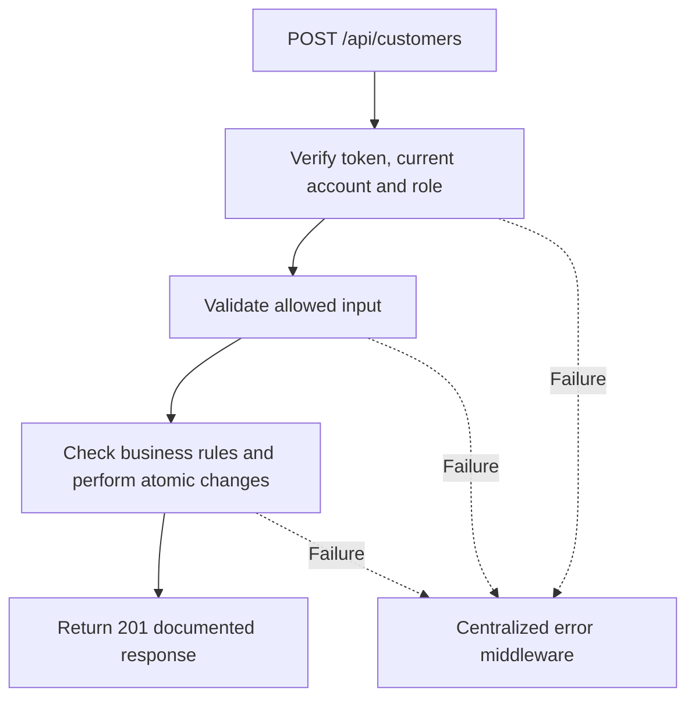

---

<!-- Source: customers/be-017-list-customers.md -->

# Task BE-017: List and search customers

**Endpoint**: `GET /api/customers`

**Owner**: Member 2 · **Priority**: Must · **Requirement**: FR-CUS-03

**Dependencies**: BE-003. Dependencies describe contracts and integration order; use fixtures to begin development before the corresponding endpoint is complete.

## 1. API Documentation

- **Method**: `GET`
- **URL**: `/api/customers`
- **Access**: Any active staff
- **Authentication**: `Authorization: Bearer <access_token>`
- **Content-Type**: `application/json`

### Request body

None. Do not send a JSON body.

### Query parameters example

```json
{
  "search": "sar",
  "active": true,
  "page": 1,
  "limit": 10
}
```

See [shared conventions](CONVENTIONS.md) for types, limits and defaults. All filters are optional. Endpoint-specific behavior is described below.

### Success response (200)

```json
{
  "status": "success",
  "message": "List and search customers successful",
  "data": {
    "customers": [
      {
        "customer_id": 12,
        "first_name": "Sara",
        "last_name": "Tesfaye",
        "email": "sara@example.com",
        "phone": "0912345678",
        "active": true,
        "created_at": "2026-10-25T12:00:00Z"
      }
    ],
    "pagination": {
      "page": 1,
      "limit": 10,
      "total": 1,
      "total_pages": 1
    }
  }
}
```

Examples use representative fixture records. Responses may have more/fewer array elements; fields and types are contractual. Nullable fields remain present as null. Where a task documents a restricted role projection, that projection replaces the general example for that role.

### Errors

- 400 Invalid input (unless this task specifies a different public-token rule)
- 401 Missing, invalid, expired or revoked access token
- 403 Inactive account or insufficient role
- 500 Unexpected server error

Shared error format (field errors apply to validation failures):

```json
{
  "status": "error",
  "message": "Validation failed",
  "data": {
    "errors": {
      "email": "Enter a valid email address"
    }
  }
}
```

Non-validation errors use `data: null`, except explicitly documented safe metadata. See [shared conventions](CONVENTIONS.md).

## 2. Instructions

1. Define route and middleware in `backend/src/api/customers/routes/customer.route.js`.
2. Add `listCustomersValidation` in `backend/src/api/customers/validations/customer.validation.js`.
3. Implement `listCustomersController` in `backend/src/api/customers/controller/customer.controller.js`. Extract allowlisted inputs and verified actor context only.
4. Implement `listCustomersService` in `backend/src/api/customers/service/customer.service.js`. Keep business rules and SQL out of controllers.
5. Share transactions, money/status helpers and notification adapter as described in foundation tasks; do not duplicate other modules’ logic.
6. On errors call `next(error)` from controller catches or use the shared async wrapper. Do not send competing error formats.

## 3. Logic & Git Instructions

### Logic steps

1. Filter by search across first_name,last_name,email,phone and optional active. Use common pagination and stable newest-first ordering.
2. Accept search of any nonempty length up to 100; the frontend starts searching after 3 characters. Use placeholders for every supplied value.

### Git workflow

```bash
git checkout dev
git pull --ff-only origin dev
git checkout -b codex/be-017-list-customers
# Implement and run task-specific checks
git add <changed-files>
git commit -m "[BE-017] List and search customers"
git push -u origin codex/be-017-list-customers
```

Open a PR into dev with requirement IDs, examples and test evidence. One teammate reviews. Coordinate shared route registration through Member 1; module files belong to their listed owner.

### PR checklist and acceptance criteria

- [ ] Successful request returns 200 and exactly the documented safe response shape.
- [ ] Missing/expired/revoked token returns401; inactive account and unauthorized role return403.
- [ ] Invalid/unknown input fields are rejected; no unexpected database changes occur on failure.
- [ ] GET has no data-changing side effects; list pagination/counts stay consistent.
- [ ] All errors go through centralized error middleware; no sensitive fields or stack traces escape.

## 4. Logic Diagram

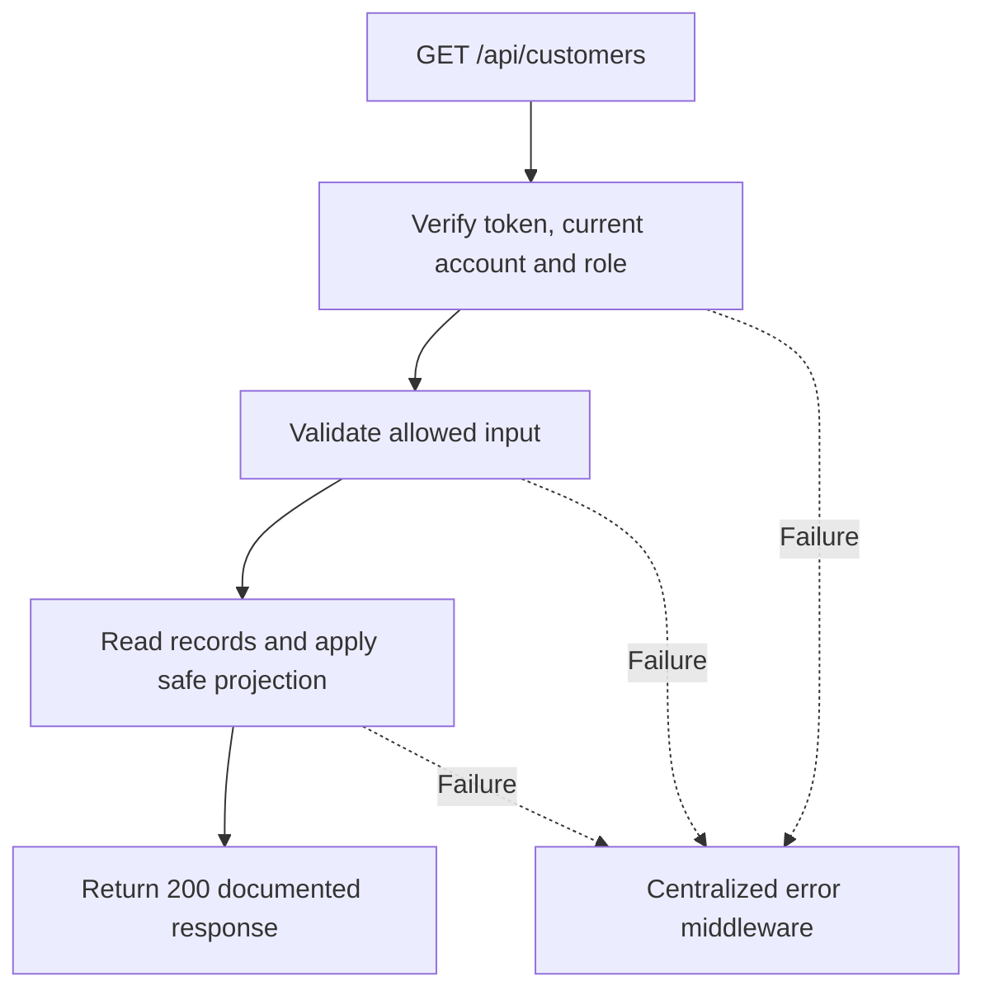

---

<!-- Source: customers/be-018-get-customer.md -->

# Task BE-018: View customer profile and financial summary

**Endpoint**: `GET /api/customers/:customer_id`

**Owner**: Member 2 · **Priority**: Must · **Requirement**: FR-CUS-05

**Dependencies**: BE-016, BE-003. Dependencies describe contracts and integration order; use fixtures to begin development before the corresponding endpoint is complete.

## 1. API Documentation

- **Method**: `GET`
- **URL**: `/api/customers/:customer_id`
- **Access**: Any active staff
- **Authentication**: `Authorization: Bearer <access_token>`
- **Content-Type**: `application/json`
- **Path parameters**: `customer_id` (positive integer)

### Request body

None. Do not send a JSON body.

### Success response (200)

```json
{
  "status": "success",
  "message": "View customer profile and financial summary successful",
  "data": {
    "customer_id": 12,
    "first_name": "Sara",
    "last_name": "Tesfaye",
    "email": "sara@example.com",
    "phone": "0912345678",
    "active": true,
    "created_at": "2026-10-25T12:00:00Z",
    "vehicles": [
      {
        "vehicle_id": 8,
        "customer_id": 12,
        "year": 2020,
        "make": "Toyota",
        "model": "Corolla",
        "type": "Sedan",
        "mileage": 65000,
        "plate": "AA-12345",
        "vin": "JTDBR32E720123456",
        "color": "White"
      }
    ],
    "recent_orders": [
      {
        "order_id": 24,
        "customer_id": 12,
        "customer_name": "Sara Tesfaye",
        "vehicle_id": 8,
        "plate": "AA-12345",
        "status": 1,
        "status_name": "Awaiting approval",
        "subtotal": "230.00",
        "vat_rate": "15.00",
        "vat_amount": "34.50",
        "total": "264.50",
        "currency": "ETB",
        "paid": false,
        "created_at": "2026-10-25T12:00:00Z",
        "estimated_ready_date": "2026-10-27T09:00:00Z",
        "completed_at": null
      }
    ],
    "order_count": 1,
    "unpaid_total": "264.50",
    "currency": "ETB"
  }
}
```

Examples use representative fixture records. Responses may have more/fewer array elements; fields and types are contractual. Nullable fields remain present as null. Where a task documents a restricted role projection, that projection replaces the general example for that role.

### Errors

- 400 Invalid input (unless this task specifies a different public-token rule)
- 401 Missing, invalid, expired or revoked access token
- 403 Inactive account or insufficient role
- 404 Customer not found
- 500 Unexpected server error

Shared error format (field errors apply to validation failures):

```json
{
  "status": "error",
  "message": "Validation failed",
  "data": {
    "errors": {
      "email": "Enter a valid email address"
    }
  }
}
```

Non-validation errors use `data: null`, except explicitly documented safe metadata. See [shared conventions](CONVENTIONS.md).

## 2. Instructions

1. Define route and middleware in `backend/src/api/customers/routes/customer.route.js`.
2. Add `getCustomerValidation` in `backend/src/api/customers/validations/customer.validation.js`.
3. Implement `getCustomerController` in `backend/src/api/customers/controller/customer.controller.js`. Extract allowlisted inputs and verified actor context only.
4. Implement `getCustomerService` in `backend/src/api/customers/service/customer.service.js`. Keep business rules and SQL out of controllers.
5. Share transactions, money/status helpers and notification adapter as described in foundation tasks; do not duplicate other modules’ logic.
6. On errors call `next(error)` from controller catches or use the shared async wrapper. Do not send competing error formats.

## 3. Logic & Git Instructions

### Logic steps

1. Fetch customer or return 404, including inactive records. Return all owned vehicles and the 10 most recent order summaries.
2. unpaid_total sums completed orders with paid=false using stored totals; exclude awaiting, approved, in-progress and declined orders.
3. Use GET /api/orders?customer_id=<id> for paginated full order history. Do not silently truncate without recent_orders and order_count naming.
4. This is staff-only; customer contact details must not be reused by public tracking DTOs.

### Git workflow

```bash
git checkout dev
git pull --ff-only origin dev
git checkout -b codex/be-018-get-customer
# Implement and run task-specific checks
git add <changed-files>
git commit -m "[BE-018] View customer profile and financial summary"
git push -u origin codex/be-018-get-customer
```

Open a PR into dev with requirement IDs, examples and test evidence. One teammate reviews. Coordinate shared route registration through Member 1; module files belong to their listed owner.

### PR checklist and acceptance criteria

- [ ] Successful request returns 200 and exactly the documented safe response shape.
- [ ] Missing/expired/revoked token returns401; inactive account and unauthorized role return403.
- [ ] Verify 404 Customer not found.
- [ ] Invalid/unknown input fields are rejected; no unexpected database changes occur on failure.
- [ ] GET has no data-changing side effects; list pagination/counts stay consistent.
- [ ] All errors go through centralized error middleware; no sensitive fields or stack traces escape.

## 4. Logic Diagram


---

<!-- Source: customers/be-019-update-customer.md -->

# Task BE-019: Edit or deactivate customer

**Endpoint**: `PATCH /api/customers/:customer_id`

**Owner**: Member 2 · **Priority**: Must · **Requirement**: FR-CUS-04 / NFR-07

**Dependencies**: BE-016. Dependencies describe contracts and integration order; use fixtures to begin development before the corresponding endpoint is complete.

## 1. API Documentation

- **Method**: `PATCH`
- **URL**: `/api/customers/:customer_id`
- **Access**: Manager or Admin
- **Authentication**: `Authorization: Bearer <access_token>`
- **Content-Type**: `application/json`
- **Path parameters**: `customer_id` (positive integer)

### Request body

```json
{
  "phone": "0912000000",
  "active": true
}
```

### Success response (200)

```json
{
  "status": "success",
  "message": "Edit or deactivate customer successful",
  "data": {
    "customer_id": 12,
    "first_name": "Sara",
    "last_name": "Tesfaye",
    "email": "sara@example.com",
    "phone": "0912000000",
    "active": true,
    "created_at": "2026-10-25T12:00:00Z"
  }
}
```

Examples use representative fixture records. Responses may have more/fewer array elements; fields and types are contractual. Nullable fields remain present as null. Where a task documents a restricted role projection, that projection replaces the general example for that role.

### Errors

- 400 Invalid input (unless this task specifies a different public-token rule)
- 401 Missing, invalid, expired or revoked access token
- 403 Inactive account or insufficient role
- 404 Customer not found
- 409 Customer email or phone already used
- 500 Unexpected server error

Shared error format (field errors apply to validation failures):

```json
{
  "status": "error",
  "message": "Validation failed",
  "data": {
    "errors": {
      "email": "Enter a valid email address"
    }
  }
}
```

Non-validation errors use `data: null`, except explicitly documented safe metadata. See [shared conventions](CONVENTIONS.md).

## 2. Instructions

1. Define route and middleware in `backend/src/api/customers/routes/customer.route.js`.
2. Add `updateCustomerValidation` in `backend/src/api/customers/validations/customer.validation.js`.
3. Implement `updateCustomerController` in `backend/src/api/customers/controller/customer.controller.js`. Extract allowlisted inputs and verified actor context only.
4. Implement `updateCustomerService` in `backend/src/api/customers/service/customer.service.js`. Keep business rules and SQL out of controllers.
5. Share transactions, money/status helpers and notification adapter as described in foundation tasks; do not duplicate other modules’ logic.
6. On errors call `next(error)` from controller catches or use the shared async wrapper. Do not send competing error formats.

## 3. Logic & Git Instructions

### Logic steps

1. Allow first_name,last_name,email,phone,active only; reject unknown fields/empty updates.
2. Enforce normalized unique email/phone. Retain record and historical orders when deactivated; no DELETE endpoint.
3. Inactive customers cannot be selected for new orders; their existing work can still be finished. Issued invoice snapshots are unaffected by profile edits.

### Git workflow

```bash
git checkout dev
git pull --ff-only origin dev
git checkout -b codex/be-019-update-customer
# Implement and run task-specific checks
git add <changed-files>
git commit -m "[BE-019] Edit or deactivate customer"
git push -u origin codex/be-019-update-customer
```

Open a PR into dev with requirement IDs, examples and test evidence. One teammate reviews. Coordinate shared route registration through Member 1; module files belong to their listed owner.

### PR checklist and acceptance criteria

- [ ] Successful request returns 200 and exactly the documented safe response shape.
- [ ] Missing/expired/revoked token returns401; inactive account and unauthorized role return403.
- [ ] Verify 404 Customer not found.
- [ ] Verify 409 Customer email or phone already used.
- [ ] Invalid/unknown input fields are rejected; no unexpected database changes occur on failure.
- [ ] Transaction/concurrency behavior and repeated-request behavior match the logic below.
- [ ] All errors go through centralized error middleware; no sensitive fields or stack traces escape.

## 4. Logic Diagram


---

<!-- Source: vehicles/be-020-create-vehicle.md -->

# Task BE-020: Add vehicle to customer

**Endpoint**: `POST /api/vehicles`

**Owner**: Member 2 · **Priority**: Must · **Requirement**: FR-VEH-01

**Dependencies**: BE-016. Dependencies describe contracts and integration order; use fixtures to begin development before the corresponding endpoint is complete.

## 1. API Documentation

- **Method**: `POST`
- **URL**: `/api/vehicles`
- **Access**: Manager or Admin
- **Authentication**: `Authorization: Bearer <access_token>`
- **Content-Type**: `application/json`

### Request body

```json
{
  "customer_id": 12,
  "year": 2020,
  "make": "Toyota",
  "model": "Corolla",
  "type": "Sedan",
  "mileage": 65000,
  "plate": "AA-12345",
  "vin": "JTDBR32E720123456",
  "color": "White"
}
```

### Success response (201)

```json
{
  "status": "success",
  "message": "Add vehicle to customer successful",
  "data": {
    "vehicle_id": 8,
    "customer_id": 12,
    "year": 2020,
    "make": "Toyota",
    "model": "Corolla",
    "type": "Sedan",
    "mileage": 65000,
    "plate": "AA-12345",
    "vin": "JTDBR32E720123456",
    "color": "White"
  }
}
```

Examples use representative fixture records. Responses may have more/fewer array elements; fields and types are contractual. Nullable fields remain present as null. Where a task documents a restricted role projection, that projection replaces the general example for that role.

### Errors

- 400 Invalid input (unless this task specifies a different public-token rule)
- 401 Missing, invalid, expired or revoked access token
- 403 Inactive account or insufficient role
- 404 Customer not found
- 409 Customer is inactive
- 409 Plate already used
- 500 Unexpected server error

Shared error format (field errors apply to validation failures):

```json
{
  "status": "error",
  "message": "Validation failed",
  "data": {
    "errors": {
      "email": "Enter a valid email address"
    }
  }
}
```

Non-validation errors use `data: null`, except explicitly documented safe metadata. See [shared conventions](CONVENTIONS.md).

## 2. Instructions

1. Define route and middleware in `backend/src/api/vehicles/routes/vehicle.route.js`.
2. Add `createVehicleValidation` in `backend/src/api/vehicles/validations/vehicle.validation.js`.
3. Implement `createVehicleController` in `backend/src/api/vehicles/controller/vehicle.controller.js`. Extract allowlisted inputs and verified actor context only.
4. Implement `createVehicleService` in `backend/src/api/vehicles/service/vehicle.service.js`. Keep business rules and SQL out of controllers.
5. Share transactions, money/status helpers and notification adapter as described in foundation tasks; do not duplicate other modules’ logic.
6. On errors call `next(error)` from controller catches or use the shared async wrapper. Do not send competing error formats.

## 3. Logic & Git Instructions

### Logic steps

1. Validate customer_id, year 1886 through current year+1, nonempty make/model/type/plate/color, and nonnegative integer mileage. VIN is optional, at most 32 characters; do not impose a universal VIN length on older vehicles.
2. Verify active customer. Normalize plate (trim/uppercase) and enforce uniqueness; VIN is not UNIQUE in this release.
3. Insert with customer foreign key; return 404 for missing customer, 409 for inactive customer or duplicate plate.

### Git workflow

```bash
git checkout dev
git pull --ff-only origin dev
git checkout -b codex/be-020-create-vehicle
# Implement and run task-specific checks
git add <changed-files>
git commit -m "[BE-020] Add vehicle to customer"
git push -u origin codex/be-020-create-vehicle
```

Open a PR into dev with requirement IDs, examples and test evidence. One teammate reviews. Coordinate shared route registration through Member 1; module files belong to their listed owner.

### PR checklist and acceptance criteria

- [ ] Successful request returns 201 and exactly the documented safe response shape.
- [ ] Missing/expired/revoked token returns401; inactive account and unauthorized role return403.
- [ ] Verify 404 Customer not found.
- [ ] Verify 409 Customer is inactive.
- [ ] Verify 409 Plate already used.
- [ ] Invalid/unknown input fields are rejected; no unexpected database changes occur on failure.
- [ ] Transaction/concurrency behavior and repeated-request behavior match the logic below.
- [ ] All errors go through centralized error middleware; no sensitive fields or stack traces escape.

## 4. Logic Diagram

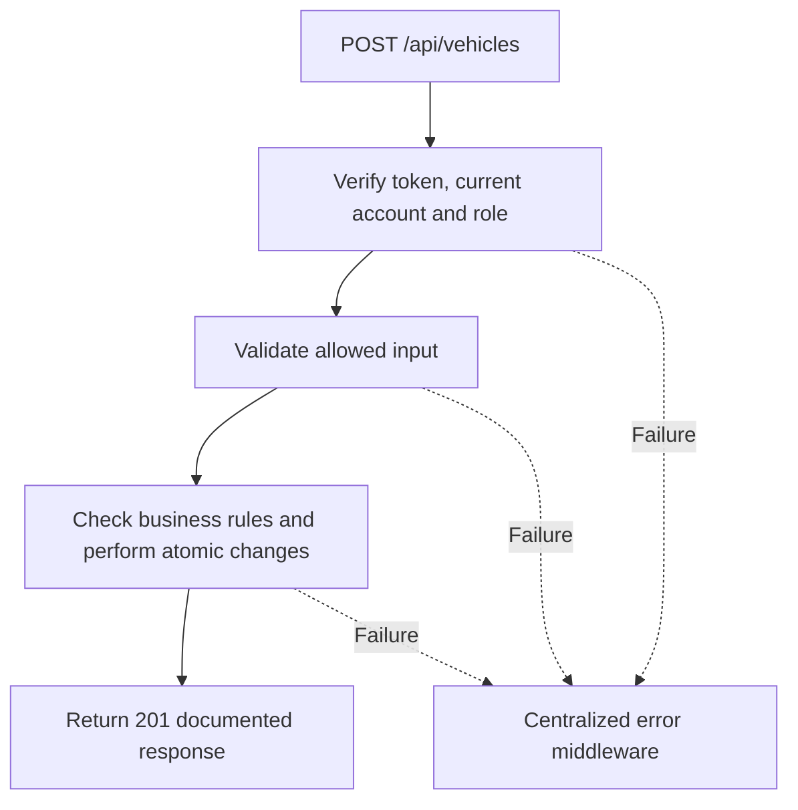

---

<!-- Source: vehicles/be-021-list-customer-vehicles.md -->

# Task BE-021: List a customer’s vehicles

**Endpoint**: `GET /api/customers/:customer_id/vehicles`

**Owner**: Member 2 · **Priority**: Must · **Requirement**: FR-VEH-01 / FR-ORD-01

**Dependencies**: BE-020. Dependencies describe contracts and integration order; use fixtures to begin development before the corresponding endpoint is complete.

## 1. API Documentation

- **Method**: `GET`
- **URL**: `/api/customers/:customer_id/vehicles`
- **Access**: Any active staff
- **Authentication**: `Authorization: Bearer <access_token>`
- **Content-Type**: `application/json`
- **Path parameters**: `customer_id` (positive integer)

### Request body

None. Do not send a JSON body.

### Success response (200)

```json
{
  "status": "success",
  "message": "List a customer’s vehicles successful",
  "data": {
    "customer_id": 12,
    "vehicles": [
      {
        "vehicle_id": 8,
        "customer_id": 12,
        "year": 2020,
        "make": "Toyota",
        "model": "Corolla",
        "type": "Sedan",
        "mileage": 65000,
        "plate": "AA-12345",
        "vin": "JTDBR32E720123456",
        "color": "White"
      }
    ]
  }
}
```

Examples use representative fixture records. Responses may have more/fewer array elements; fields and types are contractual. Nullable fields remain present as null. Where a task documents a restricted role projection, that projection replaces the general example for that role.

### Errors

- 400 Invalid input (unless this task specifies a different public-token rule)
- 401 Missing, invalid, expired or revoked access token
- 403 Inactive account or insufficient role
- 404 Customer not found
- 500 Unexpected server error

Shared error format (field errors apply to validation failures):

```json
{
  "status": "error",
  "message": "Validation failed",
  "data": {
    "errors": {
      "email": "Enter a valid email address"
    }
  }
}
```

Non-validation errors use `data: null`, except explicitly documented safe metadata. See [shared conventions](CONVENTIONS.md).

## 2. Instructions

1. Define route and middleware in `backend/src/api/vehicles/routes/vehicle.route.js`.
2. Add `listCustomerVehiclesValidation` in `backend/src/api/vehicles/validations/vehicle.validation.js`.
3. Implement `listCustomerVehiclesController` in `backend/src/api/vehicles/controller/vehicle.controller.js`. Extract allowlisted inputs and verified actor context only.
4. Implement `listCustomerVehiclesService` in `backend/src/api/vehicles/service/vehicle.service.js`. Keep business rules and SQL out of controllers.
5. Share transactions, money/status helpers and notification adapter as described in foundation tasks; do not duplicate other modules’ logic.
6. On errors call `next(error)` from controller catches or use the shared async wrapper. Do not send competing error formats.

## 3. Logic & Git Instructions

### Logic steps

1. Verify customer exists, then return owned vehicles ordered vehicle_id DESC. This small lookup is intentionally unpaginated to support order selection.
2. An existing customer with no vehicles returns vehicles=[]. Missing customer returns 404.

### Git workflow

```bash
git checkout dev
git pull --ff-only origin dev
git checkout -b codex/be-021-list-customer-vehicles
# Implement and run task-specific checks
git add <changed-files>
git commit -m "[BE-021] List a customer’s vehicles"
git push -u origin codex/be-021-list-customer-vehicles
```

Open a PR into dev with requirement IDs, examples and test evidence. One teammate reviews. Coordinate shared route registration through Member 1; module files belong to their listed owner.

### PR checklist and acceptance criteria

- [ ] Successful request returns 200 and exactly the documented safe response shape.
- [ ] Missing/expired/revoked token returns401; inactive account and unauthorized role return403.
- [ ] Verify 404 Customer not found.
- [ ] Invalid/unknown input fields are rejected; no unexpected database changes occur on failure.
- [ ] GET has no data-changing side effects; list pagination/counts stay consistent.
- [ ] All errors go through centralized error middleware; no sensitive fields or stack traces escape.

## 4. Logic Diagram

```mermaid
flowchart TD
    A["GET /api/customers/:customer_id/vehicles"] --> B["Verify token, current account and role"]
    B --> C["Validate allowed input"]
    C --> D["Read records and apply safe projection"]
    D --> E["Return 200 documented response"]
    B -. Failure .-> F["Centralized error middleware"]
    C -. Failure .-> F
    D -. Failure .-> F
```

---

<!-- Source: vehicles/be-022-get-vehicle.md -->

# Task BE-022: View vehicle

**Endpoint**: `GET /api/vehicles/:vehicle_id`

**Owner**: Member 2 · **Priority**: Must · **Requirement**: FR-VEH-03

**Dependencies**: BE-020. Dependencies describe contracts and integration order; use fixtures to begin development before the corresponding endpoint is complete.

## 1. API Documentation

- **Method**: `GET`
- **URL**: `/api/vehicles/:vehicle_id`
- **Access**: Any active staff
- **Authentication**: `Authorization: Bearer <access_token>`
- **Content-Type**: `application/json`
- **Path parameters**: `vehicle_id` (positive integer)

### Request body

None. Do not send a JSON body.

### Success response (200)

```json
{
  "status": "success",
  "message": "View vehicle successful",
  "data": {
    "vehicle_id": 8,
    "customer_id": 12,
    "year": 2020,
    "make": "Toyota",
    "model": "Corolla",
    "type": "Sedan",
    "mileage": 65000,
    "plate": "AA-12345",
    "vin": "JTDBR32E720123456",
    "color": "White"
  }
}
```

Examples use representative fixture records. Responses may have more/fewer array elements; fields and types are contractual. Nullable fields remain present as null. Where a task documents a restricted role projection, that projection replaces the general example for that role.

### Errors

- 400 Invalid input (unless this task specifies a different public-token rule)
- 401 Missing, invalid, expired or revoked access token
- 403 Inactive account or insufficient role
- 404 Vehicle not found
- 500 Unexpected server error

Shared error format (field errors apply to validation failures):

```json
{
  "status": "error",
  "message": "Validation failed",
  "data": {
    "errors": {
      "email": "Enter a valid email address"
    }
  }
}
```

Non-validation errors use `data: null`, except explicitly documented safe metadata. See [shared conventions](CONVENTIONS.md).

## 2. Instructions

1. Define route and middleware in `backend/src/api/vehicles/routes/vehicle.route.js`.
2. Add `getVehicleValidation` in `backend/src/api/vehicles/validations/vehicle.validation.js`.
3. Implement `getVehicleController` in `backend/src/api/vehicles/controller/vehicle.controller.js`. Extract allowlisted inputs and verified actor context only.
4. Implement `getVehicleService` in `backend/src/api/vehicles/service/vehicle.service.js`. Keep business rules and SQL out of controllers.
5. Share transactions, money/status helpers and notification adapter as described in foundation tasks; do not duplicate other modules’ logic.
6. On errors call `next(error)` from controller catches or use the shared async wrapper. Do not send competing error formats.

## 3. Logic & Git Instructions

### Logic steps

1. Validate vehicle_id; return vehicle or 404. Full service history uses the dedicated paginated endpoint.

### Git workflow

```bash
git checkout dev
git pull --ff-only origin dev
git checkout -b codex/be-022-get-vehicle
# Implement and run task-specific checks
git add <changed-files>
git commit -m "[BE-022] View vehicle"
git push -u origin codex/be-022-get-vehicle
```

Open a PR into dev with requirement IDs, examples and test evidence. One teammate reviews. Coordinate shared route registration through Member 1; module files belong to their listed owner.

### PR checklist and acceptance criteria

- [ ] Successful request returns 200 and exactly the documented safe response shape.
- [ ] Missing/expired/revoked token returns401; inactive account and unauthorized role return403.
- [ ] Verify 404 Vehicle not found.
- [ ] Invalid/unknown input fields are rejected; no unexpected database changes occur on failure.
- [ ] GET has no data-changing side effects; list pagination/counts stay consistent.
- [ ] All errors go through centralized error middleware; no sensitive fields or stack traces escape.

## 4. Logic Diagram

```mermaid
flowchart TD
    A["GET /api/vehicles/:vehicle_id"] --> B["Verify token, current account and role"]
    B --> C["Validate allowed input"]
    C --> D["Read records and apply safe projection"]
    D --> E["Return 200 documented response"]
    B -. Failure .-> F["Centralized error middleware"]
    C -. Failure .-> F
    D -. Failure .-> F
```

---

<!-- Source: vehicles/be-023-update-vehicle.md -->

# Task BE-023: Edit vehicle details

**Endpoint**: `PATCH /api/vehicles/:vehicle_id`

**Owner**: Member 2 · **Priority**: Must · **Requirement**: FR-VEH-03

**Dependencies**: BE-020. Dependencies describe contracts and integration order; use fixtures to begin development before the corresponding endpoint is complete.

## 1. API Documentation

- **Method**: `PATCH`
- **URL**: `/api/vehicles/:vehicle_id`
- **Access**: Manager or Admin
- **Authentication**: `Authorization: Bearer <access_token>`
- **Content-Type**: `application/json`
- **Path parameters**: `vehicle_id` (positive integer)

### Request body

```json
{
  "mileage": 66500,
  "color": "Silver"
}
```

### Success response (200)

```json
{
  "status": "success",
  "message": "Edit vehicle details successful",
  "data": {
    "vehicle_id": 8,
    "customer_id": 12,
    "year": 2020,
    "make": "Toyota",
    "model": "Corolla",
    "type": "Sedan",
    "mileage": 66500,
    "plate": "AA-12345",
    "vin": "JTDBR32E720123456",
    "color": "Silver"
  }
}
```

Examples use representative fixture records. Responses may have more/fewer array elements; fields and types are contractual. Nullable fields remain present as null. Where a task documents a restricted role projection, that projection replaces the general example for that role.

### Errors

- 400 Invalid input (unless this task specifies a different public-token rule)
- 401 Missing, invalid, expired or revoked access token
- 403 Inactive account or insufficient role
- 404 Vehicle not found
- 409 Plate already used
- 409 Mileage cannot decrease
- 500 Unexpected server error

Shared error format (field errors apply to validation failures):

```json
{
  "status": "error",
  "message": "Validation failed",
  "data": {
    "errors": {
      "email": "Enter a valid email address"
    }
  }
}
```

Non-validation errors use `data: null`, except explicitly documented safe metadata. See [shared conventions](CONVENTIONS.md).

## 2. Instructions

1. Define route and middleware in `backend/src/api/vehicles/routes/vehicle.route.js`.
2. Add `updateVehicleValidation` in `backend/src/api/vehicles/validations/vehicle.validation.js`.
3. Implement `updateVehicleController` in `backend/src/api/vehicles/controller/vehicle.controller.js`. Extract allowlisted inputs and verified actor context only.
4. Implement `updateVehicleService` in `backend/src/api/vehicles/service/vehicle.service.js`. Keep business rules and SQL out of controllers.
5. Share transactions, money/status helpers and notification adapter as described in foundation tasks; do not duplicate other modules’ logic.
6. On errors call `next(error)` from controller catches or use the shared async wrapper. Do not send competing error formats.

## 3. Logic & Git Instructions

### Logic steps

1. Allow year,make,model,type,mileage,plate,vin,color. customer_id cannot be changed in this release because it would change ownership assumptions in historical orders.
2. Validate using create rules; require at least one allowed field. Mileage must not decrease (409); duplicate plate is 409.
3. Return updated vehicle. Issued invoice snapshots remain unchanged; current vehicle profile reflects new details.

### Git workflow

```bash
git checkout dev
git pull --ff-only origin dev
git checkout -b codex/be-023-update-vehicle
# Implement and run task-specific checks
git add <changed-files>
git commit -m "[BE-023] Edit vehicle details"
git push -u origin codex/be-023-update-vehicle
```

Open a PR into dev with requirement IDs, examples and test evidence. One teammate reviews. Coordinate shared route registration through Member 1; module files belong to their listed owner.

### PR checklist and acceptance criteria

- [ ] Successful request returns 200 and exactly the documented safe response shape.
- [ ] Missing/expired/revoked token returns401; inactive account and unauthorized role return403.
- [ ] Verify 404 Vehicle not found.
- [ ] Verify 409 Plate already used.
- [ ] Verify 409 Mileage cannot decrease.
- [ ] Invalid/unknown input fields are rejected; no unexpected database changes occur on failure.
- [ ] Transaction/concurrency behavior and repeated-request behavior match the logic below.
- [ ] All errors go through centralized error middleware; no sensitive fields or stack traces escape.

## 4. Logic Diagram

```mermaid
flowchart TD
    A["PATCH /api/vehicles/:vehicle_id"] --> B["Verify token, current account and role"]
    B --> C["Validate allowed input"]
    C --> D["Check business rules and perform atomic changes"]
    D --> E["Return 200 documented response"]
    B -. Failure .-> F["Centralized error middleware"]
    C -. Failure .-> F
    D -. Failure .-> F
```

---

<!-- Source: vehicles/be-024-vehicle-history.md -->

# Task BE-024: View vehicle service history

**Endpoint**: `GET /api/vehicles/:vehicle_id/orders`

**Owner**: Member 2 · **Priority**: Should · **Requirement**: FR-VEH-04

**Dependencies**: BE-022. Dependencies describe contracts and integration order; use fixtures to begin development before the corresponding endpoint is complete.

## 1. API Documentation

- **Method**: `GET`
- **URL**: `/api/vehicles/:vehicle_id/orders`
- **Access**: Any active staff
- **Authentication**: `Authorization: Bearer <access_token>`
- **Content-Type**: `application/json`
- **Path parameters**: `vehicle_id` (positive integer)

### Request body

None. Do not send a JSON body.

### Query parameters example

```json
{
  "page": 1,
  "limit": 10
}
```

See [shared conventions](CONVENTIONS.md) for types, limits and defaults. All filters are optional. Endpoint-specific behavior is described below.

### Success response (200)

```json
{
  "status": "success",
  "message": "View vehicle service history successful",
  "data": {
    "orders": [
      {
        "order_id": 24,
        "customer_id": 12,
        "customer_name": "Sara Tesfaye",
        "vehicle_id": 8,
        "plate": "AA-12345",
        "status": 1,
        "status_name": "Awaiting approval",
        "subtotal": "230.00",
        "vat_rate": "15.00",
        "vat_amount": "34.50",
        "total": "264.50",
        "currency": "ETB",
        "paid": false,
        "created_at": "2026-10-25T12:00:00Z",
        "estimated_ready_date": "2026-10-27T09:00:00Z",
        "completed_at": null,
        "jobs": [
          {
            "service_name": "Oil change",
            "line_price": "50.00"
          },
          {
            "service_name": "Brake service",
            "line_price": "180.00"
          }
        ]
      }
    ],
    "pagination": {
      "page": 1,
      "limit": 10,
      "total": 1,
      "total_pages": 1
    }
  }
}
```

Examples use representative fixture records. Responses may have more/fewer array elements; fields and types are contractual. Nullable fields remain present as null. Where a task documents a restricted role projection, that projection replaces the general example for that role.

### Errors

- 400 Invalid input (unless this task specifies a different public-token rule)
- 401 Missing, invalid, expired or revoked access token
- 403 Inactive account or insufficient role
- 404 Vehicle not found
- 500 Unexpected server error

Shared error format (field errors apply to validation failures):

```json
{
  "status": "error",
  "message": "Validation failed",
  "data": {
    "errors": {
      "email": "Enter a valid email address"
    }
  }
}
```

Non-validation errors use `data: null`, except explicitly documented safe metadata. See [shared conventions](CONVENTIONS.md).

## 2. Instructions

1. Define route and middleware in `backend/src/api/vehicles/routes/vehicle.route.js`.
2. Add `vehicleHistoryValidation` in `backend/src/api/vehicles/validations/vehicle.validation.js`.
3. Implement `vehicleHistoryController` in `backend/src/api/vehicles/controller/vehicle.controller.js`. Extract allowlisted inputs and verified actor context only.
4. Implement `vehicleHistoryService` in `backend/src/api/vehicles/service/vehicle.service.js`. Keep business rules and SQL out of controllers.
5. Share transactions, money/status helpers and notification adapter as described in foundation tasks; do not duplicate other modules’ logic.
6. On errors call `next(error)` from controller catches or use the shared async wrapper. Do not send competing error formats.

## 3. Logic & Git Instructions

### Logic steps

1. Verify vehicle exists; return paginated order history including date,status,jobs,total and paid flag for this vehicle only.
2. Use stored line snapshots and prices, not current catalogue prices. Order newest first.

### Git workflow

```bash
git checkout dev
git pull --ff-only origin dev
git checkout -b codex/be-024-vehicle-history
# Implement and run task-specific checks
git add <changed-files>
git commit -m "[BE-024] View vehicle service history"
git push -u origin codex/be-024-vehicle-history
```

Open a PR into dev with requirement IDs, examples and test evidence. One teammate reviews. Coordinate shared route registration through Member 1; module files belong to their listed owner.

### PR checklist and acceptance criteria

- [ ] Successful request returns 200 and exactly the documented safe response shape.
- [ ] Missing/expired/revoked token returns401; inactive account and unauthorized role return403.
- [ ] Verify 404 Vehicle not found.
- [ ] Invalid/unknown input fields are rejected; no unexpected database changes occur on failure.
- [ ] GET has no data-changing side effects; list pagination/counts stay consistent.
- [ ] All errors go through centralized error middleware; no sensitive fields or stack traces escape.

## 4. Logic Diagram

```mermaid
flowchart TD
    A["GET /api/vehicles/:vehicle_id/orders"] --> B["Verify token, current account and role"]
    B --> C["Validate allowed input"]
    C --> D["Read records and apply safe projection"]
    D --> E["Return 200 documented response"]
    B -. Failure .-> F["Centralized error middleware"]
    C -. Failure .-> F
    D -. Failure .-> F
```

---

<!-- Source: services/be-025-create-service.md -->

# Task BE-025: Create repair service

**Endpoint**: `POST /api/services`

**Owner**: Member 2 · **Priority**: Must · **Requirement**: FR-SRV-01

**Dependencies**: BE-003. Dependencies describe contracts and integration order; use fixtures to begin development before the corresponding endpoint is complete.

## 1. API Documentation

- **Method**: `POST`
- **URL**: `/api/services`
- **Access**: Admin
- **Authentication**: `Authorization: Bearer <access_token>`
- **Content-Type**: `application/json`

### Request body

```json
{
  "name": "Oil change",
  "description": "Replace engine oil and filter",
  "price": "50.00",
  "labor_hours": "0.50",
  "active": true
}
```

### Success response (201)

```json
{
  "status": "success",
  "message": "Create repair service successful",
  "data": {
    "service_id": 3,
    "name": "Oil change",
    "description": "Replace engine oil and filter",
    "price": "50.00",
    "labor_hours": "0.50",
    "active": true
  }
}
```

Examples use representative fixture records. Responses may have more/fewer array elements; fields and types are contractual. Nullable fields remain present as null. Where a task documents a restricted role projection, that projection replaces the general example for that role.

### Errors

- 400 Invalid input (unless this task specifies a different public-token rule)
- 401 Missing, invalid, expired or revoked access token
- 403 Inactive account or insufficient role
- 409 Service name already used
- 500 Unexpected server error

Shared error format (field errors apply to validation failures):

```json
{
  "status": "error",
  "message": "Validation failed",
  "data": {
    "errors": {
      "email": "Enter a valid email address"
    }
  }
}
```

Non-validation errors use `data: null`, except explicitly documented safe metadata. See [shared conventions](CONVENTIONS.md).

## 2. Instructions

1. Define route and middleware in `backend/src/api/services/routes/service.route.js`.
2. Add `createServiceValidation` in `backend/src/api/services/validations/service.validation.js`.
3. Implement `createServiceController` in `backend/src/api/services/controller/service.controller.js`. Extract allowlisted inputs and verified actor context only.
4. Implement `createServiceService` in `backend/src/api/services/service/service.service.js`. Keep business rules and SQL out of controllers.
5. Share transactions, money/status helpers and notification adapter as described in foundation tasks; do not duplicate other modules’ logic.
6. On errors call `next(error)` from controller catches or use the shared async wrapper. Do not send competing error formats.

## 3. Logic & Git Instructions

### Logic steps

1. Validate unique trimmed name (1–150), description (1–2000), price as nonnegative decimal with at most 2 fractional digits, labor_hours as nonnegative decimal (2 fractional digits), active boolean.
2. Store price before VAT in DECIMAL, active defaults true. Return created service. Existing service names are unique as shown in the agreed ER diagram.

### Git workflow

```bash
git checkout dev
git pull --ff-only origin dev
git checkout -b codex/be-025-create-service
# Implement and run task-specific checks
git add <changed-files>
git commit -m "[BE-025] Create repair service"
git push -u origin codex/be-025-create-service
```

Open a PR into dev with requirement IDs, examples and test evidence. One teammate reviews. Coordinate shared route registration through Member 1; module files belong to their listed owner.

### PR checklist and acceptance criteria

- [ ] Successful request returns 201 and exactly the documented safe response shape.
- [ ] Missing/expired/revoked token returns401; inactive account and unauthorized role return403.
- [ ] Verify 409 Service name already used.
- [ ] Invalid/unknown input fields are rejected; no unexpected database changes occur on failure.
- [ ] Transaction/concurrency behavior and repeated-request behavior match the logic below.
- [ ] All errors go through centralized error middleware; no sensitive fields or stack traces escape.

## 4. Logic Diagram

```mermaid
flowchart TD
    A["POST /api/services"] --> B["Verify token, current account and role"]
    B --> C["Validate allowed input"]
    C --> D["Check business rules and perform atomic changes"]
    D --> E["Return 201 documented response"]
    B -. Failure .-> F["Centralized error middleware"]
    C -. Failure .-> F
    D -. Failure .-> F
```

---

<!-- Source: services/be-026-list-services.md -->

# Task BE-026: List staff service catalogue

**Endpoint**: `GET /api/services`

**Owner**: Member 2 · **Priority**: Must · **Requirement**: FR-SRV-01/02/03

**Dependencies**: BE-003. Dependencies describe contracts and integration order; use fixtures to begin development before the corresponding endpoint is complete.

## 1. API Documentation

- **Method**: `GET`
- **URL**: `/api/services`
- **Access**: Any active staff
- **Authentication**: `Authorization: Bearer <access_token>`
- **Content-Type**: `application/json`

### Request body

None. Do not send a JSON body.

### Query parameters example

```json
{
  "search": "oil",
  "active": true,
  "page": 1,
  "limit": 10
}
```

See [shared conventions](CONVENTIONS.md) for types, limits and defaults. All filters are optional. Endpoint-specific behavior is described below.

### Success response (200)

```json
{
  "status": "success",
  "message": "List staff service catalogue successful",
  "data": {
    "services": [
      {
        "service_id": 3,
        "name": "Oil change",
        "description": "Replace engine oil and filter",
        "price": "50.00",
        "labor_hours": "0.50",
        "active": true
      }
    ],
    "pagination": {
      "page": 1,
      "limit": 10,
      "total": 1,
      "total_pages": 1
    }
  }
}
```

Examples use representative fixture records. Responses may have more/fewer array elements; fields and types are contractual. Nullable fields remain present as null. Where a task documents a restricted role projection, that projection replaces the general example for that role.

### Errors

- 400 Invalid input (unless this task specifies a different public-token rule)
- 401 Missing, invalid, expired or revoked access token
- 403 Inactive account or insufficient role
- 500 Unexpected server error

Shared error format (field errors apply to validation failures):

```json
{
  "status": "error",
  "message": "Validation failed",
  "data": {
    "errors": {
      "email": "Enter a valid email address"
    }
  }
}
```

Non-validation errors use `data: null`, except explicitly documented safe metadata. See [shared conventions](CONVENTIONS.md).

## 2. Instructions

1. Define route and middleware in `backend/src/api/services/routes/service.route.js`.
2. Add `listServicesValidation` in `backend/src/api/services/validations/service.validation.js`.
3. Implement `listServicesController` in `backend/src/api/services/controller/service.controller.js`. Extract allowlisted inputs and verified actor context only.
4. Implement `listServicesService` in `backend/src/api/services/service/service.service.js`. Keep business rules and SQL out of controllers.
5. Share transactions, money/status helpers and notification adapter as described in foundation tasks; do not duplicate other modules’ logic.
6. On errors call `next(error)` from controller catches or use the shared async wrapper. Do not send competing error formats.

## 3. Logic & Git Instructions

### Logic steps

1. Support search on name/description and active filter. Include inactive by default for staff; order selection requests active=true.
2. Use pagination with default 10 and max 100; order name ASC,service_id ASC. Consumers needing every active item must request all pages, not assume page 1 is complete.

### Git workflow

```bash
git checkout dev
git pull --ff-only origin dev
git checkout -b codex/be-026-list-services
# Implement and run task-specific checks
git add <changed-files>
git commit -m "[BE-026] List staff service catalogue"
git push -u origin codex/be-026-list-services
```

Open a PR into dev with requirement IDs, examples and test evidence. One teammate reviews. Coordinate shared route registration through Member 1; module files belong to their listed owner.

### PR checklist and acceptance criteria

- [ ] Successful request returns 200 and exactly the documented safe response shape.
- [ ] Missing/expired/revoked token returns401; inactive account and unauthorized role return403.
- [ ] Invalid/unknown input fields are rejected; no unexpected database changes occur on failure.
- [ ] GET has no data-changing side effects; list pagination/counts stay consistent.
- [ ] All errors go through centralized error middleware; no sensitive fields or stack traces escape.

## 4. Logic Diagram

```mermaid
flowchart TD
    A["GET /api/services"] --> B["Verify token, current account and role"]
    B --> C["Validate allowed input"]
    C --> D["Read records and apply safe projection"]
    D --> E["Return 200 documented response"]
    B -. Failure .-> F["Centralized error middleware"]
    C -. Failure .-> F
    D -. Failure .-> F
```

---

<!-- Source: services/be-027-update-service.md -->

# Task BE-027: Edit or deactivate service

**Endpoint**: `PATCH /api/services/:service_id`

**Owner**: Member 2 · **Priority**: Must · **Requirement**: FR-SRV-02/03

**Dependencies**: BE-025. Dependencies describe contracts and integration order; use fixtures to begin development before the corresponding endpoint is complete.

## 1. API Documentation

- **Method**: `PATCH`
- **URL**: `/api/services/:service_id`
- **Access**: Admin
- **Authentication**: `Authorization: Bearer <access_token>`
- **Content-Type**: `application/json`
- **Path parameters**: `service_id` (positive integer)

### Request body

```json
{
  "price": "55.00",
  "active": true
}
```

### Success response (200)

```json
{
  "status": "success",
  "message": "Edit or deactivate service successful",
  "data": {
    "service_id": 3,
    "name": "Oil change",
    "description": "Replace engine oil and filter",
    "price": "55.00",
    "labor_hours": "0.50",
    "active": true
  }
}
```

Examples use representative fixture records. Responses may have more/fewer array elements; fields and types are contractual. Nullable fields remain present as null. Where a task documents a restricted role projection, that projection replaces the general example for that role.

### Errors

- 400 Invalid input (unless this task specifies a different public-token rule)
- 401 Missing, invalid, expired or revoked access token
- 403 Inactive account or insufficient role
- 404 Service not found
- 409 Service name already used
- 500 Unexpected server error

Shared error format (field errors apply to validation failures):

```json
{
  "status": "error",
  "message": "Validation failed",
  "data": {
    "errors": {
      "email": "Enter a valid email address"
    }
  }
}
```

Non-validation errors use `data: null`, except explicitly documented safe metadata. See [shared conventions](CONVENTIONS.md).

## 2. Instructions

1. Define route and middleware in `backend/src/api/services/routes/service.route.js`.
2. Add `updateServiceValidation` in `backend/src/api/services/validations/service.validation.js`.
3. Implement `updateServiceController` in `backend/src/api/services/controller/service.controller.js`. Extract allowlisted inputs and verified actor context only.
4. Implement `updateServiceService` in `backend/src/api/services/service/service.service.js`. Keep business rules and SQL out of controllers.
5. Share transactions, money/status helpers and notification adapter as described in foundation tasks; do not duplicate other modules’ logic.
6. On errors call `next(error)` from controller catches or use the shared async wrapper. Do not send competing error formats.

## 3. Logic & Git Instructions

### Logic steps

1. Allow name,description,price,labor_hours,active using create validation; reject empty or unknown input.
2. Never change existing order_lines when the catalogue changes. Deactivation hides service from new-order choices and public results, while keeping historical links.

### Git workflow

```bash
git checkout dev
git pull --ff-only origin dev
git checkout -b codex/be-027-update-service
# Implement and run task-specific checks
git add <changed-files>
git commit -m "[BE-027] Edit or deactivate service"
git push -u origin codex/be-027-update-service
```

Open a PR into dev with requirement IDs, examples and test evidence. One teammate reviews. Coordinate shared route registration through Member 1; module files belong to their listed owner.

### PR checklist and acceptance criteria

- [ ] Successful request returns 200 and exactly the documented safe response shape.
- [ ] Missing/expired/revoked token returns401; inactive account and unauthorized role return403.
- [ ] Verify 404 Service not found.
- [ ] Verify 409 Service name already used.
- [ ] Invalid/unknown input fields are rejected; no unexpected database changes occur on failure.
- [ ] Transaction/concurrency behavior and repeated-request behavior match the logic below.
- [ ] All errors go through centralized error middleware; no sensitive fields or stack traces escape.

## 4. Logic Diagram

```mermaid
flowchart TD
    A["PATCH /api/services/:service_id"] --> B["Verify token, current account and role"]
    B --> C["Validate allowed input"]
    C --> D["Check business rules and perform atomic changes"]
    D --> E["Return 200 documented response"]
    B -. Failure .-> F["Centralized error middleware"]
    C -. Failure .-> F
    D -. Failure .-> F
```

---

<!-- Source: services/be-028-public-services.md -->

# Task BE-028: Read public services and prices

**Endpoint**: `GET /api/public/services`

**Owner**: Member 2 · **Priority**: Should (scope overlap resolved for release) · **Requirement**: FR-SRV-04 / FR-WEB-02

**Dependencies**: BE-025. Dependencies describe contracts and integration order; use fixtures to begin development before the corresponding endpoint is complete.

## 1. API Documentation

- **Method**: `GET`
- **URL**: `/api/public/services`
- **Access**: Public
- **Authentication**: `None`
- **Content-Type**: `application/json`

### Request body

None. Do not send a JSON body.

### Query parameters example

```json
{
  "search": "oil",
  "page": 1,
  "limit": 10
}
```

See [shared conventions](CONVENTIONS.md) for types, limits and defaults. All filters are optional. Endpoint-specific behavior is described below.

### Success response (200)

```json
{
  "status": "success",
  "message": "Read public services and prices successful",
  "data": {
    "services": [
      {
        "service_id": 3,
        "name": "Oil change",
        "description": "Replace engine oil and filter",
        "price": "50.00",
        "labor_hours": "0.50",
        "price_includes_vat": false,
        "currency": "ETB"
      }
    ],
    "pagination": {
      "page": 1,
      "limit": 10,
      "total": 1,
      "total_pages": 1
    }
  }
}
```

Examples use representative fixture records. Responses may have more/fewer array elements; fields and types are contractual. Nullable fields remain present as null. Where a task documents a restricted role projection, that projection replaces the general example for that role.

### Errors

- 400 Invalid input (unless this task specifies a different public-token rule)
- 429 Too many requests
- 500 Unexpected server error

Shared error format (field errors apply to validation failures):

```json
{
  "status": "error",
  "message": "Validation failed",
  "data": {
    "errors": {
      "email": "Enter a valid email address"
    }
  }
}
```

Non-validation errors use `data: null`, except explicitly documented safe metadata. See [shared conventions](CONVENTIONS.md).

## 2. Instructions

1. Define route and middleware in `backend/src/api/services/routes/service.route.js`.
2. Add `publicServicesValidation` in `backend/src/api/services/validations/service.validation.js`.
3. Implement `publicServicesController` in `backend/src/api/services/controller/service.controller.js`. Extract allowlisted inputs and verified actor context only.
4. Implement `publicServicesService` in `backend/src/api/services/service/service.service.js`. Keep business rules and SQL out of controllers.
5. Share transactions, money/status helpers and notification adapter as described in foundation tasks; do not duplicate other modules’ logic.
6. On errors call `next(error)` from controller catches or use the shared async wrapper. Do not send competing error formats.

## 3. Logic & Git Instructions

### Logic steps

1. Always filter active=true. Return an explicit public projection only; do not expose staff, credentials or inactive service records.
2. Support search and common pagination, stable name/service_id order. Prices are before VAT; label this explicitly. No auth required.

### Git workflow

```bash
git checkout dev
git pull --ff-only origin dev
git checkout -b codex/be-028-public-services
# Implement and run task-specific checks
git add <changed-files>
git commit -m "[BE-028] Read public services and prices"
git push -u origin codex/be-028-public-services
```

Open a PR into dev with requirement IDs, examples and test evidence. One teammate reviews. Coordinate shared route registration through Member 1; module files belong to their listed owner.

### PR checklist and acceptance criteria

- [ ] Successful request returns 200 and exactly the documented safe response shape.
- [ ] Works without staff login; applies documented rate limits and public-field restrictions.
- [ ] Verify 429 Too many requests.
- [ ] Invalid/unknown input fields are rejected; no unexpected database changes occur on failure.
- [ ] GET has no data-changing side effects; list pagination/counts stay consistent.
- [ ] All errors go through centralized error middleware; no sensitive fields or stack traces escape.

## 4. Logic Diagram

```mermaid
flowchart TD
    A["GET /api/public/services"] --> B["Validate public request and apply rate limits"]
    B --> C["Validate allowed input"]
    C --> D["Read records and apply safe projection"]
    D --> E["Return 200 documented response"]
    B -. Failure .-> F["Centralized error middleware"]
    C -. Failure .-> F
    D -. Failure .-> F
```

---

<!-- Source: orders/be-029-create-order.md -->

# Task BE-029: Create repair order and estimate

**Endpoint**: `POST /api/orders`

**Owner**: Member 3 · **Priority**: Must · **Requirement**: FR-ORD-01/02/04 / FR-TRK-01/05/06

**Dependencies**: BE-003, BE-016, BE-020, BE-025, BE-043. Dependencies describe contracts and integration order; use fixtures to begin development before the corresponding endpoint is complete.

## 1. API Documentation

- **Method**: `POST`
- **URL**: `/api/orders`
- **Access**: Manager or Admin
- **Authentication**: `Authorization: Bearer <access_token>`
- **Content-Type**: `application/json`

### Request body

```json
{
  "customer_id": 12,
  "vehicle_id": 8,
  "lines": [
    {
      "service_id": 3
    },
    {
      "service_id": 4
    }
  ],
  "estimated_ready_date": "2026-10-27T09:00:00Z",
  "notes_for_customer": "Please call before collection.",
  "internal_notes": "Check previous repair record."
}
```

### Success response (201)

```json
{
  "status": "success",
  "message": "Create repair order and estimate successful",
  "data": {
    "order_id": 24,
    "customer_id": 12,
    "customer_name": "Sara Tesfaye",
    "vehicle_id": 8,
    "plate": "AA-12345",
    "status": 1,
    "status_name": "Awaiting approval",
    "subtotal": "230.00",
    "vat_rate": "15.00",
    "vat_amount": "34.50",
    "total": "264.50",
    "currency": "ETB",
    "paid": false,
    "created_at": "2026-10-25T12:00:00Z",
    "estimated_ready_date": "2026-10-27T09:00:00Z",
    "completed_at": null,
    "created_by": 2,
    "order_hash": "7da3e09c8bb1fa52d17e25ccafd8ec144c9bf744f806d48160a1e0b2ba7f35ca2",
    "tracking_url": "https://garage.example/order-status/7da3e09c8bb1fa52d17e25ccafd8ec144c9bf744f806d48160a1e0b2ba7f35ca2",
    "customer": {
      "customer_id": 12,
      "first_name": "Sara",
      "last_name": "Tesfaye",
      "email": "sara@example.com",
      "phone": "0912345678",
      "active": true,
      "created_at": "2026-10-25T12:00:00Z"
    },
    "vehicle": {
      "vehicle_id": 8,
      "customer_id": 12,
      "year": 2020,
      "make": "Toyota",
      "model": "Corolla",
      "type": "Sedan",
      "mileage": 65000,
      "plate": "AA-12345",
      "vin": "JTDBR32E720123456",
      "color": "White"
    },
    "lines": [
      {
        "line_id": 41,
        "order_id": 24,
        "service_id": 3,
        "service_name": "Oil change",
        "service_description": "Replace engine oil and filter",
        "labor_hours": "0.50",
        "line_price": "50.00",
        "technician_id": null,
        "technician_name": null,
        "line_status": 0,
        "started_at": null,
        "done_at": null,
        "technician_note": null
      },
      {
        "line_id": 42,
        "order_id": 24,
        "service_id": 4,
        "service_name": "Brake service",
        "service_description": "Inspect and service brakes",
        "labor_hours": "2.00",
        "line_price": "180.00",
        "technician_id": null,
        "technician_name": null,
        "line_status": 0,
        "started_at": null,
        "done_at": null,
        "technician_note": null
      }
    ],
    "approved_by": null,
    "approved_at": null,
    "approval_method": null,
    "paid_at": null,
    "paid_received_by": null,
    "notes_for_customer": "Please call before collection.",
    "internal_notes": "Check previous repair record.",
    "history": [
      {
        "history_id": 91,
        "order_id": 24,
        "employee_id": 2,
        "employee_name": "Hana Bekele",
        "action": "order_created",
        "created_at": "2026-10-25T12:00:00Z"
      }
    ]
  }
}
```

Examples use representative fixture records. Responses may have more/fewer array elements; fields and types are contractual. Nullable fields remain present as null. Where a task documents a restricted role projection, that projection replaces the general example for that role.

### Errors

- 400 Invalid input (unless this task specifies a different public-token rule)
- 401 Missing, invalid, expired or revoked access token
- 403 Inactive account or insufficient role
- 404 Customer, vehicle or service not found
- 409 Vehicle does not belong to customer
- 409 Customer or service is inactive
- 500 Unexpected server error

Shared error format (field errors apply to validation failures):

```json
{
  "status": "error",
  "message": "Validation failed",
  "data": {
    "errors": {
      "email": "Enter a valid email address"
    }
  }
}
```

Non-validation errors use `data: null`, except explicitly documented safe metadata. See [shared conventions](CONVENTIONS.md).

## 2. Instructions

1. Define route and middleware in `backend/src/api/orders/routes/order.route.js`.
2. Add `createOrderValidation` in `backend/src/api/orders/validations/order.validation.js`.
3. Implement `createOrderController` in `backend/src/api/orders/controller/order.controller.js`. Extract allowlisted inputs and verified actor context only.
4. Implement `createOrderService` in `backend/src/api/orders/service/order.service.js`. Keep business rules and SQL out of controllers.
5. Share transactions, money/status helpers and notification adapter as described in foundation tasks; do not duplicate other modules’ logic.
6. On errors call `next(error)` from controller catches or use the shared async wrapper. Do not send competing error formats.

## 3. Logic & Git Instructions

### Logic steps

1. Validate customer,vehicle,nonempty lines array (max 100), future estimated_ready_date and notes lengths. Unknown fields are rejected; client cannot set status,totals,hash,paid,creator or invoice fields.
2. In one transaction lock customer/vehicle and selected services; verify active customer, vehicle ownership and active unique service IDs. Reject a car belonging to another customer (409).
3. Copy service name,description,labor_hours and price to order_lines snapshots. Optional custom line_price follows BE-032/BE-034 policy; server always computes totals. New lines are unassigned.
4. Read settings.vat_rate into orders.vat_rate, sum prices in integer minor units, round VAT once on subtotal, and persist subtotal/vat/total. Example 230.00 + 34.50 = 264.50.
5. Set status=1,paid=false, created_by from token; create 32-byte random hex order_hash and initial history. Roll back all rows on any failure.
6. After commit call shared notification adapter (BE-043) for order_created email. Delivery failure cannot change successful 201 or roll back order. Record email_sent/email_failed history separately. Return full order; client may refetch detail to see delivery outcome.

### Git workflow

```bash
git checkout dev
git pull --ff-only origin dev
git checkout -b codex/be-029-create-order
# Implement and run task-specific checks
git add <changed-files>
git commit -m "[BE-029] Create repair order and estimate"
git push -u origin codex/be-029-create-order
```

Open a PR into dev with requirement IDs, examples and test evidence. One teammate reviews. Coordinate shared route registration through Member 1; module files belong to their listed owner.

### PR checklist and acceptance criteria

- [ ] Successful request returns 201 and exactly the documented safe response shape.
- [ ] Missing/expired/revoked token returns401; inactive account and unauthorized role return403.
- [ ] Verify 404 Customer, vehicle or service not found.
- [ ] Verify 409 Vehicle does not belong to customer.
- [ ] Verify 409 Customer or service is inactive.
- [ ] Invalid/unknown input fields are rejected; no unexpected database changes occur on failure.
- [ ] Transaction/concurrency behavior and repeated-request behavior match the logic below.
- [ ] All errors go through centralized error middleware; no sensitive fields or stack traces escape.

## 4. Logic Diagram

```mermaid
flowchart TD
    A["POST /api/orders"] --> B["Verify token, current account and role"]
    B --> C["Validate allowed input"]
    C --> D["Check business rules and perform atomic changes"]
    D --> E["Return 201 documented response"]
    B -. Failure .-> F["Centralized error middleware"]
    C -. Failure .-> F
    D -. Failure .-> F
```

---

<!-- Source: orders/be-030-list-orders.md -->

# Task BE-030: List and filter orders

**Endpoint**: `GET /api/orders`

**Owner**: Member 3 · **Priority**: Must · **Requirement**: FR-ORD-05 / FR-INV-04

**Dependencies**: BE-003. Dependencies describe contracts and integration order; use fixtures to begin development before the corresponding endpoint is complete.

## 1. API Documentation

- **Method**: `GET`
- **URL**: `/api/orders`
- **Access**: Any active staff
- **Authentication**: `Authorization: Bearer <access_token>`
- **Content-Type**: `application/json`

### Request body

None. Do not send a JSON body.

### Query parameters example

```json
{
  "search": "Sara",
  "status": 1,
  "paid": false,
  "page": 1,
  "limit": 10
}
```

See [shared conventions](CONVENTIONS.md) for types, limits and defaults. All filters are optional. Endpoint-specific behavior is described below.

### Success response (200)

```json
{
  "status": "success",
  "message": "List and filter orders successful",
  "data": {
    "orders": [
      {
        "order_id": 24,
        "customer_id": 12,
        "customer_name": "Sara Tesfaye",
        "vehicle_id": 8,
        "plate": "AA-12345",
        "status": 1,
        "status_name": "Awaiting approval",
        "subtotal": "230.00",
        "vat_rate": "15.00",
        "vat_amount": "34.50",
        "total": "264.50",
        "currency": "ETB",
        "paid": false,
        "created_at": "2026-10-25T12:00:00Z",
        "estimated_ready_date": "2026-10-27T09:00:00Z",
        "completed_at": null
      }
    ],
    "pagination": {
      "page": 1,
      "limit": 10,
      "total": 1,
      "total_pages": 1
    }
  }
}
```

Examples use representative fixture records. Responses may have more/fewer array elements; fields and types are contractual. Nullable fields remain present as null. Where a task documents a restricted role projection, that projection replaces the general example for that role.

### Errors

- 400 Invalid input (unless this task specifies a different public-token rule)
- 401 Missing, invalid, expired or revoked access token
- 403 Inactive account or insufficient role
- 500 Unexpected server error

Shared error format (field errors apply to validation failures):

```json
{
  "status": "error",
  "message": "Validation failed",
  "data": {
    "errors": {
      "email": "Enter a valid email address"
    }
  }
}
```

Non-validation errors use `data: null`, except explicitly documented safe metadata. See [shared conventions](CONVENTIONS.md).

## 2. Instructions

1. Define route and middleware in `backend/src/api/orders/routes/order.route.js`.
2. Add `listOrdersValidation` in `backend/src/api/orders/validations/order.validation.js`.
3. Implement `listOrdersController` in `backend/src/api/orders/controller/order.controller.js`. Extract allowlisted inputs and verified actor context only.
4. Implement `listOrdersService` in `backend/src/api/orders/service/order.service.js`. Keep business rules and SQL out of controllers.
5. Share transactions, money/status helpers and notification adapter as described in foundation tasks; do not duplicate other modules’ logic.
6. On errors call `next(error)` from controller catches or use the shared async wrapper. Do not send competing error formats.

## 3. Logic & Git Instructions

### Logic steps

1. Support search by customer first/last name or plate; status 1–5, paid boolean, customer_id,vehicle_id,unpaid_only boolean and common pagination.
2. unpaid_only=true means status=4 AND paid=false; reject conflicts such as paid=true or status other than 4. paid=false alone includes non-completed unpaid orders.
3. Use stable created_at DESC,order_id DESC. Do not include customer contact details, internal notes or tracking secret in list summaries.

### Git workflow

```bash
git checkout dev
git pull --ff-only origin dev
git checkout -b codex/be-030-list-orders
# Implement and run task-specific checks
git add <changed-files>
git commit -m "[BE-030] List and filter orders"
git push -u origin codex/be-030-list-orders
```

Open a PR into dev with requirement IDs, examples and test evidence. One teammate reviews. Coordinate shared route registration through Member 1; module files belong to their listed owner.

### PR checklist and acceptance criteria

- [ ] Successful request returns 200 and exactly the documented safe response shape.
- [ ] Missing/expired/revoked token returns401; inactive account and unauthorized role return403.
- [ ] Invalid/unknown input fields are rejected; no unexpected database changes occur on failure.
- [ ] GET has no data-changing side effects; list pagination/counts stay consistent.
- [ ] All errors go through centralized error middleware; no sensitive fields or stack traces escape.

## 4. Logic Diagram

```mermaid
flowchart TD
    A["GET /api/orders"] --> B["Verify token, current account and role"]
    B --> C["Validate allowed input"]
    C --> D["Read records and apply safe projection"]
    D --> E["Return 200 documented response"]
    B -. Failure .-> F["Centralized error middleware"]
    C -. Failure .-> F
    D -. Failure .-> F
```

---

<!-- Source: orders/be-031-get-order.md -->

# Task BE-031: View repair order detail

**Endpoint**: `GET /api/orders/:order_id`

**Owner**: Member 3 · **Priority**: Must · **Requirement**: FR-ORD-06

**Dependencies**: BE-003. Dependencies describe contracts and integration order; use fixtures to begin development before the corresponding endpoint is complete.

## 1. API Documentation

- **Method**: `GET`
- **URL**: `/api/orders/:order_id`
- **Access**: Any active staff
- **Authentication**: `Authorization: Bearer <access_token>`
- **Content-Type**: `application/json`
- **Path parameters**: `order_id` (positive integer)

### Request body

None. Do not send a JSON body.

### Success response (200)

```json
{
  "status": "success",
  "message": "View repair order detail successful",
  "data": {
    "order_id": 24,
    "customer_id": 12,
    "customer_name": "Sara Tesfaye",
    "vehicle_id": 8,
    "plate": "AA-12345",
    "status": 1,
    "status_name": "Awaiting approval",
    "subtotal": "230.00",
    "vat_rate": "15.00",
    "vat_amount": "34.50",
    "total": "264.50",
    "currency": "ETB",
    "paid": false,
    "created_at": "2026-10-25T12:00:00Z",
    "estimated_ready_date": "2026-10-27T09:00:00Z",
    "completed_at": null,
    "created_by": 2,
    "order_hash": "7da3e09c8bb1fa52d17e25ccafd8ec144c9bf744f806d48160a1e0b2ba7f35ca2",
    "tracking_url": "https://garage.example/order-status/7da3e09c8bb1fa52d17e25ccafd8ec144c9bf744f806d48160a1e0b2ba7f35ca2",
    "customer": {
      "customer_id": 12,
      "first_name": "Sara",
      "last_name": "Tesfaye",
      "email": "sara@example.com",
      "phone": "0912345678",
      "active": true,
      "created_at": "2026-10-25T12:00:00Z"
    },
    "vehicle": {
      "vehicle_id": 8,
      "customer_id": 12,
      "year": 2020,
      "make": "Toyota",
      "model": "Corolla",
      "type": "Sedan",
      "mileage": 65000,
      "plate": "AA-12345",
      "vin": "JTDBR32E720123456",
      "color": "White"
    },
    "lines": [
      {
        "line_id": 41,
        "order_id": 24,
        "service_id": 3,
        "service_name": "Oil change",
        "service_description": "Replace engine oil and filter",
        "labor_hours": "0.50",
        "line_price": "50.00",
        "technician_id": 5,
        "technician_name": "Abebe Kebede",
        "line_status": 0,
        "started_at": null,
        "done_at": null,
        "technician_note": null
      },
      {
        "line_id": 42,
        "order_id": 24,
        "service_id": 4,
        "service_name": "Brake service",
        "service_description": "Inspect and service brakes",
        "labor_hours": "2.00",
        "line_price": "180.00",
        "technician_id": null,
        "technician_name": null,
        "line_status": 0,
        "started_at": null,
        "done_at": null,
        "technician_note": null
      }
    ],
    "approved_by": null,
    "approved_at": null,
    "approval_method": null,
    "paid_at": null,
    "paid_received_by": null,
    "notes_for_customer": "Please call before collection.",
    "internal_notes": "Check previous repair record.",
    "history": [
      {
        "history_id": 91,
        "order_id": 24,
        "employee_id": 2,
        "employee_name": "Hana Bekele",
        "action": "order_created",
        "created_at": "2026-10-25T12:00:00Z"
      }
    ]
  }
}
```

Examples use representative fixture records. Responses may have more/fewer array elements; fields and types are contractual. Nullable fields remain present as null. Where a task documents a restricted role projection, that projection replaces the general example for that role.

### Errors

- 400 Invalid input (unless this task specifies a different public-token rule)
- 401 Missing, invalid, expired or revoked access token
- 403 Inactive account or insufficient role
- 404 Order not found
- 500 Unexpected server error

Shared error format (field errors apply to validation failures):

```json
{
  "status": "error",
  "message": "Validation failed",
  "data": {
    "errors": {
      "email": "Enter a valid email address"
    }
  }
}
```

Non-validation errors use `data: null`, except explicitly documented safe metadata. See [shared conventions](CONVENTIONS.md).

## 2. Instructions

1. Define route and middleware in `backend/src/api/orders/routes/order.route.js`.
2. Add `getOrderValidation` in `backend/src/api/orders/validations/order.validation.js`.
3. Implement `getOrderController` in `backend/src/api/orders/controller/order.controller.js`. Extract allowlisted inputs and verified actor context only.
4. Implement `getOrderService` in `backend/src/api/orders/service/order.service.js`. Keep business rules and SQL out of controllers.
5. Share transactions, money/status helpers and notification adapter as described in foundation tasks; do not duplicate other modules’ logic.
6. On errors call `next(error)` from controller catches or use the shared async wrapper. Do not send competing error formats.

## 3. Logic & Git Instructions

### Logic steps

1. Fetch order,customer,vehicle,line snapshots,technician names and history. Include actor and UTC timestamp for each audit event.
2. Return full detail to Manager/Admin. Technician may read the order but cannot mutate unrelated records; omit order_hash,tracking_url,customer email/phone and internal_notes from Technician projection.
3. Use separate collection reads or careful aggregation to avoid duplicating line totals when joining history. Missing order returns 404.

### Git workflow

```bash
git checkout dev
git pull --ff-only origin dev
git checkout -b codex/be-031-get-order
# Implement and run task-specific checks
git add <changed-files>
git commit -m "[BE-031] View repair order detail"
git push -u origin codex/be-031-get-order
```

Open a PR into dev with requirement IDs, examples and test evidence. One teammate reviews. Coordinate shared route registration through Member 1; module files belong to their listed owner.

### PR checklist and acceptance criteria

- [ ] Successful request returns 200 and exactly the documented safe response shape.
- [ ] Missing/expired/revoked token returns401; inactive account and unauthorized role return403.
- [ ] Verify 404 Order not found.
- [ ] Invalid/unknown input fields are rejected; no unexpected database changes occur on failure.
- [ ] GET has no data-changing side effects; list pagination/counts stay consistent.
- [ ] All errors go through centralized error middleware; no sensitive fields or stack traces escape.

## 4. Logic Diagram

```mermaid
flowchart TD
    A["GET /api/orders/:order_id"] --> B["Verify token, current account and role"]
    B --> C["Validate allowed input"]
    C --> D["Read records and apply safe projection"]
    D --> E["Return 200 documented response"]
    B -. Failure .-> F["Centralized error middleware"]
    C -. Failure .-> F
    D -. Failure .-> F
```

---

<!-- Source: orders/be-032-update-order.md -->

# Task BE-032: Edit estimate or order notes

**Endpoint**: `PATCH /api/orders/:order_id`

**Owner**: Member 3 · **Priority**: Must; custom prices Should · **Requirement**: FR-ORD-03/07

**Dependencies**: BE-029. Dependencies describe contracts and integration order; use fixtures to begin development before the corresponding endpoint is complete.

## 1. API Documentation

- **Method**: `PATCH`
- **URL**: `/api/orders/:order_id`
- **Access**: Manager or Admin
- **Authentication**: `Authorization: Bearer <access_token>`
- **Content-Type**: `application/json`
- **Path parameters**: `order_id` (positive integer)

### Request body

```json
{
  "lines": [
    {
      "service_id": 3,
      "line_price": "50.00"
    },
    {
      "service_id": 4,
      "line_price": "180.00"
    }
  ],
  "estimated_ready_date": "2026-10-27T10:00:00Z",
  "notes_for_customer": "Ready tomorrow."
}
```

### Success response (200)

```json
{
  "status": "success",
  "message": "Edit estimate or order notes successful",
  "data": {
    "order_id": 24,
    "customer_id": 12,
    "customer_name": "Sara Tesfaye",
    "vehicle_id": 8,
    "plate": "AA-12345",
    "status": 1,
    "status_name": "Awaiting approval",
    "subtotal": "230.00",
    "vat_rate": "15.00",
    "vat_amount": "34.50",
    "total": "264.50",
    "currency": "ETB",
    "paid": false,
    "created_at": "2026-10-25T12:00:00Z",
    "estimated_ready_date": "2026-10-27T10:00:00Z",
    "completed_at": null,
    "created_by": 2,
    "order_hash": "7da3e09c8bb1fa52d17e25ccafd8ec144c9bf744f806d48160a1e0b2ba7f35ca2",
    "tracking_url": "https://garage.example/order-status/7da3e09c8bb1fa52d17e25ccafd8ec144c9bf744f806d48160a1e0b2ba7f35ca2",
    "customer": {
      "customer_id": 12,
      "first_name": "Sara",
      "last_name": "Tesfaye",
      "email": "sara@example.com",
      "phone": "0912345678",
      "active": true,
      "created_at": "2026-10-25T12:00:00Z"
    },
    "vehicle": {
      "vehicle_id": 8,
      "customer_id": 12,
      "year": 2020,
      "make": "Toyota",
      "model": "Corolla",
      "type": "Sedan",
      "mileage": 65000,
      "plate": "AA-12345",
      "vin": "JTDBR32E720123456",
      "color": "White"
    },
    "lines": [
      {
        "line_id": 41,
        "order_id": 24,
        "service_id": 3,
        "service_name": "Oil change",
        "service_description": "Replace engine oil and filter",
        "labor_hours": "0.50",
        "line_price": "50.00",
        "technician_id": 5,
        "technician_name": "Abebe Kebede",
        "line_status": 0,
        "started_at": null,
        "done_at": null,
        "technician_note": null
      },
      {
        "line_id": 42,
        "order_id": 24,
        "service_id": 4,
        "service_name": "Brake service",
        "service_description": "Inspect and service brakes",
        "labor_hours": "2.00",
        "line_price": "180.00",
        "technician_id": null,
        "technician_name": null,
        "line_status": 0,
        "started_at": null,
        "done_at": null,
        "technician_note": null
      }
    ],
    "approved_by": null,
    "approved_at": null,
    "approval_method": null,
    "paid_at": null,
    "paid_received_by": null,
    "notes_for_customer": "Ready tomorrow.",
    "internal_notes": "Check previous repair record.",
    "history": [
      {
        "history_id": 91,
        "order_id": 24,
        "employee_id": 2,
        "employee_name": "Hana Bekele",
        "action": "order_created",
        "created_at": "2026-10-25T12:00:00Z"
      }
    ]
  }
}
```

Examples use representative fixture records. Responses may have more/fewer array elements; fields and types are contractual. Nullable fields remain present as null. Where a task documents a restricted role projection, that projection replaces the general example for that role.

### Errors

- 400 Invalid input (unless this task specifies a different public-token rule)
- 401 Missing, invalid, expired or revoked access token
- 403 Inactive account or insufficient role
- 404 Order not found
- 409 Order is not editable in this state
- 409 Cannot modify performed work or issued invoice lines
- 500 Unexpected server error

Shared error format (field errors apply to validation failures):

```json
{
  "status": "error",
  "message": "Validation failed",
  "data": {
    "errors": {
      "email": "Enter a valid email address"
    }
  }
}
```

Non-validation errors use `data: null`, except explicitly documented safe metadata. See [shared conventions](CONVENTIONS.md).

## 2. Instructions

1. Define route and middleware in `backend/src/api/orders/routes/order.route.js`.
2. Add `updateOrderValidation` in `backend/src/api/orders/validations/order.validation.js`.
3. Implement `updateOrderController` in `backend/src/api/orders/controller/order.controller.js`. Extract allowlisted inputs and verified actor context only.
4. Implement `updateOrderService` in `backend/src/api/orders/service/order.service.js`. Keep business rules and SQL out of controllers.
5. Share transactions, money/status helpers and notification adapter as described in foundation tasks; do not duplicate other modules’ logic.
6. On errors call `next(error)` from controller catches or use the shared async wrapper. Do not send competing error formats.

## 3. Logic & Git Instructions

### Logic steps

1. Lock order first. In status=1, allow replacing the entire unstarted lines array plus notes/date; retain existing line IDs and assignments for retained services, snapshot fresh data for new services, and remove only unstarted unapproved lines.
2. If a reapproval order already has started/done work, do not remove or reprice those lines. Awaiting approval alone does not authorize rewriting previously performed work.
3. After approval (status 2/3/4), only notes_for_customer,internal_notes and estimated_ready_date may change. Declined orders are read-only. Billing issuance prevents all line/price edits.
4. Custom nonnegative line_price is a Should feature; if implemented, use same policy at creation and update. Unspecified prices for retained lines keep their snapshot; new lines copy current service price. At least one line remains; no duplicate services.
5. Never permit customer_id,vehicle_id,paid,status,vat_rate or calculated totals in update. Recalculate totals from retained snapshots using stored vat_rate and append descriptive history.
6. Return full Manager/Admin detail. For already completed orders do not accept a new future readiness date that contradicts completion; notes remain editable.

### Git workflow

```bash
git checkout dev
git pull --ff-only origin dev
git checkout -b codex/be-032-update-order
# Implement and run task-specific checks
git add <changed-files>
git commit -m "[BE-032] Edit estimate or order notes"
git push -u origin codex/be-032-update-order
```

Open a PR into dev with requirement IDs, examples and test evidence. One teammate reviews. Coordinate shared route registration through Member 1; module files belong to their listed owner.

### PR checklist and acceptance criteria

- [ ] Successful request returns 200 and exactly the documented safe response shape.
- [ ] Missing/expired/revoked token returns401; inactive account and unauthorized role return403.
- [ ] Verify 404 Order not found.
- [ ] Verify 409 Order is not editable in this state.
- [ ] Verify 409 Cannot modify performed work or issued invoice lines.
- [ ] Invalid/unknown input fields are rejected; no unexpected database changes occur on failure.
- [ ] Transaction/concurrency behavior and repeated-request behavior match the logic below.
- [ ] All errors go through centralized error middleware; no sensitive fields or stack traces escape.

## 4. Logic Diagram

```mermaid
flowchart TD
    A["PATCH /api/orders/:order_id"] --> B["Verify token, current account and role"]
    B --> C["Validate allowed input"]
    C --> D["Check business rules and perform atomic changes"]
    D --> E["Return 200 documented response"]
    B -. Failure .-> F["Centralized error middleware"]
    C -. Failure .-> F
    D -. Failure .-> F
```

---

<!-- Source: orders/be-033-record-approval.md -->

# Task BE-033: Record estimate approval or decline

**Endpoint**: `PATCH /api/orders/:order_id/approval`

**Owner**: Member 3 · **Priority**: Must · **Requirement**: FR-EST-02/03

**Dependencies**: BE-029. Dependencies describe contracts and integration order; use fixtures to begin development before the corresponding endpoint is complete.

## 1. API Documentation

- **Method**: `PATCH`
- **URL**: `/api/orders/:order_id/approval`
- **Access**: Manager or Admin
- **Authentication**: `Authorization: Bearer <access_token>`
- **Content-Type**: `application/json`
- **Path parameters**: `order_id` (positive integer)

### Request body

```json
{
  "decision": "approved",
  "approval_method": "phone"
}
```

### Success response (200)

```json
{
  "status": "success",
  "message": "Record estimate approval or decline successful",
  "data": {
    "order_id": 24,
    "status": 2,
    "status_name": "Approved",
    "approved_by": 2,
    "approved_at": "2026-10-25T12:00:00Z",
    "approval_method": "phone"
  }
}
```

Examples use representative fixture records. Responses may have more/fewer array elements; fields and types are contractual. Nullable fields remain present as null. Where a task documents a restricted role projection, that projection replaces the general example for that role.

### Errors

- 400 Invalid input (unless this task specifies a different public-token rule)
- 401 Missing, invalid, expired or revoked access token
- 403 Inactive account or insufficient role
- 404 Order not found
- 409 Order is not awaiting approval
- 409 Cannot decline an estimate with performed work
- 500 Unexpected server error

Shared error format (field errors apply to validation failures):

```json
{
  "status": "error",
  "message": "Validation failed",
  "data": {
    "errors": {
      "email": "Enter a valid email address"
    }
  }
}
```

Non-validation errors use `data: null`, except explicitly documented safe metadata. See [shared conventions](CONVENTIONS.md).

## 2. Instructions

1. Define route and middleware in `backend/src/api/orders/routes/order.route.js`.
2. Add `recordApprovalValidation` in `backend/src/api/orders/validations/order.validation.js`.
3. Implement `recordApprovalController` in `backend/src/api/orders/controller/order.controller.js`. Extract allowlisted inputs and verified actor context only.
4. Implement `recordApprovalService` in `backend/src/api/orders/service/order.service.js`. Keep business rules and SQL out of controllers.
5. Share transactions, money/status helpers and notification adapter as described in foundation tasks; do not duplicate other modules’ logic.
6. On errors call `next(error)` from controller catches or use the shared async wrapper. Do not send competing error formats.

## 3. Logic & Git Instructions

### Logic steps

1. Accept decision=approved|declined; approval_method=phone|in_person required for both. Actor/time are server-generated. Lock order before state checks.
2. Only status=1 may accept a new decision. Initial approval sets approved_by/approved_at/method; next job start may proceed. Decline sets status=5 and writes actor/method/time to history; no repair,invoice or payment allowed.
3. For reapproval with existing progress: approving derives status=3 if any work started,4 if all done, otherwise2. If this newly completes order, trigger readiness email once after commit.
4. If customer declines extra work after performed work exists, return 409 for this release; do not erase or terminally decline performed work. Manager removes only unstarted extra lines and obtains approval for the retained scope, or resolves the case outside this release.
5. Write history for every accepted decision. Repeating an already applied decision returns 409; prevent duplicate approval history under concurrency.
6. Decline response uses status5,status_name=Declined,approved_by=null,approved_at=null and approval_method supplied; history.details stores decision actor,time and method. Reapproval response reflects derived status2/3/4, not always2.

### Git workflow

```bash
git checkout dev
git pull --ff-only origin dev
git checkout -b codex/be-033-record-approval
# Implement and run task-specific checks
git add <changed-files>
git commit -m "[BE-033] Record estimate approval or decline"
git push -u origin codex/be-033-record-approval
```

Open a PR into dev with requirement IDs, examples and test evidence. One teammate reviews. Coordinate shared route registration through Member 1; module files belong to their listed owner.

### PR checklist and acceptance criteria

- [ ] Successful request returns 200 and exactly the documented safe response shape.
- [ ] Missing/expired/revoked token returns401; inactive account and unauthorized role return403.
- [ ] Verify 404 Order not found.
- [ ] Verify 409 Order is not awaiting approval.
- [ ] Verify 409 Cannot decline an estimate with performed work.
- [ ] Invalid/unknown input fields are rejected; no unexpected database changes occur on failure.
- [ ] Transaction/concurrency behavior and repeated-request behavior match the logic below.
- [ ] All errors go through centralized error middleware; no sensitive fields or stack traces escape.

## 4. Logic Diagram

```mermaid
flowchart TD
    A["PATCH /api/orders/:order_id/approval"] --> B["Verify token, current account and role"]
    B --> C["Validate allowed input"]
    C --> D["Check business rules and perform atomic changes"]
    D --> E["Return 200 documented response"]
    B -. Failure .-> F["Centralized error middleware"]
    C -. Failure .-> F
    D -. Failure .-> F
```

---

<!-- Source: orders/be-034-add-extra-job.md -->

# Task BE-034: Add extra work and request reapproval

**Endpoint**: `POST /api/orders/:order_id/lines`

**Owner**: Member 3 · **Priority**: Should · **Requirement**: FR-EST-04 / FR-ORD-03

**Dependencies**: BE-032, BE-033. Dependencies describe contracts and integration order; use fixtures to begin development before the corresponding endpoint is complete.

## 1. API Documentation

- **Method**: `POST`
- **URL**: `/api/orders/:order_id/lines`
- **Access**: Manager or Admin
- **Authentication**: `Authorization: Bearer <access_token>`
- **Content-Type**: `application/json`
- **Path parameters**: `order_id` (positive integer)

### Request body

```json
{
  "service_id": 7,
  "line_price": "90.00"
}
```

### Success response (201)

```json
{
  "status": "success",
  "message": "Add extra work and request reapproval successful",
  "data": {
    "order_id": 24,
    "status": 1,
    "status_name": "Awaiting approval",
    "added_line": {
      "line_id": 43,
      "order_id": 24,
      "service_id": 7,
      "service_name": "Wheel alignment",
      "service_description": "Align wheels",
      "labor_hours": "0.50",
      "line_price": "90.00",
      "technician_id": null,
      "technician_name": null,
      "line_status": 0,
      "started_at": null,
      "done_at": null,
      "technician_note": null
    },
    "subtotal": "320.00",
    "vat_rate": "15.00",
    "vat_amount": "48.00",
    "total": "368.00",
    "currency": "ETB"
  }
}
```

Examples use representative fixture records. Responses may have more/fewer array elements; fields and types are contractual. Nullable fields remain present as null. Where a task documents a restricted role projection, that projection replaces the general example for that role.

### Errors

- 400 Invalid input (unless this task specifies a different public-token rule)
- 401 Missing, invalid, expired or revoked access token
- 403 Inactive account or insufficient role
- 404 Order or service not found
- 409 Extra work cannot be added in this state
- 409 Service is inactive or already present
- 500 Unexpected server error

Shared error format (field errors apply to validation failures):

```json
{
  "status": "error",
  "message": "Validation failed",
  "data": {
    "errors": {
      "email": "Enter a valid email address"
    }
  }
}
```

Non-validation errors use `data: null`, except explicitly documented safe metadata. See [shared conventions](CONVENTIONS.md).

## 2. Instructions

1. Define route and middleware in `backend/src/api/orders/routes/order.route.js`.
2. Add `addExtraJobValidation` in `backend/src/api/orders/validations/order.validation.js`.
3. Implement `addExtraJobController` in `backend/src/api/orders/controller/order.controller.js`. Extract allowlisted inputs and verified actor context only.
4. Implement `addExtraJobService` in `backend/src/api/orders/service/order.service.js`. Keep business rules and SQL out of controllers.
5. Share transactions, money/status helpers and notification adapter as described in foundation tasks; do not duplicate other modules’ logic.
6. On errors call `next(error)` from controller catches or use the shared async wrapper. Do not send competing error formats.

## 3. Logic & Git Instructions

### Logic steps

1. Lock order and verify service exists,active and not already on order. Allow additions in status 1/2/3 only and before invoice issuance; reject completed/declined/paid orders.
2. Snapshot new service data and optional custom price; recompute totals with stored VAT rate. Clear current approval fields when invalidating approval, retaining prior approvals in history.
3. Set order status=1, preserve all existing line progress/timestamps, and log extra_work_added plus approval_required. No job may start or finish while awaiting reapproval.
4. Obtain new phone/in-person approval through BE-033. Return 201 with added line and revised totals; no automatic customer approval through tracking link.

### Git workflow

```bash
git checkout dev
git pull --ff-only origin dev
git checkout -b codex/be-034-add-extra-job
# Implement and run task-specific checks
git add <changed-files>
git commit -m "[BE-034] Add extra work and request reapproval"
git push -u origin codex/be-034-add-extra-job
```

Open a PR into dev with requirement IDs, examples and test evidence. One teammate reviews. Coordinate shared route registration through Member 1; module files belong to their listed owner.

### PR checklist and acceptance criteria

- [ ] Successful request returns 201 and exactly the documented safe response shape.
- [ ] Missing/expired/revoked token returns401; inactive account and unauthorized role return403.
- [ ] Verify 404 Order or service not found.
- [ ] Verify 409 Extra work cannot be added in this state.
- [ ] Verify 409 Service is inactive or already present.
- [ ] Invalid/unknown input fields are rejected; no unexpected database changes occur on failure.
- [ ] Transaction/concurrency behavior and repeated-request behavior match the logic below.
- [ ] All errors go through centralized error middleware; no sensitive fields or stack traces escape.

## 4. Logic Diagram

```mermaid
flowchart TD
    A["POST /api/orders/:order_id/lines"] --> B["Verify token, current account and role"]
    B --> C["Validate allowed input"]
    C --> D["Check business rules and perform atomic changes"]
    D --> E["Return 201 documented response"]
    B -. Failure .-> F["Centralized error middleware"]
    C -. Failure .-> F
    D -. Failure .-> F
```

---

<!-- Source: technician-jobs/be-035-assign-technician.md -->

# Task BE-035: Assign technician to job line

**Endpoint**: `PATCH /api/order-lines/:line_id/technician`

**Owner**: Member 2 · **Priority**: Must · **Requirement**: FR-TEC-01

**Dependencies**: BE-003, BE-029. Dependencies describe contracts and integration order; use fixtures to begin development before the corresponding endpoint is complete.

## 1. API Documentation

- **Method**: `PATCH`
- **URL**: `/api/order-lines/:line_id/technician`
- **Access**: Manager or Admin
- **Authentication**: `Authorization: Bearer <access_token>`
- **Content-Type**: `application/json`
- **Path parameters**: `line_id` (positive integer)

### Request body

```json
{
  "technician_id": 5
}
```

### Success response (200)

```json
{
  "status": "success",
  "message": "Assign technician to job line successful",
  "data": {
    "line_id": 41,
    "order_id": 24,
    "technician_id": 5,
    "technician_name": "Abebe Kebede"
  }
}
```

Examples use representative fixture records. Responses may have more/fewer array elements; fields and types are contractual. Nullable fields remain present as null. Where a task documents a restricted role projection, that projection replaces the general example for that role.

### Errors

- 400 Invalid input (unless this task specifies a different public-token rule)
- 401 Missing, invalid, expired or revoked access token
- 403 Inactive account or insufficient role
- 404 Job line or employee not found
- 409 Employee is not an active Technician
- 409 Job or order is closed
- 500 Unexpected server error

Shared error format (field errors apply to validation failures):

```json
{
  "status": "error",
  "message": "Validation failed",
  "data": {
    "errors": {
      "email": "Enter a valid email address"
    }
  }
}
```

Non-validation errors use `data: null`, except explicitly documented safe metadata. See [shared conventions](CONVENTIONS.md).

## 2. Instructions

1. Define route and middleware in `backend/src/api/technician-jobs/routes/technician-job.route.js`.
2. Add `assignTechnicianValidation` in `backend/src/api/technician-jobs/validations/technician-job.validation.js`.
3. Implement `assignTechnicianController` in `backend/src/api/technician-jobs/controller/technician-job.controller.js`. Extract allowlisted inputs and verified actor context only.
4. Implement `assignTechnicianService` in `backend/src/api/technician-jobs/service/technician-job.service.js`. Keep business rules and SQL out of controllers.
5. Share transactions, money/status helpers and notification adapter as described in foundation tasks; do not duplicate other modules’ logic.
6. On errors call `next(error)` from controller catches or use the shared async wrapper. Do not send competing error formats.

## 3. Logic & Git Instructions

### Logic steps

1. Resolve parent order, lock parent order first and then line. Verify active employee with role_id=1; arbitrary Manager/Admin accounts are not assignment candidates.
2. Allow assignment/reassignment on status 1/2/3 for not-started or started lines; reject completed lines and terminal orders. Technician_id must be a positive integer; no unassign action in this release.
3. Lock/check candidate employee while saving so deactivation cannot race assignment. Reassigning a started line preserves its progress and records old/new technician in history.
4. Preserve state rules in shared order-domain service owned by Member 3. Reassigning the same technician is a successful no-op without duplicate history.

### Git workflow

```bash
git checkout dev
git pull --ff-only origin dev
git checkout -b codex/be-035-assign-technician
# Implement and run task-specific checks
git add <changed-files>
git commit -m "[BE-035] Assign technician to job line"
git push -u origin codex/be-035-assign-technician
```

Open a PR into dev with requirement IDs, examples and test evidence. One teammate reviews. Coordinate shared route registration through Member 1; module files belong to their listed owner.

### PR checklist and acceptance criteria

- [ ] Successful request returns 200 and exactly the documented safe response shape.
- [ ] Missing/expired/revoked token returns401; inactive account and unauthorized role return403.
- [ ] Verify 404 Job line or employee not found.
- [ ] Verify 409 Employee is not an active Technician.
- [ ] Verify 409 Job or order is closed.
- [ ] Invalid/unknown input fields are rejected; no unexpected database changes occur on failure.
- [ ] Transaction/concurrency behavior and repeated-request behavior match the logic below.
- [ ] All errors go through centralized error middleware; no sensitive fields or stack traces escape.

## 4. Logic Diagram

```mermaid
flowchart TD
    A["PATCH /api/order-lines/:line_id/technician"] --> B["Verify token, current account and role"]
    B --> C["Validate allowed input"]
    C --> D["Check business rules and perform atomic changes"]
    D --> E["Return 200 documented response"]
    B -. Failure .-> F["Centralized error middleware"]
    C -. Failure .-> F
    D -. Failure .-> F
```

---

<!-- Source: technician-jobs/be-036-my-jobs.md -->

# Task BE-036: List my technician jobs

**Endpoint**: `GET /api/my-jobs`

**Owner**: Member 2 · **Priority**: Must · **Requirement**: FR-TEC-02

**Dependencies**: BE-035. Dependencies describe contracts and integration order; use fixtures to begin development before the corresponding endpoint is complete.

## 1. API Documentation

- **Method**: `GET`
- **URL**: `/api/my-jobs`
- **Access**: Technician only
- **Authentication**: `Authorization: Bearer <access_token>`
- **Content-Type**: `application/json`

### Request body

None. Do not send a JSON body.

### Query parameters example

```json
{
  "line_status": 0,
  "page": 1,
  "limit": 10
}
```

See [shared conventions](CONVENTIONS.md) for types, limits and defaults. All filters are optional. Endpoint-specific behavior is described below.

### Success response (200)

```json
{
  "status": "success",
  "message": "List my technician jobs successful",
  "data": {
    "jobs": [
      {
        "line_id": 41,
        "order_id": 24,
        "service_id": 3,
        "service_name": "Oil change",
        "service_description": "Replace engine oil and filter",
        "labor_hours": "0.50",
        "line_price": "50.00",
        "technician_id": 5,
        "technician_name": "Abebe Kebede",
        "line_status": 0,
        "started_at": null,
        "done_at": null,
        "technician_note": null,
        "order_status": 2,
        "customer_name": "Sara Tesfaye",
        "vehicle": {
          "make": "Toyota",
          "model": "Corolla",
          "plate": "AA-12345"
        },
        "estimated_ready_date": "2026-10-27T09:00:00Z"
      }
    ],
    "pagination": {
      "page": 1,
      "limit": 10,
      "total": 1,
      "total_pages": 1
    }
  }
}
```

Examples use representative fixture records. Responses may have more/fewer array elements; fields and types are contractual. Nullable fields remain present as null. Where a task documents a restricted role projection, that projection replaces the general example for that role.

### Errors

- 400 Invalid input (unless this task specifies a different public-token rule)
- 401 Missing, invalid, expired or revoked access token
- 403 Inactive account or insufficient role
- 500 Unexpected server error

Shared error format (field errors apply to validation failures):

```json
{
  "status": "error",
  "message": "Validation failed",
  "data": {
    "errors": {
      "email": "Enter a valid email address"
    }
  }
}
```

Non-validation errors use `data: null`, except explicitly documented safe metadata. See [shared conventions](CONVENTIONS.md).

## 2. Instructions

1. Define route and middleware in `backend/src/api/technician-jobs/routes/technician-job.route.js`.
2. Add `myJobsValidation` in `backend/src/api/technician-jobs/validations/technician-job.validation.js`.
3. Implement `myJobsController` in `backend/src/api/technician-jobs/controller/technician-job.controller.js`. Extract allowlisted inputs and verified actor context only.
4. Implement `myJobsService` in `backend/src/api/technician-jobs/service/technician-job.service.js`. Keep business rules and SQL out of controllers.
5. Share transactions, money/status helpers and notification adapter as described in foundation tasks; do not duplicate other modules’ logic.
6. On errors call `next(error)` from controller catches or use the shared async wrapper. Do not send competing error formats.

## 3. Logic & Git Instructions

### Logic steps

1. Take technician ID exclusively from token; clients cannot request another technician_id.
2. Return assigned lines whose orders have approved work scope (status 2/3/4); optional line_status=0|1|2 filters. Hide status 1 awaiting/reapproval and status 5 declined orders.
3. Sort parent order created_at DESC,order_id DESC,line_id DESC. Include vehicle and readiness info, not customer contact/internal notes. Use shared pagination.

### Git workflow

```bash
git checkout dev
git pull --ff-only origin dev
git checkout -b codex/be-036-my-jobs
# Implement and run task-specific checks
git add <changed-files>
git commit -m "[BE-036] List my technician jobs"
git push -u origin codex/be-036-my-jobs
```

Open a PR into dev with requirement IDs, examples and test evidence. One teammate reviews. Coordinate shared route registration through Member 1; module files belong to their listed owner.

### PR checklist and acceptance criteria

- [ ] Successful request returns 200 and exactly the documented safe response shape.
- [ ] Missing/expired/revoked token returns401; inactive account and unauthorized role return403.
- [ ] Invalid/unknown input fields are rejected; no unexpected database changes occur on failure.
- [ ] GET has no data-changing side effects; list pagination/counts stay consistent.
- [ ] All errors go through centralized error middleware; no sensitive fields or stack traces escape.

## 4. Logic Diagram

```mermaid
flowchart TD
    A["GET /api/my-jobs"] --> B["Verify token, current account and role"]
    B --> C["Validate allowed input"]
    C --> D["Read records and apply safe projection"]
    D --> E["Return 200 documented response"]
    B -. Failure .-> F["Centralized error middleware"]
    C -. Failure .-> F
    D -. Failure .-> F
```

---

<!-- Source: technician-jobs/be-037-update-job-status.md -->

# Task BE-037: Start or finish technician job

**Endpoint**: `PATCH /api/order-lines/:line_id/status`

**Owner**: Member 2 · **Priority**: Must · **Requirement**: FR-TEC-03/04

**Dependencies**: BE-035, BE-033, BE-043. Dependencies describe contracts and integration order; use fixtures to begin development before the corresponding endpoint is complete.

## 1. API Documentation

- **Method**: `PATCH`
- **URL**: `/api/order-lines/:line_id/status`
- **Access**: Assigned Technician; Manager or Admin
- **Authentication**: `Authorization: Bearer <access_token>`
- **Content-Type**: `application/json`
- **Path parameters**: `line_id` (positive integer)

### Request body

```json
{
  "line_status": 1
}
```

### Success response (200)

```json
{
  "status": "success",
  "message": "Start or finish technician job successful",
  "data": {
    "line_id": 41,
    "line_status": 1,
    "started_at": "2026-10-25T12:00:00Z",
    "done_at": null,
    "order_id": 24,
    "order_status": 3,
    "order_status_name": "In progress"
  }
}
```

Examples use representative fixture records. Responses may have more/fewer array elements; fields and types are contractual. Nullable fields remain present as null. Where a task documents a restricted role projection, that projection replaces the general example for that role.

### Errors

- 400 Invalid input (unless this task specifies a different public-token rule)
- 401 Missing, invalid, expired or revoked access token
- 403 Inactive account or insufficient role
- 404 Job line not found
- 403 Job is assigned to another Technician
- 409 Invalid transition or approval is required
- 409 Assigned technician is inactive
- 500 Unexpected server error

Shared error format (field errors apply to validation failures):

```json
{
  "status": "error",
  "message": "Validation failed",
  "data": {
    "errors": {
      "email": "Enter a valid email address"
    }
  }
}
```

Non-validation errors use `data: null`, except explicitly documented safe metadata. See [shared conventions](CONVENTIONS.md).

## 2. Instructions

1. Define route and middleware in `backend/src/api/technician-jobs/routes/technician-job.route.js`.
2. Add `updateJobStatusValidation` in `backend/src/api/technician-jobs/validations/technician-job.validation.js`.
3. Implement `updateJobStatusController` in `backend/src/api/technician-jobs/controller/technician-job.controller.js`. Extract allowlisted inputs and verified actor context only.
4. Implement `updateJobStatusService` in `backend/src/api/technician-jobs/service/technician-job.service.js`. Keep business rules and SQL out of controllers.
5. Share transactions, money/status helpers and notification adapter as described in foundation tasks; do not duplicate other modules’ logic.
6. On errors call `next(error)` from controller catches or use the shared async wrapper. Do not send competing error formats.

## 3. Logic & Git Instructions

### Logic steps

1. Resolve line then lock parent order first and target line on same transaction connection; authenticate assignment again after locks. Another Technician gets403; Manager/Admin may progress any valid assigned line.
2. Require approved scope for new transitions (order status2/3). Permit only 0→1→2; no skipping or backward transitions. Exact repeated status is a successful no-op on approved/in-progress/completed orders, retaining original timestamps and no new history. Awaiting-reapproval and declined orders still reject409.
3. First start sets started_at and parent status3; finishing sets done_at. Require active assigned Technician for unfinished work; otherwise Manager must reassign first.
4. After update recompute parent from all lines under parent lock: any started/done but not all done →3; all done →4 and completed_at set once. Write history with actor/time.
5. Only transaction that changes parent to4 schedules car_ready email after commit via shared adapter; delivery failures leave completion intact and are recorded in history.

### Git workflow

```bash
git checkout dev
git pull --ff-only origin dev
git checkout -b codex/be-037-update-job-status
# Implement and run task-specific checks
git add <changed-files>
git commit -m "[BE-037] Start or finish technician job"
git push -u origin codex/be-037-update-job-status
```

Open a PR into dev with requirement IDs, examples and test evidence. One teammate reviews. Coordinate shared route registration through Member 1; module files belong to their listed owner.

### PR checklist and acceptance criteria

- [ ] Successful request returns 200 and exactly the documented safe response shape.
- [ ] Run two final-job completions concurrently; order completes once and only one readiness notification is scheduled.
- [ ] Missing/expired/revoked token returns401; inactive account and unauthorized role return403.
- [ ] Verify 404 Job line not found.
- [ ] Verify 403 Job is assigned to another Technician.
- [ ] Verify 409 Invalid transition or approval is required.
- [ ] Verify 409 Assigned technician is inactive.
- [ ] Invalid/unknown input fields are rejected; no unexpected database changes occur on failure.
- [ ] Transaction/concurrency behavior and repeated-request behavior match the logic below.
- [ ] All errors go through centralized error middleware; no sensitive fields or stack traces escape.

## 4. Logic Diagram

```mermaid
flowchart TD
    A["PATCH /api/order-lines/:line_id/status"] --> B["Verify token, current account and role"]
    B --> C["Validate allowed input"]
    C --> D["Check business rules and perform atomic changes"]
    D --> E["Return 200 documented response"]
    B -. Failure .-> F["Centralized error middleware"]
    C -. Failure .-> F
    D -. Failure .-> F
```

---

<!-- Source: technician-jobs/be-038-job-note.md -->

# Task BE-038: Add or edit technician work note

**Endpoint**: `PATCH /api/order-lines/:line_id/note`

**Owner**: Member 2 · **Priority**: Should · **Requirement**: FR-TEC-05

**Dependencies**: BE-035. Dependencies describe contracts and integration order; use fixtures to begin development before the corresponding endpoint is complete.

## 1. API Documentation

- **Method**: `PATCH`
- **URL**: `/api/order-lines/:line_id/note`
- **Access**: Assigned Technician; Manager or Admin
- **Authentication**: `Authorization: Bearer <access_token>`
- **Content-Type**: `application/json`
- **Path parameters**: `line_id` (positive integer)

### Request body

```json
{
  "technician_note": "Inspected pads; replaced worn components."
}
```

### Success response (200)

```json
{
  "status": "success",
  "message": "Add or edit technician work note successful",
  "data": {
    "line_id": 41,
    "technician_note": "Inspected pads; replaced worn components."
  }
}
```

Examples use representative fixture records. Responses may have more/fewer array elements; fields and types are contractual. Nullable fields remain present as null. Where a task documents a restricted role projection, that projection replaces the general example for that role.

### Errors

- 400 Invalid input (unless this task specifies a different public-token rule)
- 401 Missing, invalid, expired or revoked access token
- 403 Inactive account or insufficient role
- 404 Job line not found
- 403 Job is assigned to another Technician
- 409 Order is not approved
- 500 Unexpected server error

Shared error format (field errors apply to validation failures):

```json
{
  "status": "error",
  "message": "Validation failed",
  "data": {
    "errors": {
      "email": "Enter a valid email address"
    }
  }
}
```

Non-validation errors use `data: null`, except explicitly documented safe metadata. See [shared conventions](CONVENTIONS.md).

## 2. Instructions

1. Define route and middleware in `backend/src/api/technician-jobs/routes/technician-job.route.js`.
2. Add `jobNoteValidation` in `backend/src/api/technician-jobs/validations/technician-job.validation.js`.
3. Implement `jobNoteController` in `backend/src/api/technician-jobs/controller/technician-job.controller.js`. Extract allowlisted inputs and verified actor context only.
4. Implement `jobNoteService` in `backend/src/api/technician-jobs/service/technician-job.service.js`. Keep business rules and SQL out of controllers.
5. Share transactions, money/status helpers and notification adapter as described in foundation tasks; do not duplicate other modules’ logic.
6. On errors call `next(error)` from controller catches or use the shared async wrapper. Do not send competing error formats.

## 3. Logic & Git Instructions

### Logic steps

1. Validate note string up to2000 characters. Lock parent then line and recheck assignment; other Technicians get403.
2. Allow notes in approved/in-progress/completed orders; declined and awaiting-approval orders reject409. Notes do not change billed prices or timestamps.
3. Log note update actor/time. Work notes are staff-only and excluded from public tracking and invoices.

### Git workflow

```bash
git checkout dev
git pull --ff-only origin dev
git checkout -b codex/be-038-job-note
# Implement and run task-specific checks
git add <changed-files>
git commit -m "[BE-038] Add or edit technician work note"
git push -u origin codex/be-038-job-note
```

Open a PR into dev with requirement IDs, examples and test evidence. One teammate reviews. Coordinate shared route registration through Member 1; module files belong to their listed owner.

### PR checklist and acceptance criteria

- [ ] Successful request returns 200 and exactly the documented safe response shape.
- [ ] Missing/expired/revoked token returns401; inactive account and unauthorized role return403.
- [ ] Verify 404 Job line not found.
- [ ] Verify 403 Job is assigned to another Technician.
- [ ] Verify 409 Order is not approved.
- [ ] Invalid/unknown input fields are rejected; no unexpected database changes occur on failure.
- [ ] Transaction/concurrency behavior and repeated-request behavior match the logic below.
- [ ] All errors go through centralized error middleware; no sensitive fields or stack traces escape.

## 4. Logic Diagram

```mermaid
flowchart TD
    A["PATCH /api/order-lines/:line_id/note"] --> B["Verify token, current account and role"]
    B --> C["Validate allowed input"]
    C --> D["Check business rules and perform atomic changes"]
    D --> E["Return 200 documented response"]
    B -. Failure .-> F["Centralized error middleware"]
    C -. Failure .-> F
    D -. Failure .-> F
```

---

<!-- Source: orders/be-039-get-estimate.md -->

# Task BE-039: Read printable estimate data

**Endpoint**: `GET /api/orders/:order_id/estimate`

**Owner**: Member 3 · **Priority**: Must · **Requirement**: FR-EST-01

**Dependencies**: BE-031. Dependencies describe contracts and integration order; use fixtures to begin development before the corresponding endpoint is complete.

## 1. API Documentation

- **Method**: `GET`
- **URL**: `/api/orders/:order_id/estimate`
- **Access**: Manager or Admin
- **Authentication**: `Authorization: Bearer <access_token>`
- **Content-Type**: `application/json`
- **Path parameters**: `order_id` (positive integer)

### Request body

None. Do not send a JSON body.

### Success response (200)

```json
{
  "status": "success",
  "message": "Read printable estimate data successful",
  "data": {
    "order_id": 24,
    "document_type": "estimate",
    "estimate_number": "EST-24",
    "issued_at": "2026-10-25T12:00:00Z",
    "garage": {
      "settings_id": 1,
      "name": "Abe Garage",
      "address": "Addis Ababa",
      "phone": "0111234567",
      "email": "contact@abegarage.com",
      "vat_rate": "15.00"
    },
    "customer": {
      "first_name": "Sara",
      "last_name": "Tesfaye",
      "email": "sara@example.com",
      "phone": "0912345678"
    },
    "vehicle": {
      "vehicle_id": 8,
      "customer_id": 12,
      "year": 2020,
      "make": "Toyota",
      "model": "Corolla",
      "type": "Sedan",
      "mileage": 65000,
      "plate": "AA-12345",
      "vin": "JTDBR32E720123456",
      "color": "White"
    },
    "lines": [
      {
        "line_id": 41,
        "service_name": "Oil change",
        "description": "Replace engine oil and filter",
        "line_price": "50.00"
      },
      {
        "line_id": 42,
        "service_name": "Brake service",
        "description": "Inspect and service brakes",
        "line_price": "180.00"
      }
    ],
    "subtotal": "230.00",
    "vat_rate": "15.00",
    "vat_amount": "34.50",
    "total": "264.50",
    "currency": "ETB",
    "status": 1
  }
}
```

Examples use representative fixture records. Responses may have more/fewer array elements; fields and types are contractual. Nullable fields remain present as null. Where a task documents a restricted role projection, that projection replaces the general example for that role.

### Errors

- 400 Invalid input (unless this task specifies a different public-token rule)
- 401 Missing, invalid, expired or revoked access token
- 403 Inactive account or insufficient role
- 404 Order not found
- 500 Unexpected server error

Shared error format (field errors apply to validation failures):

```json
{
  "status": "error",
  "message": "Validation failed",
  "data": {
    "errors": {
      "email": "Enter a valid email address"
    }
  }
}
```

Non-validation errors use `data: null`, except explicitly documented safe metadata. See [shared conventions](CONVENTIONS.md).

## 2. Instructions

1. Define route and middleware in `backend/src/api/orders/routes/order.route.js`.
2. Add `getEstimateValidation` in `backend/src/api/orders/validations/order.validation.js`.
3. Implement `getEstimateController` in `backend/src/api/orders/controller/order.controller.js`. Extract allowlisted inputs and verified actor context only.
4. Implement `getEstimateService` in `backend/src/api/orders/service/order.service.js`. Keep business rules and SQL out of controllers.
5. Share transactions, money/status helpers and notification adapter as described in foundation tasks; do not duplicate other modules’ logic.
6. On errors call `next(error)` from controller catches or use the shared async wrapper. Do not send competing error formats.

## 3. Logic & Git Instructions

### Logic steps

1. Return print-ready JSON, not a generated PDF. Frontend renders A4 and browser Print / Save as PDF.
2. Use current order line snapshots and stored totals/rate; never recalculate from current service prices. Label as estimate, not invoice.
3. Use current garage/customer/vehicle details prior to invoicing. For an issued invoice retain current estimate behavior but final invoice reads frozen snapshot. No internal notes,technician notes,hash or token in printable payload.
4. Get has no state-changing side effects. estimate_number is display-only EST-<order_id>, not a stored invoice identifier.

### Git workflow

```bash
git checkout dev
git pull --ff-only origin dev
git checkout -b codex/be-039-get-estimate
# Implement and run task-specific checks
git add <changed-files>
git commit -m "[BE-039] Read printable estimate data"
git push -u origin codex/be-039-get-estimate
```

Open a PR into dev with requirement IDs, examples and test evidence. One teammate reviews. Coordinate shared route registration through Member 1; module files belong to their listed owner.

### PR checklist and acceptance criteria

- [ ] Successful request returns 200 and exactly the documented safe response shape.
- [ ] Missing/expired/revoked token returns401; inactive account and unauthorized role return403.
- [ ] Verify 404 Order not found.
- [ ] Invalid/unknown input fields are rejected; no unexpected database changes occur on failure.
- [ ] GET has no data-changing side effects; list pagination/counts stay consistent.
- [ ] All errors go through centralized error middleware; no sensitive fields or stack traces escape.

## 4. Logic Diagram

```mermaid
flowchart TD
    A["GET /api/orders/:order_id/estimate"] --> B["Verify token, current account and role"]
    B --> C["Validate allowed input"]
    C --> D["Read records and apply safe projection"]
    D --> E["Return 200 documented response"]
    B -. Failure .-> F["Centralized error middleware"]
    C -. Failure .-> F
    D -. Failure .-> F
```

---

<!-- Source: billing/be-040-issue-invoice.md -->

# Task BE-040: Issue immutable invoice

**Endpoint**: `POST /api/orders/:order_id/invoice`

**Owner**: Member 4 · **Priority**: Must (supporting endpoint) · **Requirement**: FR-INV-01/03/05

**Dependencies**: BE-037, BE-039. Dependencies describe contracts and integration order; use fixtures to begin development before the corresponding endpoint is complete.

## 1. API Documentation

- **Method**: `POST`
- **URL**: `/api/orders/:order_id/invoice`
- **Access**: Manager or Admin
- **Authentication**: `Authorization: Bearer <access_token>`
- **Content-Type**: `application/json`
- **Path parameters**: `order_id` (positive integer)

### Request body

None. Do not send a JSON body.

### Success response (201)

```json
{
  "status": "success",
  "message": "Issue immutable invoice successful",
  "data": {
    "order_id": 24,
    "document_type": "invoice",
    "issued_at": "2026-10-25T12:00:00Z",
    "garage": {
      "settings_id": 1,
      "name": "Abe Garage",
      "address": "Addis Ababa",
      "phone": "0111234567",
      "email": "contact@abegarage.com",
      "vat_rate": "15.00"
    },
    "customer": {
      "first_name": "Sara",
      "last_name": "Tesfaye",
      "email": "sara@example.com",
      "phone": "0912345678"
    },
    "vehicle": {
      "vehicle_id": 8,
      "customer_id": 12,
      "year": 2020,
      "make": "Toyota",
      "model": "Corolla",
      "type": "Sedan",
      "mileage": 65000,
      "plate": "AA-12345",
      "vin": "JTDBR32E720123456",
      "color": "White"
    },
    "lines": [
      {
        "line_id": 41,
        "service_name": "Oil change",
        "description": "Replace engine oil and filter",
        "line_price": "50.00"
      },
      {
        "line_id": 42,
        "service_name": "Brake service",
        "description": "Inspect and service brakes",
        "line_price": "180.00"
      }
    ],
    "subtotal": "230.00",
    "vat_rate": "15.00",
    "vat_amount": "34.50",
    "total": "264.50",
    "currency": "ETB",
    "status": 4,
    "invoice_number": "INV-000024",
    "paid": false,
    "paid_at": null,
    "paid_received_by": null
  }
}
```

Examples use representative fixture records. Responses may have more/fewer array elements; fields and types are contractual. Nullable fields remain present as null. Where a task documents a restricted role projection, that projection replaces the general example for that role.

### Errors

- 400 Invalid input (unless this task specifies a different public-token rule)
- 401 Missing, invalid, expired or revoked access token
- 403 Inactive account or insufficient role
- 404 Order not found
- 409 Only completed orders can be invoiced
- 500 Unexpected server error

Shared error format (field errors apply to validation failures):

```json
{
  "status": "error",
  "message": "Validation failed",
  "data": {
    "errors": {
      "email": "Enter a valid email address"
    }
  }
}
```

Non-validation errors use `data: null`, except explicitly documented safe metadata. See [shared conventions](CONVENTIONS.md).

## 2. Instructions

1. Define route and middleware in `backend/src/api/billing/routes/billing.route.js`.
2. Add `issueInvoiceValidation` in `backend/src/api/billing/validations/billing.validation.js`.
3. Implement `issueInvoiceController` in `backend/src/api/billing/controller/billing.controller.js`. Extract allowlisted inputs and verified actor context only.
4. Implement `issueInvoiceService` in `backend/src/api/billing/service/billing.service.js`. Keep business rules and SQL out of controllers.
5. Share transactions, money/status helpers and notification adapter as described in foundation tasks; do not duplicate other modules’ logic.
6. On errors call `next(error)` from controller catches or use the shared async wrapper. Do not send competing error formats.

## 3. Logic & Git Instructions

### Logic steps

1. Lock order and verify status4 and every line done. Declined/unfinished orders return409. Invoice creation is a write operation, so use POST, not GET.
2. If already issued return existing invoice with200, without new number or new snapshot. First issue returns201. Deterministic unique invoice_number=INV- plus zero-padded order_id avoids a shared number counter.
3. Persist invoice_number,invoice_issued_at,invoice_snapshot together. Snapshot includes garage details,customer/vehicle fields,line descriptions/prices,currency,vat_rate and totals, all from stored order values.
4. After issuance, prevent line/price/financial identity edits. Payment status is live metadata outside immutable invoice_snapshot. Browser renders JSON into A4/PDF; no PDF generation endpoint required.
5. Use source row locks or a consistent transaction read when capturing snapshot. Invoice issuance must not change order status or mark it paid.

### Git workflow

```bash
git checkout dev
git pull --ff-only origin dev
git checkout -b codex/be-040-issue-invoice
# Implement and run task-specific checks
git add <changed-files>
git commit -m "[BE-040] Issue immutable invoice"
git push -u origin codex/be-040-issue-invoice
```

Open a PR into dev with requirement IDs, examples and test evidence. One teammate reviews. Coordinate shared route registration through Member 1; module files belong to their listed owner.

### PR checklist and acceptance criteria

- [ ] Successful request returns 201 and exactly the documented safe response shape.
- [ ] Repeat issuance returns200 with identical invoice_number,issued_at and snapshot.
- [ ] Missing/expired/revoked token returns401; inactive account and unauthorized role return403.
- [ ] Verify 404 Order not found.
- [ ] Verify 409 Only completed orders can be invoiced.
- [ ] Invalid/unknown input fields are rejected; no unexpected database changes occur on failure.
- [ ] Transaction/concurrency behavior and repeated-request behavior match the logic below.
- [ ] All errors go through centralized error middleware; no sensitive fields or stack traces escape.

## 4. Logic Diagram

```mermaid
flowchart TD
    A["POST /api/orders/:order_id/invoice"] --> B["Verify token, current account and role"]
    B --> C["Validate allowed input"]
    C --> D["Check business rules and perform atomic changes"]
    D --> E["Return 201 documented response"]
    B -. Failure .-> F["Centralized error middleware"]
    C -. Failure .-> F
    D -. Failure .-> F
```

---

<!-- Source: billing/be-041-get-invoice.md -->

# Task BE-041: Read issued invoice

**Endpoint**: `GET /api/orders/:order_id/invoice`

**Owner**: Member 4 · **Priority**: Must · **Requirement**: FR-INV-01/03

**Dependencies**: BE-040. Dependencies describe contracts and integration order; use fixtures to begin development before the corresponding endpoint is complete.

## 1. API Documentation

- **Method**: `GET`
- **URL**: `/api/orders/:order_id/invoice`
- **Access**: Manager or Admin
- **Authentication**: `Authorization: Bearer <access_token>`
- **Content-Type**: `application/json`
- **Path parameters**: `order_id` (positive integer)

### Request body

None. Do not send a JSON body.

### Success response (200)

```json
{
  "status": "success",
  "message": "Read issued invoice successful",
  "data": {
    "order_id": 24,
    "document_type": "invoice",
    "issued_at": "2026-10-25T12:00:00Z",
    "garage": {
      "settings_id": 1,
      "name": "Abe Garage",
      "address": "Addis Ababa",
      "phone": "0111234567",
      "email": "contact@abegarage.com",
      "vat_rate": "15.00"
    },
    "customer": {
      "first_name": "Sara",
      "last_name": "Tesfaye",
      "email": "sara@example.com",
      "phone": "0912345678"
    },
    "vehicle": {
      "vehicle_id": 8,
      "customer_id": 12,
      "year": 2020,
      "make": "Toyota",
      "model": "Corolla",
      "type": "Sedan",
      "mileage": 65000,
      "plate": "AA-12345",
      "vin": "JTDBR32E720123456",
      "color": "White"
    },
    "lines": [
      {
        "line_id": 41,
        "service_name": "Oil change",
        "description": "Replace engine oil and filter",
        "line_price": "50.00"
      },
      {
        "line_id": 42,
        "service_name": "Brake service",
        "description": "Inspect and service brakes",
        "line_price": "180.00"
      }
    ],
    "subtotal": "230.00",
    "vat_rate": "15.00",
    "vat_amount": "34.50",
    "total": "264.50",
    "currency": "ETB",
    "status": 4,
    "invoice_number": "INV-000024",
    "paid": false,
    "paid_at": null,
    "paid_received_by": null
  }
}
```

Examples use representative fixture records. Responses may have more/fewer array elements; fields and types are contractual. Nullable fields remain present as null. Where a task documents a restricted role projection, that projection replaces the general example for that role.

### Errors

- 400 Invalid input (unless this task specifies a different public-token rule)
- 401 Missing, invalid, expired or revoked access token
- 403 Inactive account or insufficient role
- 404 Order or issued invoice not found
- 500 Unexpected server error

Shared error format (field errors apply to validation failures):

```json
{
  "status": "error",
  "message": "Validation failed",
  "data": {
    "errors": {
      "email": "Enter a valid email address"
    }
  }
}
```

Non-validation errors use `data: null`, except explicitly documented safe metadata. See [shared conventions](CONVENTIONS.md).

## 2. Instructions

1. Define route and middleware in `backend/src/api/billing/routes/billing.route.js`.
2. Add `getInvoiceValidation` in `backend/src/api/billing/validations/billing.validation.js`.
3. Implement `getInvoiceController` in `backend/src/api/billing/controller/billing.controller.js`. Extract allowlisted inputs and verified actor context only.
4. Implement `getInvoiceService` in `backend/src/api/billing/service/billing.service.js`. Keep business rules and SQL out of controllers.
5. Share transactions, money/status helpers and notification adapter as described in foundation tasks; do not duplicate other modules’ logic.
6. On errors call `next(error)` from controller catches or use the shared async wrapper. Do not send competing error formats.

## 3. Logic & Git Instructions

### Logic steps

1. Return stored immutable invoice snapshot plus current paid,paid_at,paid_received_by metadata. Do not generate an invoice as a GET side effect.
2. Missing order or not-yet-issued invoice returns404. Profile/catalogue/settings edits must not affect printed historical invoice values.
3. Do not expose internal notes,technician notes,reset tokens or tracking hash. Print layout is frontend work.

### Git workflow

```bash
git checkout dev
git pull --ff-only origin dev
git checkout -b codex/be-041-get-invoice
# Implement and run task-specific checks
git add <changed-files>
git commit -m "[BE-041] Read issued invoice"
git push -u origin codex/be-041-get-invoice
```

Open a PR into dev with requirement IDs, examples and test evidence. One teammate reviews. Coordinate shared route registration through Member 1; module files belong to their listed owner.

### PR checklist and acceptance criteria

- [ ] Successful request returns 200 and exactly the documented safe response shape.
- [ ] Missing/expired/revoked token returns401; inactive account and unauthorized role return403.
- [ ] Verify 404 Order or issued invoice not found.
- [ ] Invalid/unknown input fields are rejected; no unexpected database changes occur on failure.
- [ ] GET has no data-changing side effects; list pagination/counts stay consistent.
- [ ] All errors go through centralized error middleware; no sensitive fields or stack traces escape.

## 4. Logic Diagram

```mermaid
flowchart TD
    A["GET /api/orders/:order_id/invoice"] --> B["Verify token, current account and role"]
    B --> C["Validate allowed input"]
    C --> D["Read records and apply safe projection"]
    D --> E["Return 200 documented response"]
    B -. Failure .-> F["Centralized error middleware"]
    C -. Failure .-> F
    D -. Failure .-> F
```

---

<!-- Source: billing/be-042-record-cash-payment.md -->

# Task BE-042: Record cash payment

**Endpoint**: `PATCH /api/orders/:order_id/payment`

**Owner**: Member 4 · **Priority**: Must · **Requirement**: FR-INV-02/04

**Dependencies**: BE-040. Dependencies describe contracts and integration order; use fixtures to begin development before the corresponding endpoint is complete.

## 1. API Documentation

- **Method**: `PATCH`
- **URL**: `/api/orders/:order_id/payment`
- **Access**: Manager or Admin
- **Authentication**: `Authorization: Bearer <access_token>`
- **Content-Type**: `application/json`
- **Path parameters**: `order_id` (positive integer)

### Request body

```json
{
  "paid": true
}
```

### Success response (200)

```json
{
  "status": "success",
  "message": "Record cash payment successful",
  "data": {
    "order_id": 24,
    "invoice_number": "INV-000024",
    "paid": true,
    "paid_at": "2026-10-25T12:00:00Z",
    "paid_received_by": 2,
    "total": "264.50",
    "currency": "ETB"
  }
}
```

Examples use representative fixture records. Responses may have more/fewer array elements; fields and types are contractual. Nullable fields remain present as null. Where a task documents a restricted role projection, that projection replaces the general example for that role.

### Errors

- 400 Invalid input (unless this task specifies a different public-token rule)
- 401 Missing, invalid, expired or revoked access token
- 403 Inactive account or insufficient role
- 404 Order not found
- 409 Complete order and issue invoice before payment
- 500 Unexpected server error

Shared error format (field errors apply to validation failures):

```json
{
  "status": "error",
  "message": "Validation failed",
  "data": {
    "errors": {
      "email": "Enter a valid email address"
    }
  }
}
```

Non-validation errors use `data: null`, except explicitly documented safe metadata. See [shared conventions](CONVENTIONS.md).

## 2. Instructions

1. Define route and middleware in `backend/src/api/billing/routes/billing.route.js`.
2. Add `recordCashPaymentValidation` in `backend/src/api/billing/validations/billing.validation.js`.
3. Implement `recordCashPaymentController` in `backend/src/api/billing/controller/billing.controller.js`. Extract allowlisted inputs and verified actor context only.
4. Implement `recordCashPaymentService` in `backend/src/api/billing/service/billing.service.js`. Keep business rules and SQL out of controllers.
5. Share transactions, money/status helpers and notification adapter as described in foundation tasks; do not duplicate other modules’ logic.
6. On errors call `next(error)` from controller catches or use the shared async wrapper. Do not send competing error formats.

## 3. Logic & Git Instructions

### Logic steps

1. Only accepted body is paid=true. No partial payment,refund,paid=false,payment method,client amount or client timestamp is supported.
2. Lock order and require completed status plus issued invoice. Mark paid_at and paid_received_by from server context; increment no other balances.
3. If already paid return existing payment data200 without changing collector,time or duplicating history. Transaction protects against simultaneous requests.
4. Money dashboards sum paid order totals and paid_at, never invoice issue time or order creation time.

### Git workflow

```bash
git checkout dev
git pull --ff-only origin dev
git checkout -b codex/be-042-record-cash-payment
# Implement and run task-specific checks
git add <changed-files>
git commit -m "[BE-042] Record cash payment"
git push -u origin codex/be-042-record-cash-payment
```

Open a PR into dev with requirement IDs, examples and test evidence. One teammate reviews. Coordinate shared route registration through Member 1; module files belong to their listed owner.

### PR checklist and acceptance criteria

- [ ] Successful request returns 200 and exactly the documented safe response shape.
- [ ] Missing/expired/revoked token returns401; inactive account and unauthorized role return403.
- [ ] Verify 404 Order not found.
- [ ] Verify 409 Complete order and issue invoice before payment.
- [ ] Invalid/unknown input fields are rejected; no unexpected database changes occur on failure.
- [ ] Transaction/concurrency behavior and repeated-request behavior match the logic below.
- [ ] All errors go through centralized error middleware; no sensitive fields or stack traces escape.

## 4. Logic Diagram

```mermaid
flowchart TD
    A["PATCH /api/orders/:order_id/payment"] --> B["Verify token, current account and role"]
    B --> C["Validate allowed input"]
    C --> D["Check business rules and perform atomic changes"]
    D --> E["Return 200 documented response"]
    B -. Failure .-> F["Centralized error middleware"]
    C -. Failure .-> F
    D -. Failure .-> F
```

---

<!-- Source: foundation/be-043-notification-adapter.md -->

# Task BE-043: Shared email adapter and automatic order notifications

**Owner**: Member 4 · **Priority**: Must

**Dependencies**: BE-001, BE-002

## 1. API Documentation

Shared infrastructure task; no independent business endpoint or response body. Endpoint behavior is specified in linked task files and [CONVENTIONS.md](CONVENTIONS.md).

## 2. Instructions

1. Expose in-process sendPasswordResetEmail,sendOrderCreatedEmail,sendCarReadyEmail and resendOrderEmail adapters with a fake implementation for local tests. No public generic send-email endpoint.
2. Configure SMTP solely from env and escape all dynamic HTML. Build absolute HTTPS URLs from FRONTEND_URL; never untrusted Host. Only the password-reset delivery receives raw reset token.
3. On order creation/completion services call adapter after successful DB commit. Adapter records email_sent or email_failed in order_history with nullable employee_id and timestamp. Completion actor can be included when known; never store raw tracking/reset tokens in history.
4. Catch SMTP failures in automatic hooks and never let them reject an already committed order request. Explicit resend propagates a controlled503; forgot-password keeps its generic response even on delivery failure.
5. Completion hook fires only for transaction that actually changes status to4. Set bounded SMTP connection/send timeouts. SMTP acceptance is not inbox delivery; include manual Copy link frontend fallback.
6. Transactional outbox/exactly-once delivery is not claimed by this10-table design. Record and surface failures; future durable queue needs a separate agreed migration. Fake SMTP failure test is mandatory.
7. Member1 owns reset-token creation and eligibility; Member4 owns delivery mechanics. Adapter contract can be delivered first with mock mail, allowing auth and orders to proceed independently.

## 3. Logic & Git Instructions

Branch: `codex/be-043-notification-adapter`; start from updated dev, commit with [BE-043], open PR into dev for teammate review.

### PR checklist

- [ ] Every instruction has implementation or verification evidence.
- [ ] Local README and env examples are updated where required.
- [ ] No secrets or generated database dumps committed.
- [ ] Agreed contracts remain unchanged or affected owners reviewed the change.

## 4. Logic Diagram

```mermaid
flowchart LR
    A["Shared contract"] --> B["Implement BE-043"]
    B --> C["Verify in isolated environment"]
    C --> D["Review and integrate"]
```

---

<!-- Source: tracking/be-044-public-order-status.md -->

# Task BE-044: Read private-link customer order status

**Endpoint**: `GET /api/public/orders/:order_hash`

**Owner**: Member 4 · **Priority**: Must · **Requirement**: FR-TRK-02/03

**Dependencies**: BE-003. Dependencies describe contracts and integration order; use fixtures to begin development before the corresponding endpoint is complete.

## 1. API Documentation

- **Method**: `GET`
- **URL**: `/api/public/orders/:order_hash`
- **Access**: Public with valid unguessable order hash
- **Authentication**: `None`
- **Content-Type**: `application/json`
- **Path parameters**: `order_hash` (64-character hexadecimal secret)

### Request body

None. Do not send a JSON body.

### Success response (200)

```json
{
  "status": "success",
  "message": "Read private-link customer order status successful",
  "data": {
    "order_id": 24,
    "vehicle": {
      "year": 2020,
      "make": "Toyota",
      "model": "Corolla",
      "color": "White",
      "plate": "AA-12345"
    },
    "status": 3,
    "status_name": "In progress",
    "estimated_ready_date": "2026-10-27T09:00:00Z",
    "notes_for_customer": "Please call before collection.",
    "jobs": [
      {
        "service_name": "Oil change",
        "line_status": 1
      },
      {
        "service_name": "Brake service",
        "line_status": 0
      }
    ],
    "subtotal": "230.00",
    "vat_rate": "15.00",
    "vat_amount": "34.50",
    "total": "264.50",
    "currency": "ETB",
    "paid": false
  }
}
```

Examples use representative fixture records. Responses may have more/fewer array elements; fields and types are contractual. Nullable fields remain present as null. Where a task documents a restricted role projection, that projection replaces the general example for that role.

### Errors

- 400 Invalid input (unless this task specifies a different public-token rule)
- 404 Order not found
- 429 Too many requests
- 500 Unexpected server error

Shared error format (field errors apply to validation failures):

```json
{
  "status": "error",
  "message": "Validation failed",
  "data": {
    "errors": {
      "email": "Enter a valid email address"
    }
  }
}
```

Non-validation errors use `data: null`, except explicitly documented safe metadata. See [shared conventions](CONVENTIONS.md).

## 2. Instructions

1. Define route and middleware in `backend/src/api/tracking/routes/tracking.route.js`.
2. Add `publicOrderStatusValidation` in `backend/src/api/tracking/validations/tracking.validation.js`.
3. Implement `publicOrderStatusController` in `backend/src/api/tracking/controller/tracking.controller.js`. Extract allowlisted inputs and verified actor context only.
4. Implement `publicOrderStatusService` in `backend/src/api/tracking/service/tracking.service.js`. Keep business rules and SQL out of controllers.
5. Share transactions, money/status helpers and notification adapter as described in foundation tasks; do not duplicate other modules’ logic.
6. On errors call `next(error)` from controller catches or use the shared async wrapper. Do not send competing error formats.

## 3. Logic & Git Instructions

### Logic steps

1. Hash format is64 lowercase hex characters (32 random bytes). Malformed or unknown hashes both return404 Order not found, without a distinguishable validation response.
2. Explicitly select only fields in example. Never return customer names,email,phone,VIN,internal_notes,technician notes/identities,history,staff information or other orders.
3. Treat URL as a bearer secret: HTTPS,Cache-Control:no-store,Referrer-Policy:no-referrer and sanitized access logs; rate-limit lookup attempts. No public approve/decline or payment mutation.
4. Frontend /order-status/:hash and optional code-entry box call this same API; no separate check-code endpoint required.

### Git workflow

```bash
git checkout dev
git pull --ff-only origin dev
git checkout -b codex/be-044-public-order-status
# Implement and run task-specific checks
git add <changed-files>
git commit -m "[BE-044] Read private-link customer order status"
git push -u origin codex/be-044-public-order-status
```

Open a PR into dev with requirement IDs, examples and test evidence. One teammate reviews. Coordinate shared route registration through Member 1; module files belong to their listed owner.

### PR checklist and acceptance criteria

- [ ] Successful request returns 200 and exactly the documented safe response shape.
- [ ] Works without staff login; applies documented rate limits and public-field restrictions.
- [ ] Verify 404 Order not found.
- [ ] Verify 429 Too many requests.
- [ ] Invalid/unknown input fields are rejected; no unexpected database changes occur on failure.
- [ ] GET has no data-changing side effects; list pagination/counts stay consistent.
- [ ] All errors go through centralized error middleware; no sensitive fields or stack traces escape.

## 4. Logic Diagram

```mermaid
flowchart TD
    A["GET /api/public/orders/:order_hash"] --> B["Validate public request and apply rate limits"]
    B --> C["Validate allowed input"]
    C --> D["Read records and apply safe projection"]
    D --> E["Return 200 documented response"]
    B -. Failure .-> F["Centralized error middleware"]
    C -. Failure .-> F
    D -. Failure .-> F
```

---

<!-- Source: tracking/be-045-resend-status-email.md -->

# Task BE-045: Resend order tracking email

**Endpoint**: `POST /api/orders/:order_id/resend-email`

**Owner**: Member 4 · **Priority**: Should · **Requirement**: FR-TRK-07

**Dependencies**: BE-043, BE-029. Dependencies describe contracts and integration order; use fixtures to begin development before the corresponding endpoint is complete.

## 1. API Documentation

- **Method**: `POST`
- **URL**: `/api/orders/:order_id/resend-email`
- **Access**: Manager or Admin
- **Authentication**: `Authorization: Bearer <access_token>`
- **Content-Type**: `application/json`
- **Path parameters**: `order_id` (positive integer)

### Request body

None. Do not send a JSON body.

### Success response (200)

```json
{
  "status": "success",
  "message": "Resend order tracking email successful",
  "data": {
    "order_id": 24,
    "email_status": "sent"
  }
}
```

Examples use representative fixture records. Responses may have more/fewer array elements; fields and types are contractual. Nullable fields remain present as null. Where a task documents a restricted role projection, that projection replaces the general example for that role.

### Errors

- 400 Invalid input (unless this task specifies a different public-token rule)
- 401 Missing, invalid, expired or revoked access token
- 403 Inactive account or insufficient role
- 404 Order not found
- 429 Too many resend attempts
- 503 Email could not be sent
- 500 Unexpected server error

Shared error format (field errors apply to validation failures):

```json
{
  "status": "error",
  "message": "Validation failed",
  "data": {
    "errors": {
      "email": "Enter a valid email address"
    }
  }
}
```

Non-validation errors use `data: null`, except explicitly documented safe metadata. See [shared conventions](CONVENTIONS.md).

## 2. Instructions

1. Define route and middleware in `backend/src/api/tracking/routes/tracking.route.js`.
2. Add `resendStatusEmailValidation` in `backend/src/api/tracking/validations/tracking.validation.js`.
3. Implement `resendStatusEmailController` in `backend/src/api/tracking/controller/tracking.controller.js`. Extract allowlisted inputs and verified actor context only.
4. Implement `resendStatusEmailService` in `backend/src/api/tracking/service/tracking.service.js`. Keep business rules and SQL out of controllers.
5. Share transactions, money/status helpers and notification adapter as described in foundation tasks; do not duplicate other modules’ logic.
6. On errors call `next(error)` from controller catches or use the shared async wrapper. Do not send competing error formats.

## 3. Logic & Git Instructions

### Logic steps

1. Verify order and customer email. Rate-limit by order and caller; require active caller but historical order can be viewed/emailed even when customer record is inactive.
2. Call shared mail adapter using current customer email; completed order uses car_ready template, others use tracking template. Tracking URL uses fixed FRONTEND_URL and stored hash.
3. Log delivery result in order_history without raw link/token. Successful SMTP acceptance returns200 with email_status=sent; it is not proof of inbox delivery.
4. Delivery failure returns503 through centralized error middleware with generic message and safe data {order_id,email_status:"failed"}; order remains saved. Automatic creation/completion emails instead swallow adapter failure after recording it.

### Git workflow

```bash
git checkout dev
git pull --ff-only origin dev
git checkout -b codex/be-045-resend-status-email
# Implement and run task-specific checks
git add <changed-files>
git commit -m "[BE-045] Resend order tracking email"
git push -u origin codex/be-045-resend-status-email
```

Open a PR into dev with requirement IDs, examples and test evidence. One teammate reviews. Coordinate shared route registration through Member 1; module files belong to their listed owner.

### PR checklist and acceptance criteria

- [ ] Successful request returns 200 and exactly the documented safe response shape.
- [ ] Missing/expired/revoked token returns401; inactive account and unauthorized role return403.
- [ ] Verify 404 Order not found.
- [ ] Verify 429 Too many resend attempts.
- [ ] Verify 503 Email could not be sent.
- [ ] Invalid/unknown input fields are rejected; no unexpected database changes occur on failure.
- [ ] Transaction/concurrency behavior and repeated-request behavior match the logic below.
- [ ] All errors go through centralized error middleware; no sensitive fields or stack traces escape.

## 4. Logic Diagram

```mermaid
flowchart TD
    A["POST /api/orders/:order_id/resend-email"] --> B["Verify token, current account and role"]
    B --> C["Validate allowed input"]
    C --> D["Check business rules and perform atomic changes"]
    D --> E["Return 200 documented response"]
    B -. Failure .-> F["Centralized error middleware"]
    C -. Failure .-> F
    D -. Failure .-> F
```

---

<!-- Source: dashboard/be-046-get-dashboard.md -->

# Task BE-046: Read operational dashboard

**Endpoint**: `GET /api/dashboard`

**Owner**: Member 4 · **Priority**: Must; money totals Should · **Requirement**: FR-DSH-02/03

**Dependencies**: BE-003, BE-042. Dependencies describe contracts and integration order; use fixtures to begin development before the corresponding endpoint is complete.

## 1. API Documentation

- **Method**: `GET`
- **URL**: `/api/dashboard`
- **Access**: Manager or Admin
- **Authentication**: `Authorization: Bearer <access_token>`
- **Content-Type**: `application/json`

### Request body

None. Do not send a JSON body.

### Success response (200)

```json
{
  "status": "success",
  "message": "Read operational dashboard successful",
  "data": {
    "timezone": "Africa/Addis_Ababa",
    "as_of": "2026-10-25T12:00:00Z",
    "counters": {
      "awaiting_approval": 3,
      "in_progress": 4,
      "completed_today": 2,
      "unpaid": 5
    },
    "money": {
      "currency": "ETB",
      "week_start": "2026-10-18T21:00:00Z",
      "month_start": "2026-09-30T21:00:00Z",
      "paid_this_week": "264.50",
      "paid_this_month": "1058.00"
    }
  }
}
```

Examples use representative fixture records. Responses may have more/fewer array elements; fields and types are contractual. Nullable fields remain present as null. Where a task documents a restricted role projection, that projection replaces the general example for that role.

### Errors

- 400 Invalid input (unless this task specifies a different public-token rule)
- 401 Missing, invalid, expired or revoked access token
- 403 Inactive account or insufficient role
- 500 Unexpected server error

Shared error format (field errors apply to validation failures):

```json
{
  "status": "error",
  "message": "Validation failed",
  "data": {
    "errors": {
      "email": "Enter a valid email address"
    }
  }
}
```

Non-validation errors use `data: null`, except explicitly documented safe metadata. See [shared conventions](CONVENTIONS.md).

## 2. Instructions

1. Define route and middleware in `backend/src/api/dashboard/routes/dashboard.route.js`.
2. Add `getDashboardValidation` in `backend/src/api/dashboard/validations/dashboard.validation.js`.
3. Implement `getDashboardController` in `backend/src/api/dashboard/controller/dashboard.controller.js`. Extract allowlisted inputs and verified actor context only.
4. Implement `getDashboardService` in `backend/src/api/dashboard/service/dashboard.service.js`. Keep business rules and SQL out of controllers.
5. Share transactions, money/status helpers and notification adapter as described in foundation tasks; do not duplicate other modules’ logic.
6. On errors call `next(error)` from controller catches or use the shared async wrapper. Do not send competing error formats.

## 3. Logic & Git Instructions

### Logic steps

1. awaiting_approval counts status1; in_progress counts status3; completed_today uses completed_at in current local day; unpaid counts status4 AND paid=false.
2. Money sums stored totals of paid orders by paid_at. Week starts Monday00:00 in configured GARAGE_TIMEZONE (default Africa/Addis_Ababa); month starts day1. Convert boundaries to UTC before SQL predicates.
3. Return decimal strings and currency; numbers must match order filters. Use inclusive start and exclusive next-boundary timestamps. No technician financial dashboard.
4. Clock fixture for example is2026-10-25T12:00:00Z. Sunday week started Monday2026-10-19 local (2026-10-18T21:00:00Z).

### Git workflow

```bash
git checkout dev
git pull --ff-only origin dev
git checkout -b codex/be-046-get-dashboard
# Implement and run task-specific checks
git add <changed-files>
git commit -m "[BE-046] Read operational dashboard"
git push -u origin codex/be-046-get-dashboard
```

Open a PR into dev with requirement IDs, examples and test evidence. One teammate reviews. Coordinate shared route registration through Member 1; module files belong to their listed owner.

### PR checklist and acceptance criteria

- [ ] Successful request returns 200 and exactly the documented safe response shape.
- [ ] Missing/expired/revoked token returns401; inactive account and unauthorized role return403.
- [ ] Invalid/unknown input fields are rejected; no unexpected database changes occur on failure.
- [ ] GET has no data-changing side effects; list pagination/counts stay consistent.
- [ ] All errors go through centralized error middleware; no sensitive fields or stack traces escape.

## 4. Logic Diagram

```mermaid
flowchart TD
    A["GET /api/dashboard"] --> B["Verify token, current account and role"]
    B --> C["Validate allowed input"]
    C --> D["Read records and apply safe projection"]
    D --> E["Return 200 documented response"]
    B -. Failure .-> F["Centralized error middleware"]
    C -. Failure .-> F
    D -. Failure .-> F
```

---

<!-- Source: setup/be-047-install.md -->

# Task BE-047: Initialize and lock installation

**Endpoint**: `POST /api/install`

**Owner**: Member 1 · **Priority**: Must; repeat safety Should · **Requirement**: FR-INS-01/02/03

**Dependencies**: BE-001, BE-002. Dependencies describe contracts and integration order; use fixtures to begin development before the corresponding endpoint is complete.

## 1. API Documentation

- **Method**: `POST`
- **URL**: `/api/install`
- **Access**: Deployment operator with setup secret; unavailable after setup
- **Authentication**: `X-Setup-Key: <setup-secret>`
- **Content-Type**: `application/json`

### Request body

None. Do not send a JSON body.

### Success response (201)

```json
{
  "status": "success",
  "message": "Initialize and lock installation successful",
  "data": {
    "installed": true,
    "roles_created": 3,
    "admin_created": true
  }
}
```

Examples use representative fixture records. Responses may have more/fewer array elements; fields and types are contractual. Nullable fields remain present as null. Where a task documents a restricted role projection, that projection replaces the general example for that role.

### Errors

- 400 Invalid input (unless this task specifies a different public-token rule)
- 403 Setup access denied or installation is locked
- 503 Installation currently running
- 500 Unexpected server error

Shared error format (field errors apply to validation failures):

```json
{
  "status": "error",
  "message": "Validation failed",
  "data": {
    "errors": {
      "email": "Enter a valid email address"
    }
  }
}
```

Non-validation errors use `data: null`, except explicitly documented safe metadata. See [shared conventions](CONVENTIONS.md).

## 2. Instructions

1. Define route and middleware in `backend/src/api/setup/routes/setup.route.js`.
2. Add `installValidation` in `backend/src/api/setup/validations/setup.validation.js`.
3. Implement `installController` in `backend/src/api/setup/controller/setup.controller.js`. Extract allowlisted inputs and verified actor context only.
4. Implement `installService` in `backend/src/api/setup/service/setup.service.js`. Keep business rules and SQL out of controllers.
5. Share transactions, money/status helpers and notification adapter as described in foundation tasks; do not duplicate other modules’ logic.
6. On errors call `next(error)` from controller catches or use the shared async wrapper. Do not send competing error formats.

## 3. Logic & Git Instructions

### Logic steps

1. Changed from document GET /install to POST /api/install because initialization changes state. Prefer running migrations/seed CLI in production; if HTTP setup is enabled require X-Setup-Key matching env-only INSTALL_SECRET.
2. Admin email/name/password and initial settings come from deployment environment, not public request. Enforce password policy and never return credentials.
3. Use migration ledger/setup metadata plus database advisory lock to serialize installation. MySQL DDL implicitly commits: do NOT claim CREATE TABLE migrations roll back with seed inserts. Apply idempotent migrations first; seed rows transactionally with unique role IDs/admin email.
4. Set installed marker only when migrations and seed complete; persist across restarts. Successful setup returns201. Later HTTP requests return403 Installation is locked. Internal migration/seed reruns are idempotent; disabled install returns404.
5. Concurrent installer cannot create duplicate admin/roles. Missing/incorrect setup key returns403 without touching schema. Keep /api/health usable before setup.

### Git workflow

```bash
git checkout dev
git pull --ff-only origin dev
git checkout -b codex/be-047-install
# Implement and run task-specific checks
git add <changed-files>
git commit -m "[BE-047] Initialize and lock installation"
git push -u origin codex/be-047-install
```

Open a PR into dev with requirement IDs, examples and test evidence. One teammate reviews. Coordinate shared route registration through Member 1; module files belong to their listed owner.

### PR checklist and acceptance criteria

- [ ] Successful request returns 201 and exactly the documented safe response shape.
- [ ] Wrong key, repeated setup and concurrent setup behave as specified.
- [ ] Verify 403 Setup access denied or installation is locked.
- [ ] Verify 503 Installation currently running.
- [ ] Invalid/unknown input fields are rejected; no unexpected database changes occur on failure.
- [ ] Transaction/concurrency behavior and repeated-request behavior match the logic below.
- [ ] All errors go through centralized error middleware; no sensitive fields or stack traces escape.

## 4. Logic Diagram

```mermaid
flowchart TD
    A["POST /api/install"] --> B["Verify setup key and installation lock"]
    B --> C["Validate allowed input"]
    C --> D["Check business rules and perform atomic changes"]
    D --> E["Return 201 documented response"]
    B -. Failure .-> F["Centralized error middleware"]
    C -. Failure .-> F
    D -. Failure .-> F
```

---

<!-- Source: setup/be-048-health.md -->

# Task BE-048: Check API readiness

**Endpoint**: `GET /api/health`

**Owner**: Member 1 · **Priority**: Must (operational) · **Requirement**: Deployment readiness

**Dependencies**: BE-001. Dependencies describe contracts and integration order; use fixtures to begin development before the corresponding endpoint is complete.

## 1. API Documentation

- **Method**: `GET`
- **URL**: `/api/health`
- **Access**: Public
- **Authentication**: `None`
- **Content-Type**: `application/json`

### Request body

None. Do not send a JSON body.

### Success response (200)

```json
{
  "status": "success",
  "message": "Check API readiness successful",
  "data": {
    "service": "abe-garage-api",
    "ready": true
  }
}
```

Examples use representative fixture records. Responses may have more/fewer array elements; fields and types are contractual. Nullable fields remain present as null. Where a task documents a restricted role projection, that projection replaces the general example for that role.

### Errors

- 400 Invalid input (unless this task specifies a different public-token rule)
- 503 Service unavailable
- 500 Unexpected server error

Shared error format (field errors apply to validation failures):

```json
{
  "status": "error",
  "message": "Validation failed",
  "data": {
    "errors": {
      "email": "Enter a valid email address"
    }
  }
}
```

Non-validation errors use `data: null`, except explicitly documented safe metadata. See [shared conventions](CONVENTIONS.md).

## 2. Instructions

1. Define route and middleware in `backend/src/api/setup/routes/setup.route.js`.
2. Add `healthValidation` in `backend/src/api/setup/validations/setup.validation.js`.
3. Implement `healthController` in `backend/src/api/setup/controller/setup.controller.js`. Extract allowlisted inputs and verified actor context only.
4. Implement `healthService` in `backend/src/api/setup/service/setup.service.js`. Keep business rules and SQL out of controllers.
5. Share transactions, money/status helpers and notification adapter as described in foundation tasks; do not duplicate other modules’ logic.
6. On errors call `next(error)` from controller catches or use the shared async wrapper. Do not send competing error formats.

## 3. Logic & Git Instructions

### Logic steps

1. Check database connectivity with a short timeout and initialized schema marker. Return200 only when application is ready; otherwise503 with generic Service unavailable and data {ready:false}.
2. Do not expose database hostname,password,SQL,environment or stack trace. Public monitoring response is minimal.

### Git workflow

```bash
git checkout dev
git pull --ff-only origin dev
git checkout -b codex/be-048-health
# Implement and run task-specific checks
git add <changed-files>
git commit -m "[BE-048] Check API readiness"
git push -u origin codex/be-048-health
```

Open a PR into dev with requirement IDs, examples and test evidence. One teammate reviews. Coordinate shared route registration through Member 1; module files belong to their listed owner.

### PR checklist and acceptance criteria

- [ ] Successful request returns 200 and exactly the documented safe response shape.
- [ ] Works without staff login; applies documented rate limits and public-field restrictions.
- [ ] Verify 503 Service unavailable.
- [ ] Invalid/unknown input fields are rejected; no unexpected database changes occur on failure.
- [ ] GET has no data-changing side effects; list pagination/counts stay consistent.
- [ ] All errors go through centralized error middleware; no sensitive fields or stack traces escape.

## 4. Logic Diagram

```mermaid
flowchart TD
    A["GET /api/health"] --> B["Validate public request and apply rate limits"]
    B --> C["Validate allowed input"]
    C --> D["Read records and apply safe projection"]
    D --> E["Return 200 documented response"]
    B -. Failure .-> F["Centralized error middleware"]
    C -. Failure .-> F
    D -. Failure .-> F
```

---

<!-- Source: foundation/be-049-backend-acceptance-tests.md -->

# Task BE-049: Shared backend integration and acceptance tests

**Owner**: Member 4 · **Priority**: Must

**Dependencies**: BE-003

## 1. API Documentation

Shared infrastructure task; no independent business endpoint or response body. Endpoint behavior is specified in linked task files and [CONVENTIONS.md](CONVENTIONS.md).

## 2. Instructions

1. Every endpoint owner supplies runnable Postman requests for success and documented error cases plus test evidence. Member4 assembles shared collection/environment; no real secrets committed.
2. Test complete workflow:new customer→vehicle→estimate→approval→assign→start→done→issue invoice→cash payment→public tracking. Verify decline blocks work/invoice/payment.
3. Test wrong roles,expired/revoked tokens,deactivated staff,duplicate emails/phones/plates,invalid fields,customer/vehicle mismatch,transaction rollback and public data privacy.
4. Test concurrent job completions,concurrent last-Admin changes,repeated payment/invoice requests,single-use reset race and paused progress during reapproval.
5. Change catalogue prices,garage settings and customer/vehicle data after invoice issuance; assert old invoice unchanged. Test VAT230.00→34.50→264.50 and0.01 rounding edge cases.
6. Mail failure never blocks order creation/completion. Password reset never reveals account eligibility; old access tokens revoked after password reset/change.
7. With1000 seeded orders,measure list queries end to end against under2s target; verify pages/counts and dashboard boundary timezone cases. Tests use isolated nonproduction DB.
8. Central error handler is tested for malformed JSON,unknown route,DB error and thrown async error; response envelope must remain consistent.

## 3. Logic & Git Instructions

Branch: `codex/be-049-backend-acceptance-tests`; start from updated dev, commit with [BE-049], open PR into dev for teammate review.

### PR checklist

- [ ] Every instruction has implementation or verification evidence.
- [ ] Local README and env examples are updated where required.
- [ ] No secrets or generated database dumps committed.
- [ ] Agreed contracts remain unchanged or affected owners reviewed the change.

## 4. Logic Diagram

```mermaid
flowchart LR
    A["Shared contract"] --> B["Implement BE-049"]
    B --> C["Verify in isolated environment"]
    C --> D["Review and integrate"]
```

---

<!-- Source: foundation/be-050-backend-deployment.md -->

# Task BE-050: Backend deployment and handover

**Owner**: Member 1 · **Priority**: Must

**Dependencies**: BE-047, BE-048, BE-049

## 1. API Documentation

Shared infrastructure task; no independent business endpoint or response body. Endpoint behavior is specified in linked task files and [CONVENTIONS.md](CONVENTIONS.md).

## 2. Instructions

1. Deploy skeleton early to chosen backend host with persistent MySQL; verify allowed SMTP outbound traffic. Confirm platform current limits before choosing; no specific paid plan is mandated.
2. Set production secrets,frontend/CORS URLs,UTC DB timezone,Africa/Addis_Ababa business timezone and launch currency. Set NODE_ENV=production,HTTPS and correct trust-proxy only for known proxy topology.
3. Apply versioned migrations,seed initial Admin securely,disable/lock installation and rotate temporary setup credentials. Do not deploy sample passwords or production development seed data.
4. Configure readiness health,process restart,structured redacted logs,DB backup schedule and one restore rehearsal in a separate database. Restrict DB network access to backend.
5. Run deployed acceptance collection with isolated synthetic records; test email,auth,reset,invoice/payment,public privacy and401/403 handling.
6. Deliver README with local setup,env variables,migration/seed commands,run/test commands,deployment/rollback procedure and endpoint/task index. Rollback must account for schema compatibility; do not blindly run destructive down migrations.

## 3. Logic & Git Instructions

Branch: `codex/be-050-backend-deployment`; start from updated dev, commit with [BE-050], open PR into dev for teammate review.

### PR checklist

- [ ] Every instruction has implementation or verification evidence.
- [ ] Local README and env examples are updated where required.
- [ ] No secrets or generated database dumps committed.
- [ ] Agreed contracts remain unchanged or affected owners reviewed the change.

## 4. Logic Diagram

```mermaid
flowchart LR
    A["Shared contract"] --> B["Implement BE-050"]
    B --> C["Verify in isolated environment"]
    C --> D["Review and integrate"]
```
